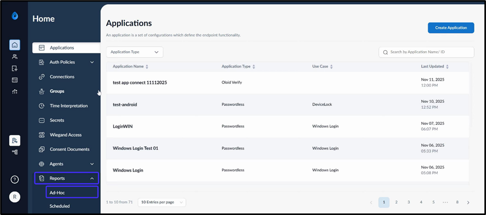
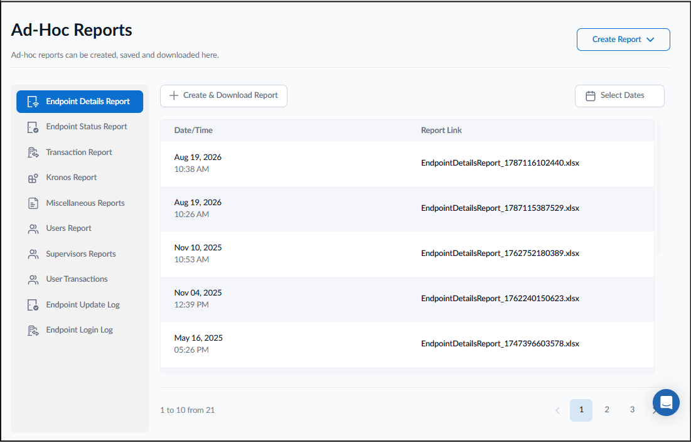
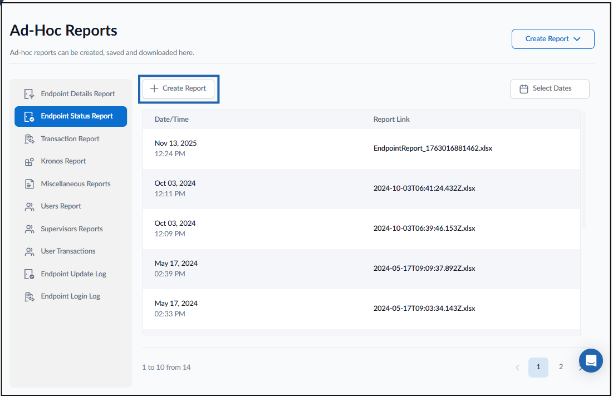
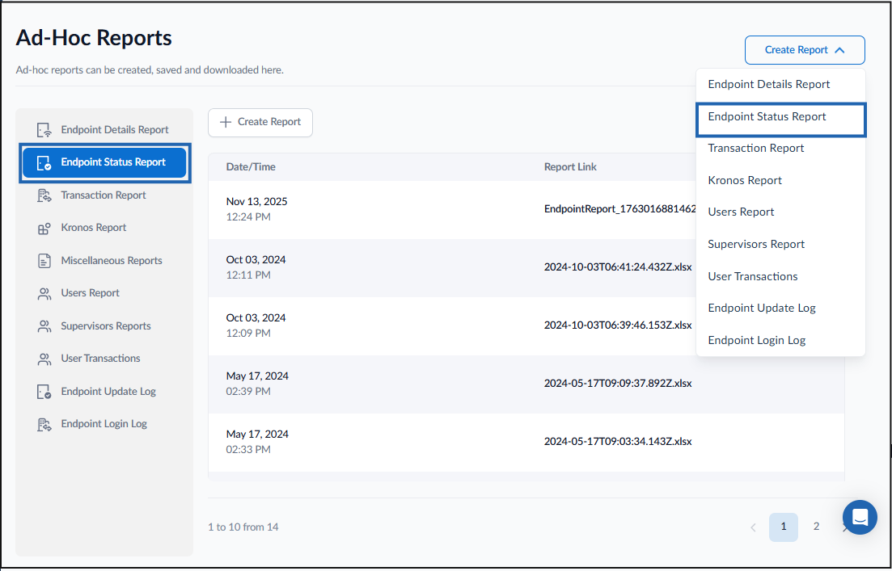
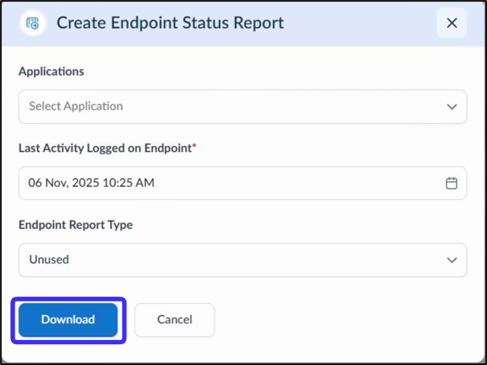
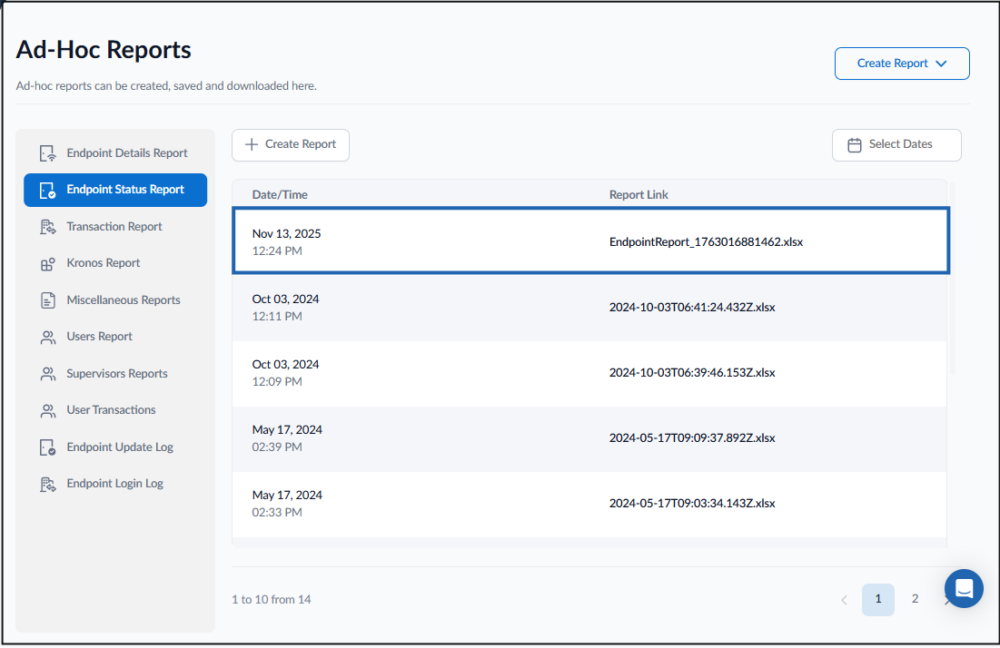

{/* Source: Intercom article 8450433 - https://oloid.help/en/articles/8450433-tenant-admin-portal-how-to-create-and-download-endpoint-status-report-ad-hoc */}
{/* Generated by intercom_to_mintlify.py - re-running overwrites this file. */}

## Introduction

Endpoint Status Report provides the status of all the endpoints of the associated applicated.

## Prerequisite

You must have admin access to the Tenant Admin Portal.

## Steps to create and download Endpoint Status Report

1. Log in to the **Oloid Portal**.
2. On the homepage, click **Reports > Ad-Hoc** on the left menu panel.

   

   The **Ad-Hoc Reports** page is displayed.

   

3. Do one of the following:
   1. Go to **Endpoint Status Report** > **+ Create Report**.

      

      OR
   2. On the top right, click **Create Report** > **Endpoint Status Report**.

      

      The **Create Endpoint Status Report** pop-up box is displayed.
4. On the pop-up box, do the following:
   1. Select application from the **Applications** drop-down list. (Optional)
   2. Select **Last Activity Logged on Endpoint** from the calendar. (Required)
   3. Select endpoint report type from **Endpoint Report Type** drop-down list. (Optional)
   4. Select **Download**.

The report is generated and saved to the local device.

<Note>
  **Note:**

  - Ensure you have sufficient permissions as a **Tenant Admin** before attempting to create the report.
  - The downloaded file format for reports is XLSX.
</Note>
