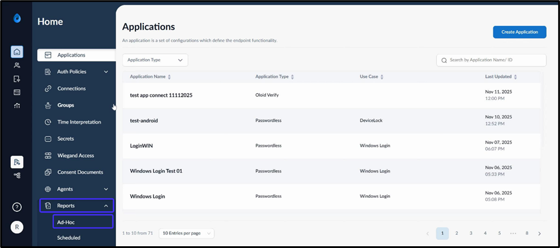
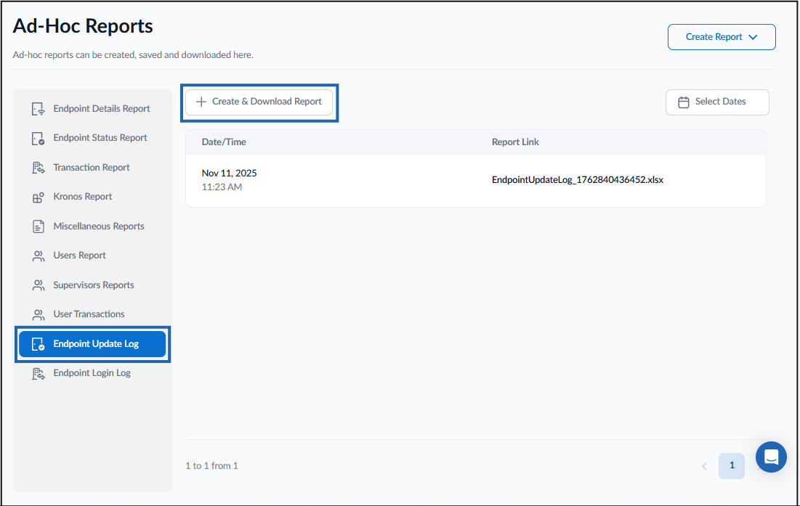
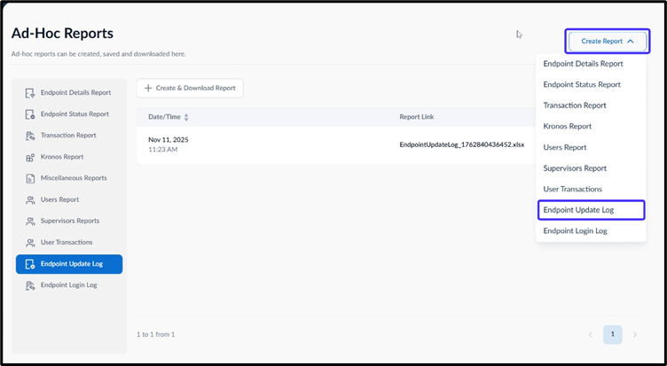
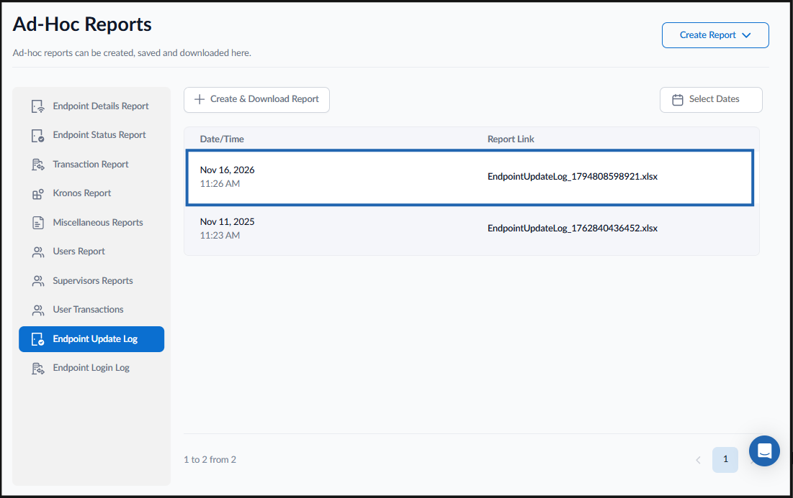

{/* Source: Intercom article 12807264 - https://oloid.help/en/articles/12807264-tenant-admin-portal-how-to-create-and-download-endpoint-update-log-report-ad-hoc */}
{/* Generated by intercom_to_mintlify.py - re-running overwrites this file. */}

## Introduction

An Endpoint Update Log provides details of all the updates made with the endpoints that are associated with the application, including details regarding last updated, Auto-update details etc.

## Prerequisite

You must have admin access to the Tenant Admin Portal.

## Steps to create & download Endpoint Update Log

1. Log in to the **Oloid Portal**.
2. On the homepage, click **Reports > Ad-Hoc** on the left menu panel.

   

   The **Ad-Hoc Reports** page is displayed.

   

3. Use one of the following methods to download the report:
   1. Select Endpoint Update Log from the left menu panel then click **Create & Download Report.**

      

      OR
   2. On the top right, click **Create Report** > **Endpoint Update Log**

      

      The **Endpoint Update Log** is saved to the local device and listed on the **Ad-Hoc Reports** page under the Endpoint Update Log tab.

      

<Note>
  **Note:**

  - Ensure you have sufficient permissions as a **Tenant Admin** before attempting to create the report.
  - The downloaded file format for reports is XLSX.
</Note>
