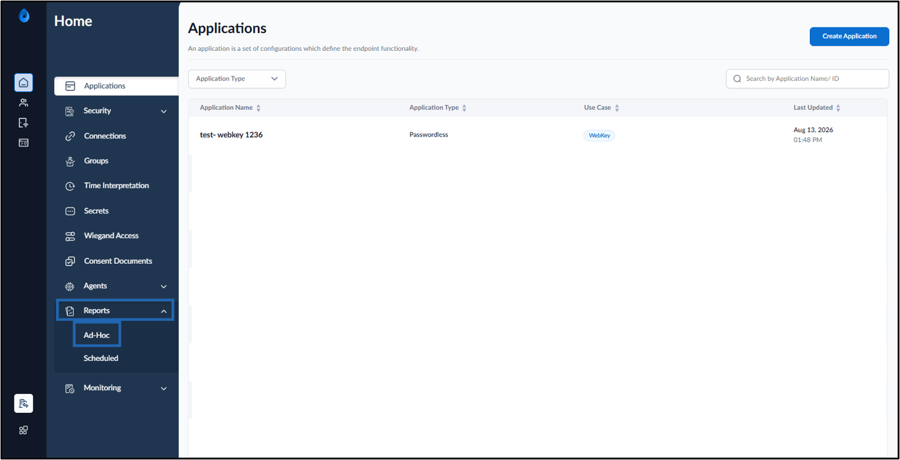
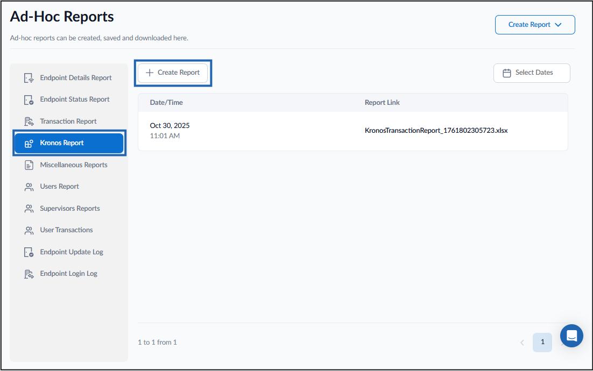
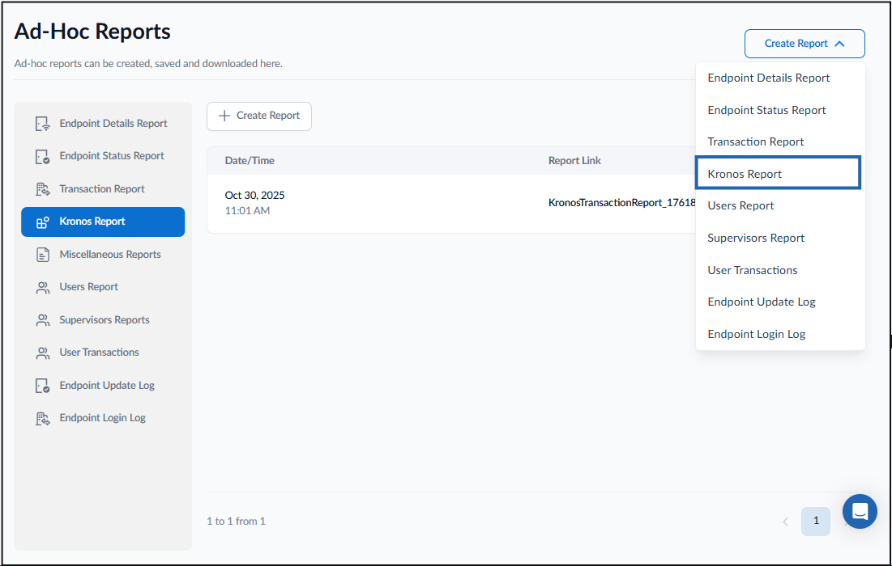
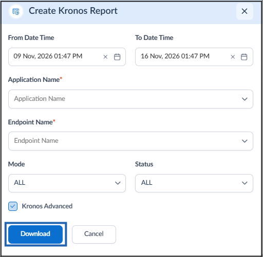
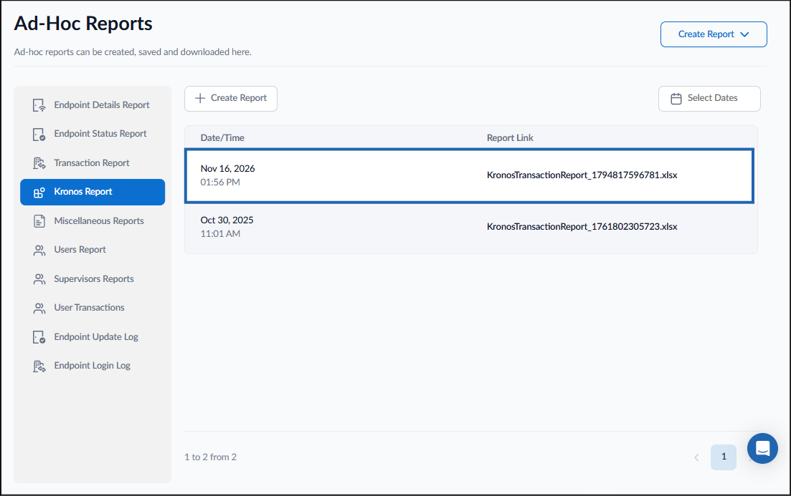

{/* Source: Intercom article 18453948 - https://oloid.help/en/articles/18453948-tenant-admin-portal-how-to-create-and-download-kronos-report-ad-hoc */}
{/* Generated by intercom_to_mintlify.py - re-running overwrites this file. */}

## Introduction

This document explains how to create and download a Kronos report from the Tenant Admin Portal.

## Prerequisite

You must have admin access to the Tenant Admin Portal.

## Steps to Create and Download a Kronos Report

1. Log in to the **Tenant Admin Portal**.
2. On the homepage, click **Reports > Ad-Hoc** on the left menu panel.

   

   The **Ad-Hoc Reports** page is displayed.

   

3. Do one of the following:
   1. Select **Kronos Report** from the left menu panel, and then click **+ Create Report**.

      

      OR
   2. Click **Create Report** > **Kronos Report**.

      

      The **Create Kronos Report** pop-up box is displayed.
4. Do the following:
   1. In **From Date Time**, select the start date and time for the report.(Optional)
   2. In **To Date Time**, select the end date and time for the report.(Optional)
   3. Select an application from the **Application Name** list.
      or
   4. Select an endpoint from the **Endpoint Name** list.
   5. Select a mode from the **Mode** list. **ALL** is selected by default.(Optional)
   6. Select a status from the **Status** list. **ALL** is selected by default.(Optional)
   7. Select **Kronos Advanced** to include advanced Kronos details in the report.(Optional)
5. Click **Download**.

   

   The **Kronos report** is saved to the local device and listed on the **Ad-Hoc Reports** page.

   
