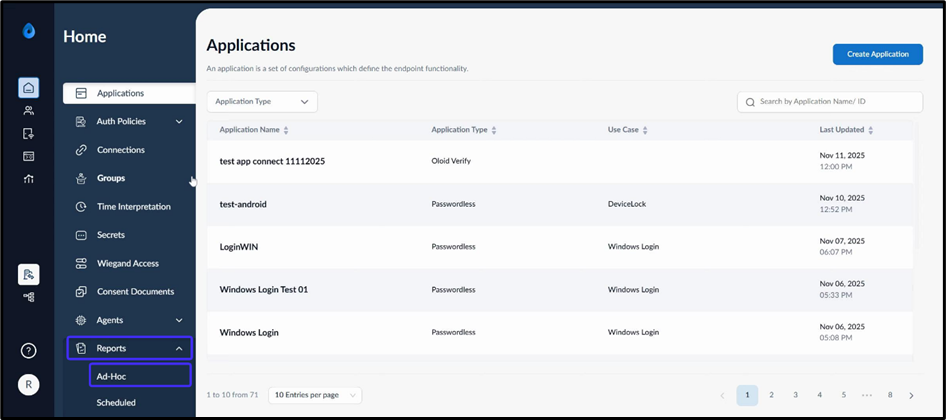
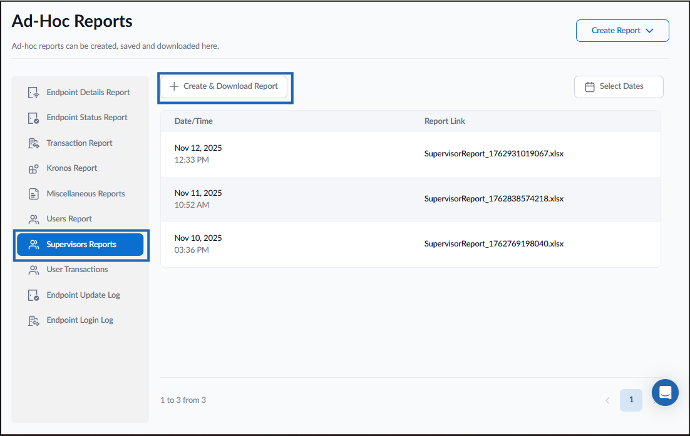
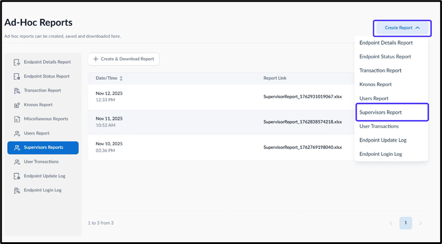
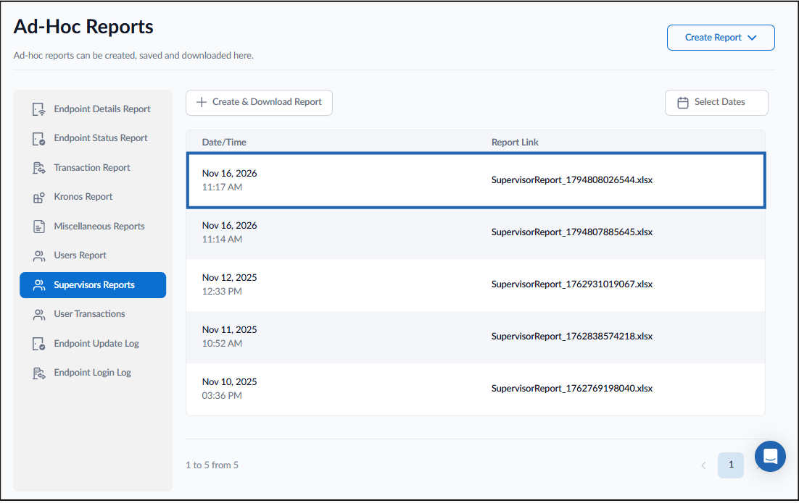

{/* Source: Intercom article 12807154 - https://oloid.help/en/articles/12807154-tenant-admin-portal-how-to-create-and-download-supervisors-reports-ad-hoc */}
{/* Generated by intercom_to_mintlify.py - re-running overwrites this file. */}

## Introduction

A Supervisors Reports provides supervisors details of all the supervisors of the associated applications, including details regarding connections, assigned applications, assigned connections, and assigned groups.

## Prerequisite

You must have admin access to the Tenant Admin Portal.

## Steps to create & download Supervisors Reports

1. Log in to the **Oloid Portal**.
2. On the homepage, click **Reports > Ad-Hoc** on the left menu panel.

   

   The **Ad-Hoc Reports** page is displayed.

   

3. Use one of the following methods to download the report:
   1. Select Supervisors Report from the left menu panel then click **Create & Download Report.**

      

      OR
   2. On the top right, click **Create Report** > **Supervisors Reports**.

      

The **Supervisors Reports** is saved to the local device and listed on the **Ad-Hoc Reports** page under the Supervisors Reports tab.

<Note>
  **Note:**

  - Ensure you have sufficient permissions as a **Tenant Admin** before attempting to create the report.
  - The downloaded file format for reports is XLSX.
</Note>
