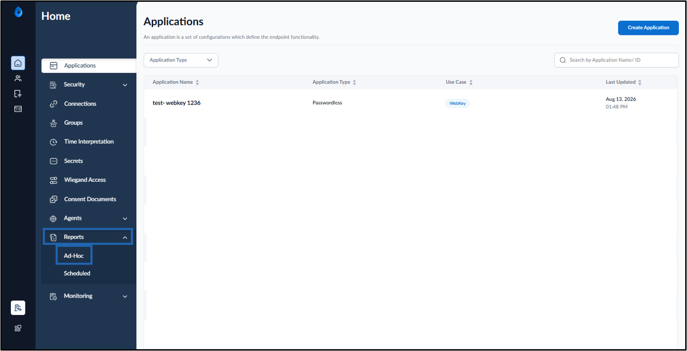
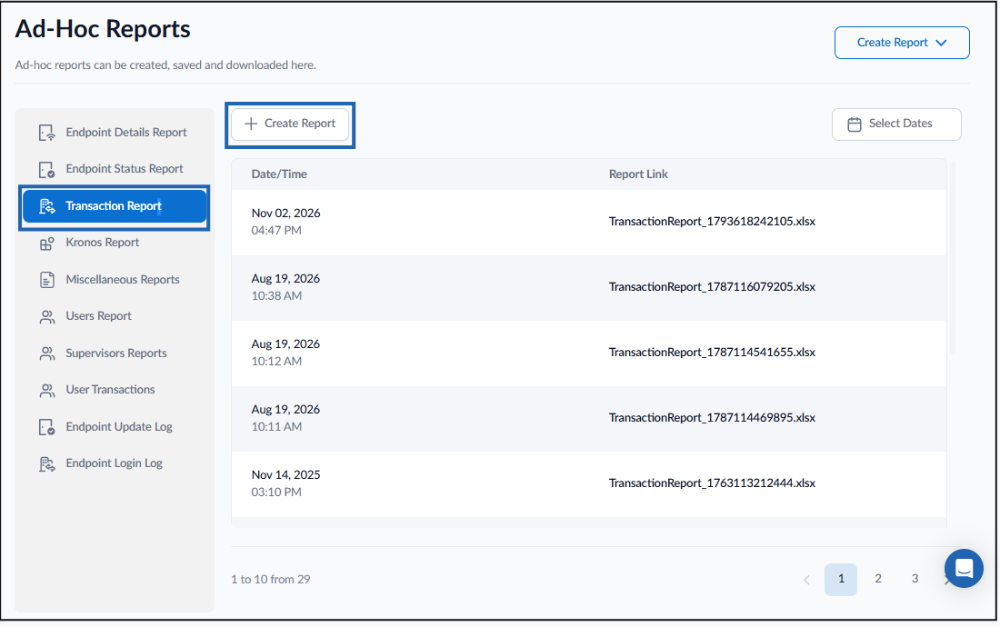
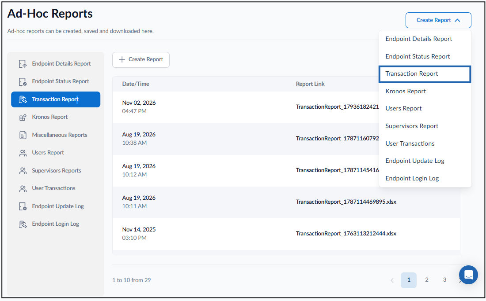
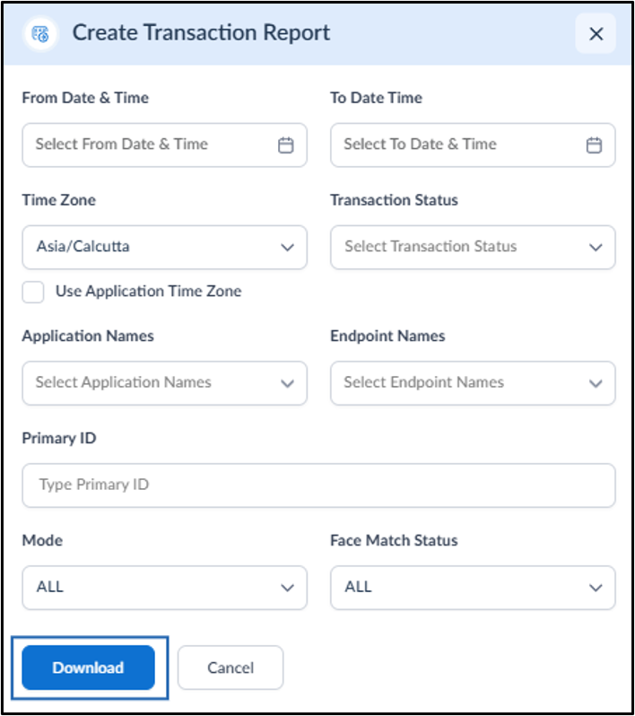
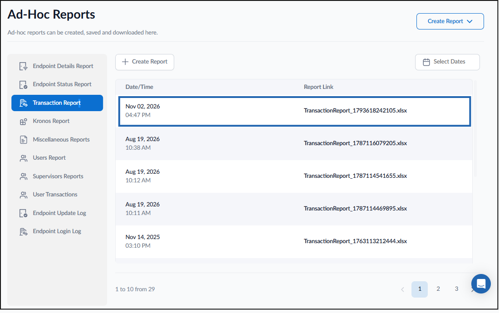

{/* Source: Intercom article 8450533 - https://oloid.help/en/articles/8450533-tenant-admin-portal-how-to-create-and-download-transaction-report-ad-hoc */}
{/* Generated by intercom_to_mintlify.py - re-running overwrites this file. */}

## Introduction

This document provides step-by-step instructions to create and download a Transaction Report (Ad-Hoc) from the Tenant Admin Portal. The report provides transaction details for endpoints and their associated applications.

## Prerequisite

You must have admin access to the Tenant Admin Portal.

## Steps to Create and Download the Transaction Report

1. Log in to the **Tenant Admin Portal**.
2. On the homepage, click **Reports > Ad-Hoc** on the left menu panel.

   

   The **Ad-Hoc Reports** page is displayed.

   

3. Do one of the following:
   1. Select **Transactions Report** from the left menu panel, and then click **+ Create Report**.

      

      OR
   2. Click **Create Report** > **Transaction Report**.

      

      The **Create Transaction Report** pop-up box is displayed.
4. Do the following:
   1. Select the date and time from the calendar for **From Date & Time** and **To Date Time.**
   2. Select time-zone from **Time-zone** drop-down list.
   3. Select transaction status from **Transaction Status** drop-down list.
   4. Select application names from **Application Names** drop-down list.

      <Note>
        **Note:** Click the **Use Application Time** checkbox to show transactions based on the time-zone set in the application.
      </Note>

   5. Select endpoint names from **Endpoint Names** drop-down list.
   6. Enter **Primary ID**.
   7. Select Mode from **Mode** drop-down list.
   8. Select face match status from **Face Match Status** drop-down list.
   9. Click **Download.**

      <Note>
        **Note:** All filters are optional. If you do not apply any filters, the report includes all available transaction details.
      </Note>

      

      The **transaction report** is saved to the local device and listed on the **Ad-Hoc Reports** page.

      <Note>
        **Note:** The downloaded file format for reports is XLSX.
      </Note>

      
