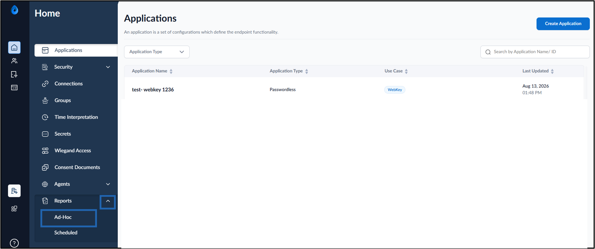
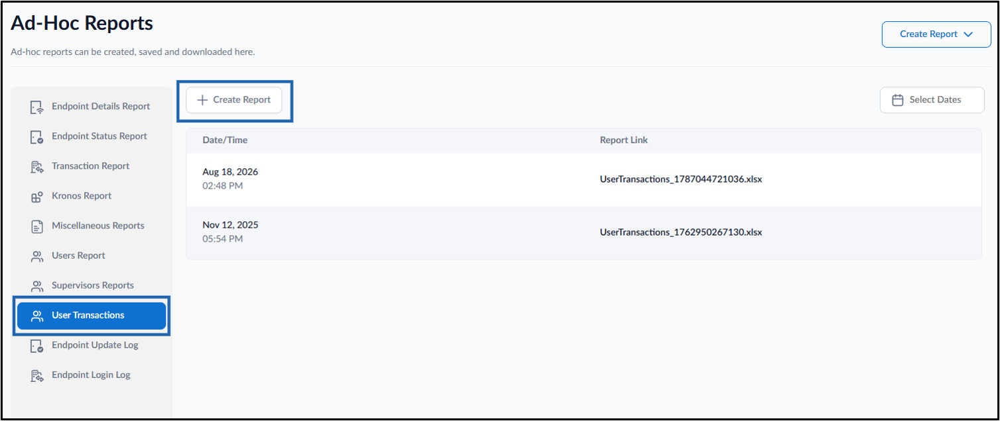
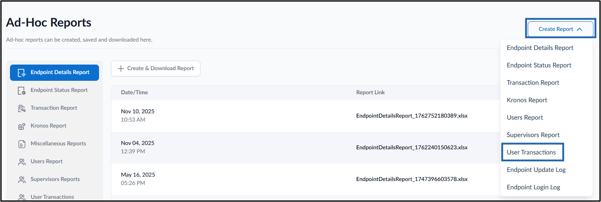
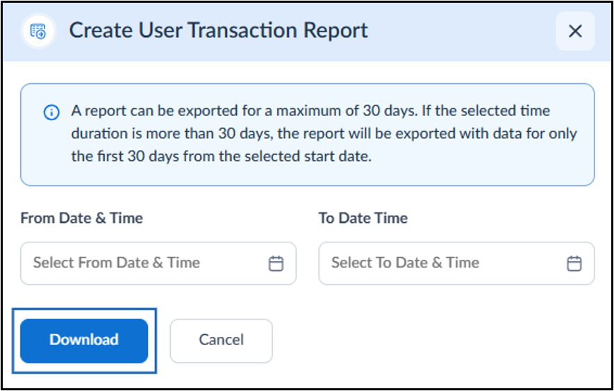
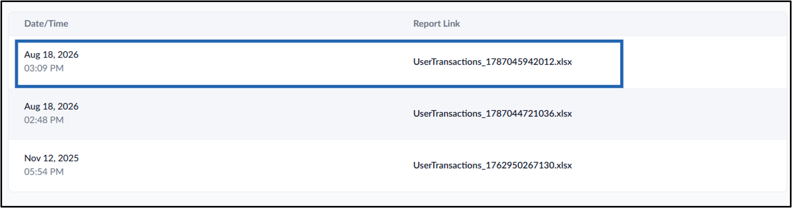

{/* Source: Intercom article 12807325 - https://oloid.help/en/articles/12807325-tenant-admin-portal-how-to-create-and-download-user-transactions-report-ad-hoc */}
{/* Generated by intercom_to_mintlify.py - re-running overwrites this file. */}

## Introduction

This document provides instructions to create and download a User Transactions Report that contains user transaction details across the associated endpoints in the Tenant Admin Portal.

## Prerequisite

You must have admin access to the Tenant Admin Portal.

## Steps to Create and Download User Transactions Report

1. Log in to the **Tenant Admin Portal**.
2. On the homepage, click **Reports > Ad-Hoc** in the left menu panel.

   

   The **Ad-Hoc Reports** page is displayed.

   

3. Do one of the following methods to download the report.
   1. Select **User Transactions** from the left menu panel, and then click **Create Report.**

      

      OR
   2. Click **Create Report** > **User Transactions.**

      

      The **Create User Transactions Report** pop-up box is displayed.
4. Do the following:
   1. Select the date and time from the calendar for **From Date & Time** (Mandatory).
   2. Select the date and time for **To Date Time** (Optional).
   3. Click **Download**.

      

      The **User Transactions Report** is downloaded to your device and listed on the **Ad-Hoc Reports** page.

      <Note>
        **Note:** The downloaded file format for reports is XLSX.
      </Note>

      
