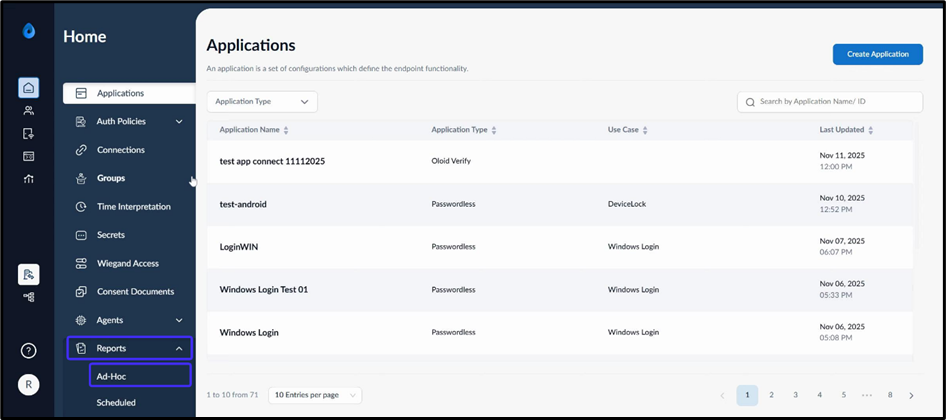
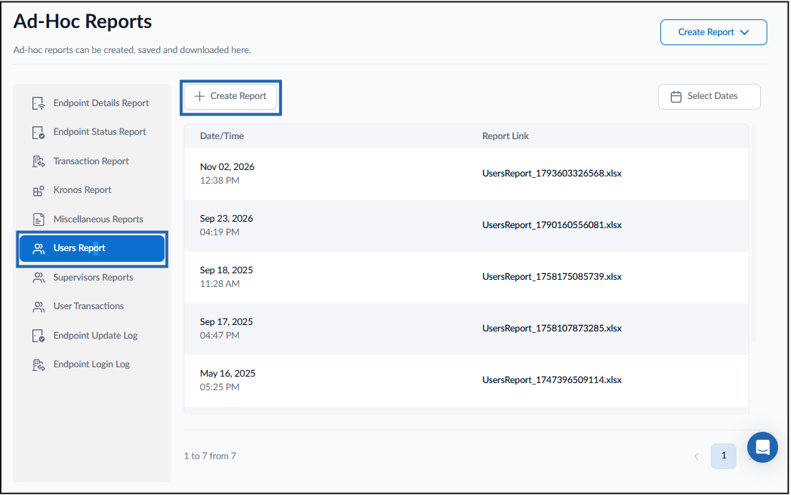
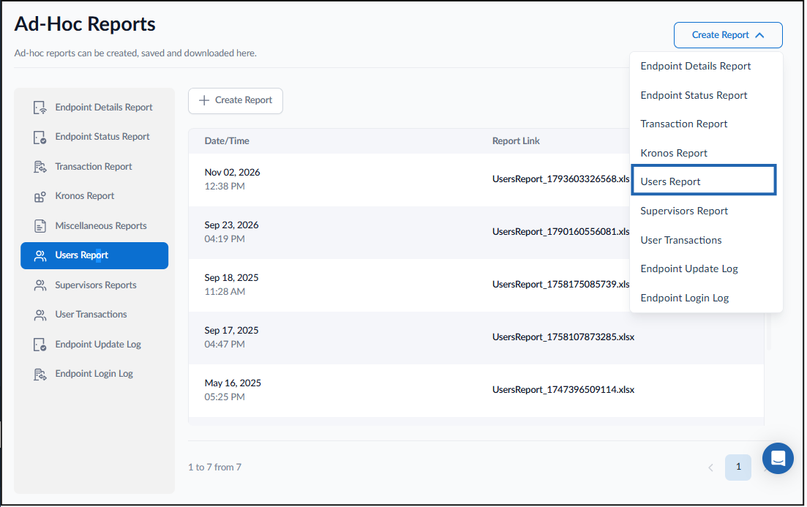
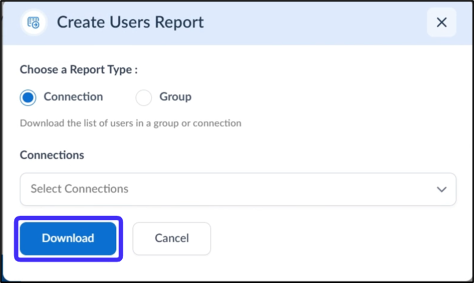
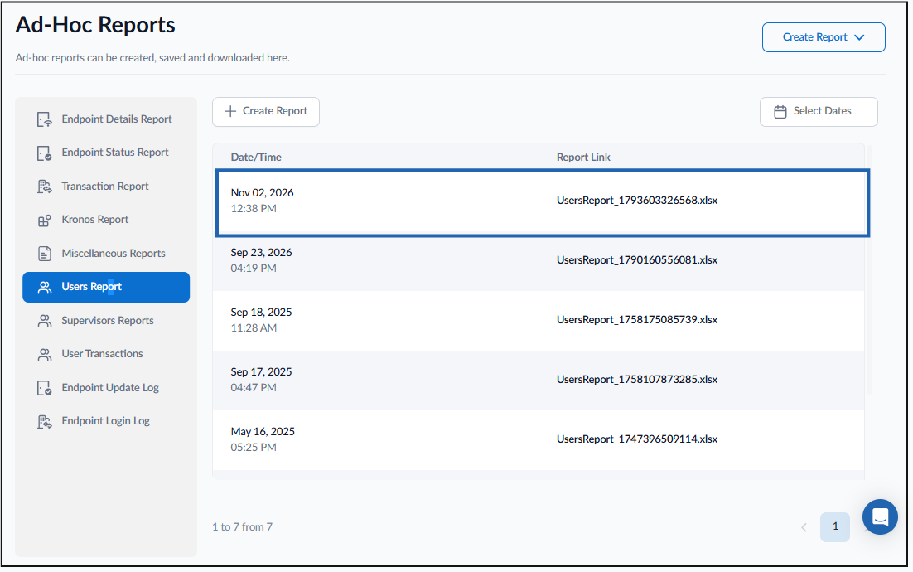

{/* Source: Intercom article 8450674 - https://oloid.help/en/articles/8450674-tenant-admin-portal-how-to-create-and-download-users-report-ad-hoc */}
{/* Generated by intercom_to_mintlify.py - re-running overwrites this file. */}

## Introduction

A Users report provides information on all the users of selected groups or connections.

## Pre-requisite

You must have admin access to the Tenant Admin Portal.

## Steps to create Users Report

1. Log in to the **Oloid Portal**.
2. On the homepage, click **Reports > Ad-Hoc** on the left menu panel.

   

   The **Ad-Hoc Reports** page is displayed.

   

3. Do one of the following:
   1. Go to **Users Reports** > **+ Create Report**.

      

      OR
   2. On the top right, click **Create Report** > **Users Report**.

      

      The **Create Users Report** pop-up box is displayed.
4. Do the following:
   1. **Choose a report type** as Connection or Group to generate a report of users.
   2. If you select **Connection**, choose a connection from the **Connections** dropdown. (Required)
   3. If you select **Group**, select a group from the **Groups** dropdown. (Required)
   4. Click **Download** to download the user report.

      

The Users report is saved to the local device.

<Note>
  **Note:**

  - Ensure you have sufficient permissions as a **Tenant Admin** before attempting to create the report.
  - The downloaded file format for reports is XLSX.
</Note>
