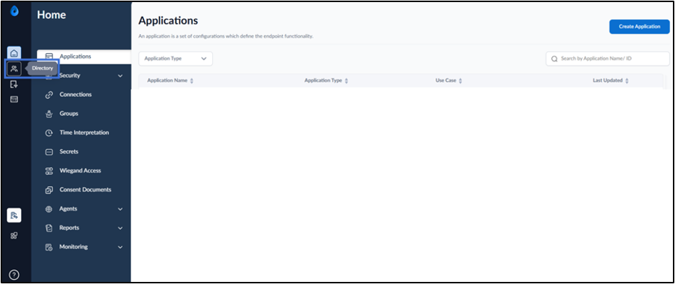
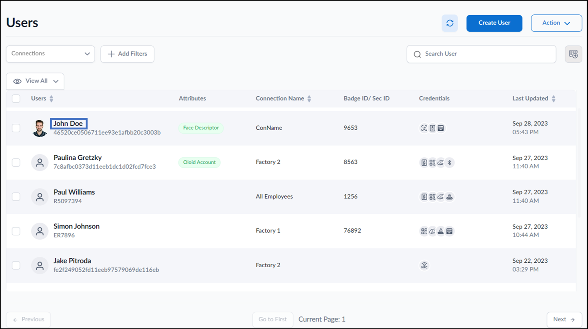
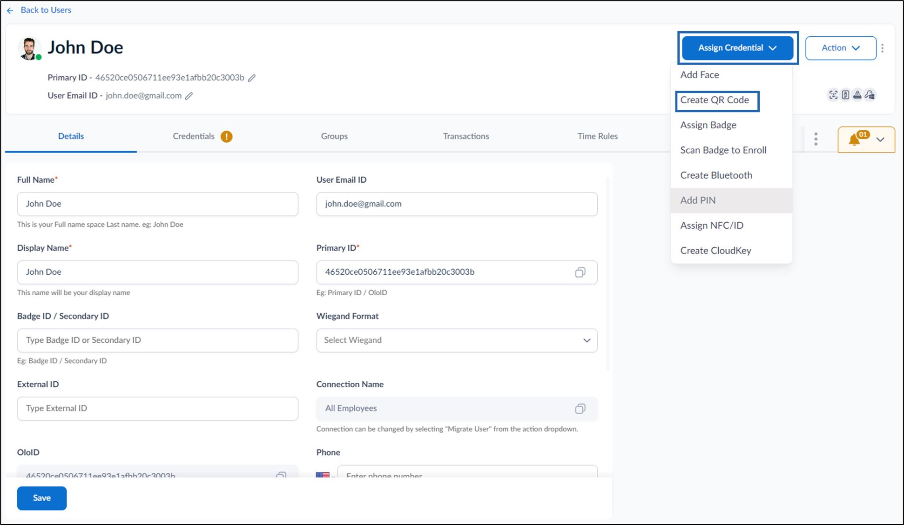
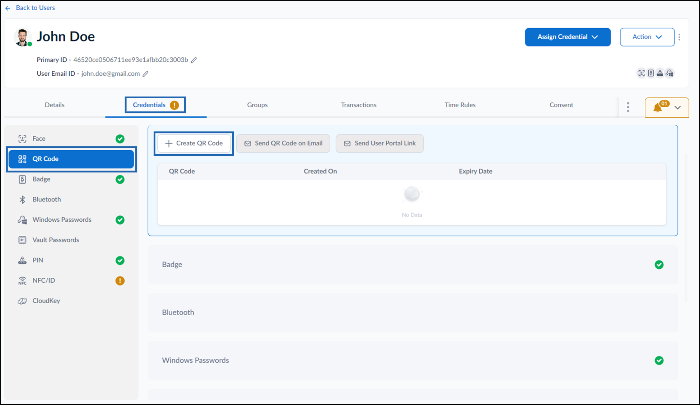
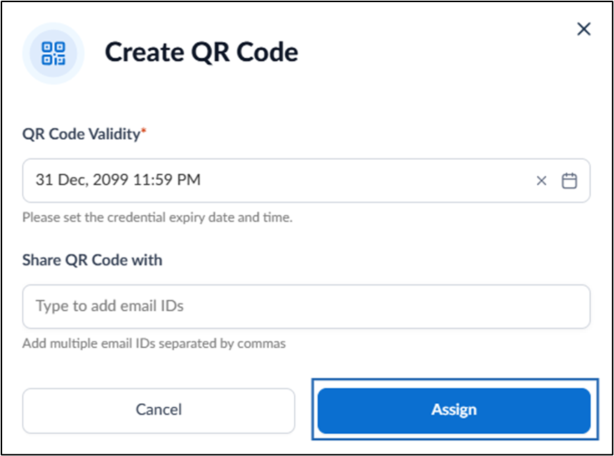
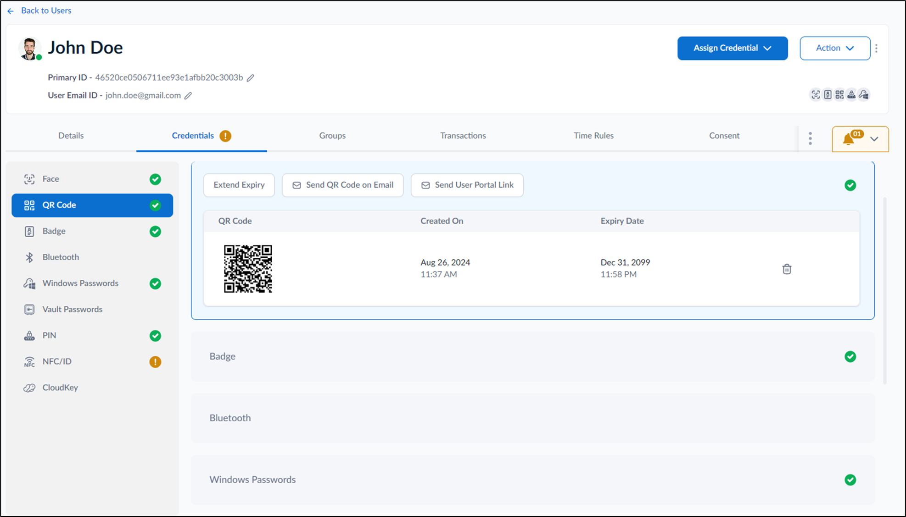

{/* Source: Intercom article 8294162 - https://oloid.help/en/articles/8294162-tenant-admin-portal-how-to-create-and-share-qr-code-credential-with-user */}
{/* Generated by intercom_to_mintlify.py - re-running overwrites this file. */}

## Introduction

This document explains how to create and share QR Code Credential with User in the Tenant Admin Portal.

## Prerequisite

You must have Admin access to the Tenant Admin Portal.

## Steps to create QR code

1. Log in to the **Tenant Admin Portal**.
2. On the home page of the portal, click **Directory** on the left menu panel.

   

   The **Users** page is displayed.
3. Click **username** to edit.

   

   The **User details** page is displayed.
4. Do one of the following:
   1. Go to **Assign Credential** > **Create QR Code**.

      

   2. Go to **Credentials** tab > **QR Code** >**+Create QR Code**.

      

      The **Create QR Code** pop-up window is displayed.
5. On the pop-up box, do the following:
   1. Select **QR Code Validity** from the calendar.
   2. Enter one or more **email IDs** of the recipients(Optional).

      <Note>
        **Note:** To add multiple recipients, separate each email ID using a comma (,).
      </Note>

   1. Click **Assign**.

      

The QR code is created and listed in the **QR Code** tab. The QR code is sent to the recipient's (user's) email id.

Watch our video [How to add QR Code as credential to users - Video Tutorial](/platform/tenant-admin-portal/videos/how-to-add-qr-code-as-credential-to-users-video-tutorial)
