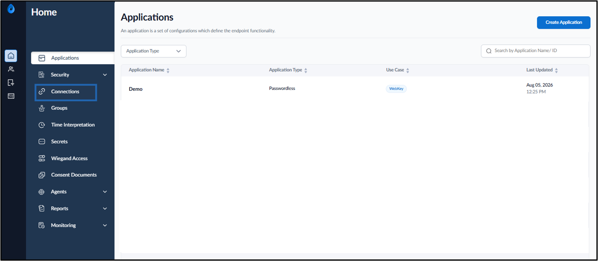
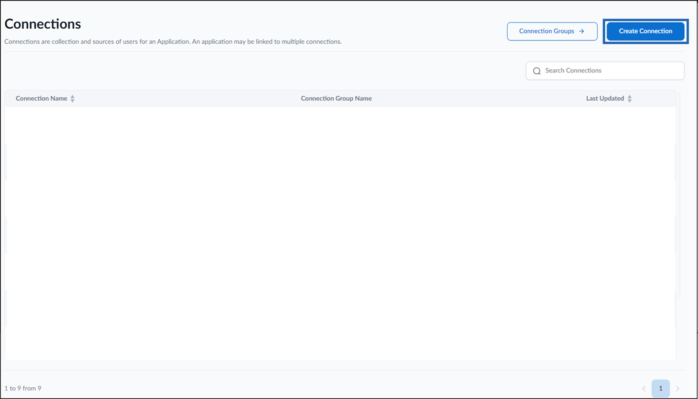
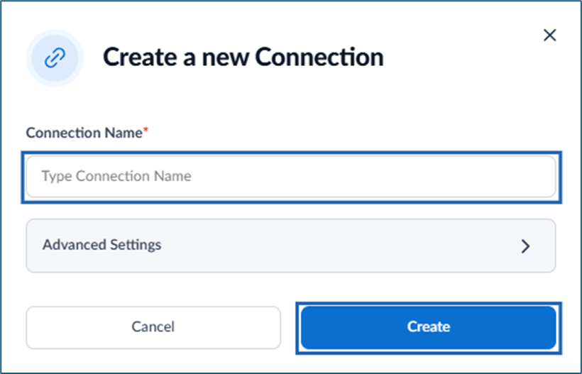
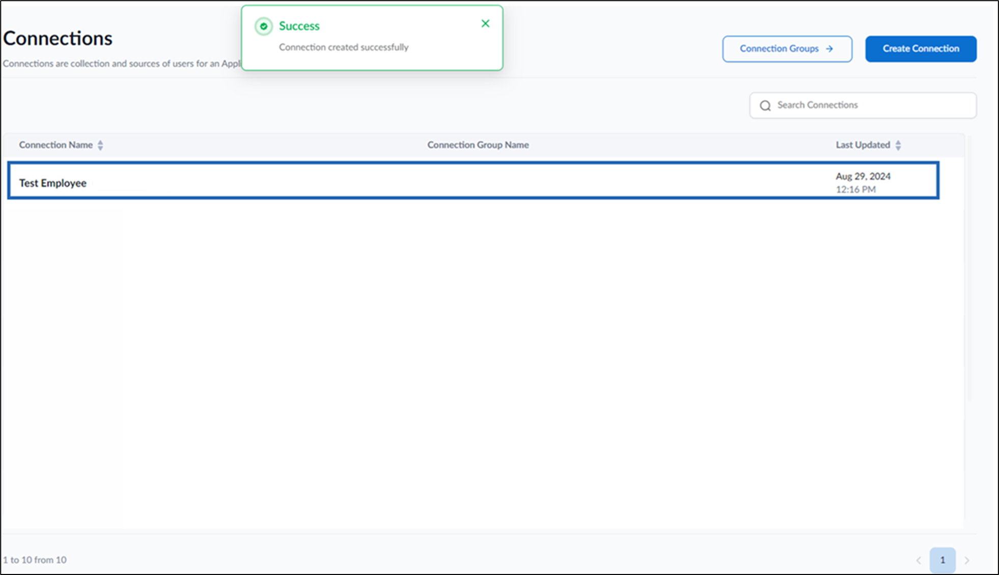

{/* Source: Intercom article 8294297 - https://oloid.help/en/articles/8294297-tenant-admin-portal-how-to-create-connection */}
{/* Generated by intercom_to_mintlify.py - re-running overwrites this file. */}

## Introduction

This document provides instructions to create a Connection in the Tenant Admin Portal. A Connection is a logical group of users used to manage access within the Oloid platform. Each user belongs to one Connection. One or more Connections can be linked to one or more applications to grant user's access.

## Prerequisites

You must have an Admin access to the Tenant Admin Portal.

## Steps to Create a Connection

1. Log in to the **Tenant Admin Portal**.
2. On the home page of the portal, click **Connections** on the left panel menu.

   

   The **Connections** page is displayed.
3. Click **Create Connection**.

   

   The **Create a new Connection** pop-up box is displayed.
4. Do the following.
   1. Enter **Connection Name**.

      <Note>
        **Note:** You can enable **PC/SC Badge Input** from the **Advanced Settings** section while creating a Connection for Windows Login Application. For more details refer [How to create PC/SC Badge Input enabled Connections in the Tenant Admin Portal](/platform/tenant-admin-portal/tenant-admin-portal-how-to-create-personal-computer-smart-card-pc-sc).
      </Note>

   2. Click **Create**.

      

      A connection is created successfully and listed on the **Connections** page.

      
