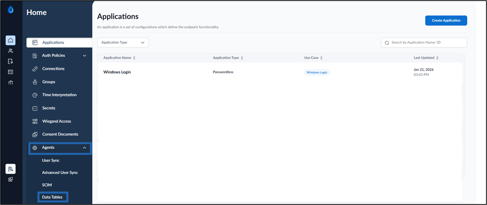
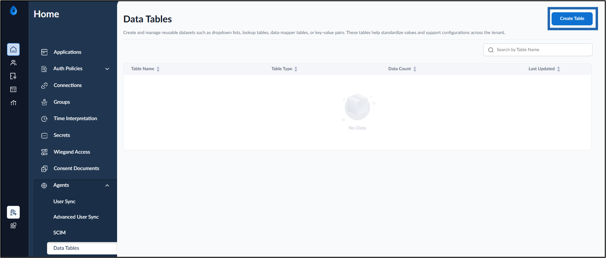
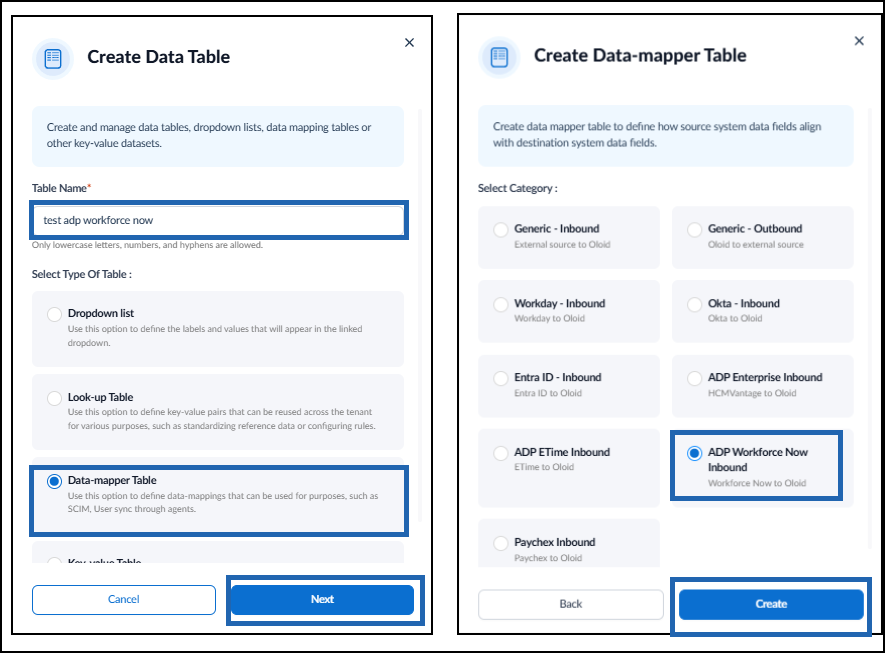
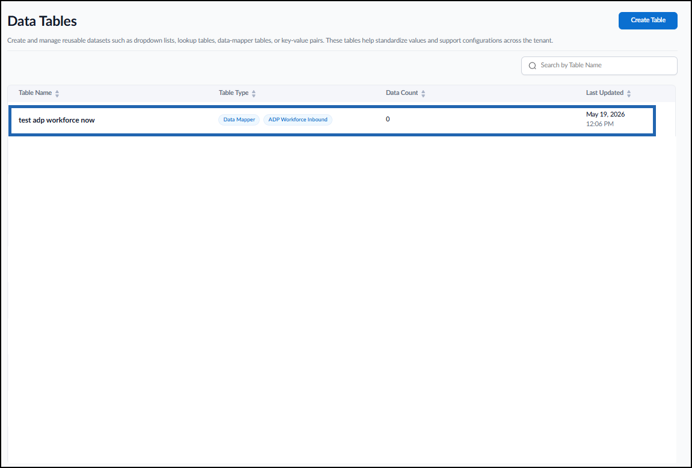

{/* Source: Intercom article 15174007 - https://oloid.help/en/articles/15174007-tenant-admin-portal-how-to-create-data-mapper-table-for-adp-workforce-now-inbound */}
{/* Generated by intercom_to_mintlify.py - re-running overwrites this file. */}

## Introduction

The Data Mapper Table in the Tenant Admin Portal allows admin to map employee data from external systems such as ADP Workforce Now Inbound to Oloid. This document provides instructions on how to create the Data Mapper table for ADP Workforce Now.

## Prerequisite

You must have access to the Tenant Admin Portal.

## Steps to Create Data Mapper Table

1. Log in to **Tenant Admin Portal**.
2. Go to **Agents** tab > click **Data Tables**.

   

   The Data Tables page is displayed.
3. Click **Create Table**.

   

   The **Create Data Table** pop-up box is displayed.
4. Do the following:
   1. Enter **Table Name**.
   2. Select **Data-mapper Table** in Type of Table.
   3. Click **Next**.
   4. Select **ADP Workforce Now Inbound** as a Category.
   5. Click **Create**.

      

      The data mapper table is created successfully.

      

##### Related Article

[Tenant Admin Portal - How to Configure Data Mapper Table for ADP Workforce Now Inbound](/platform/tenant-admin-portal/tenant-admin-portal-how-to-configure-data-mapper-table-for-adp-15174524)
