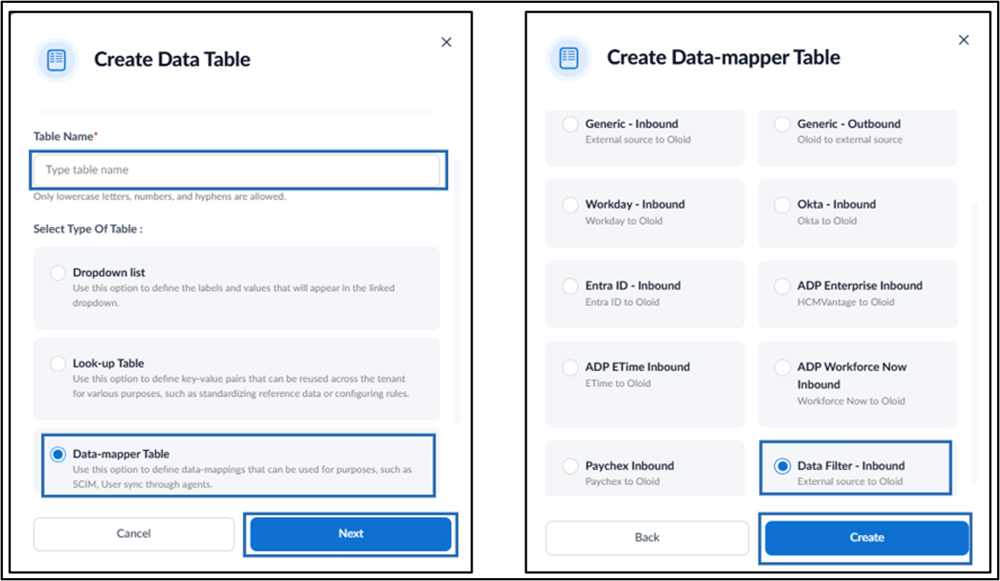
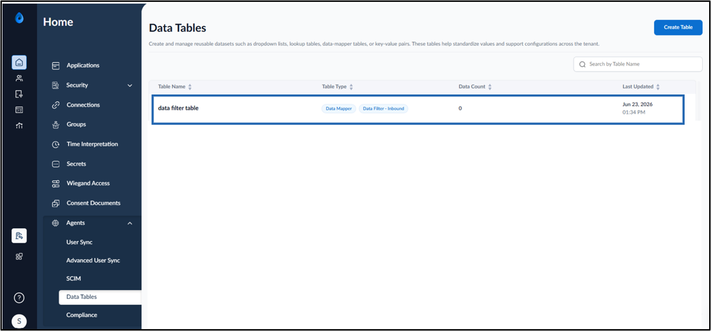

{/* Source: Intercom article 15391903 - https://oloid.help/en/articles/15391903-tenant-admin-portal-how-to-create-data-mapper-table-for-data-filter-inbound */}
{/* Generated by intercom_to_mintlify.py - re-running overwrites this file. */}

## Introduction

This document describes how to create a **Data Filter Table** in the **Tenant Admin Portal**. Data Filter Tables allow admin to define filtering criteria that can be used during data processing and user synchronization workflows.

## Prerequisite

You must have access to the Tenant Admin Portal.

## Steps to Create Data Filter Table

1. Log in to **Tenant Admin Portal**.
2. Go to **Agents** tab > click **Data Tables**.

   

   The Data Tables page is displayed.
3. Click **Create Table**.

   

   The **Create Data Table** pop-up box is displayed.
4. Do the following:
   1. Enter **Table Name**.
   2. Select **Data-mapper Table** in Type of Table.
   3. Click **Next**.
   4. Select **Data Filter - Inbound** as a Category.
   5. Click **Create**.

      

      The data filter table is created successfully.

      
