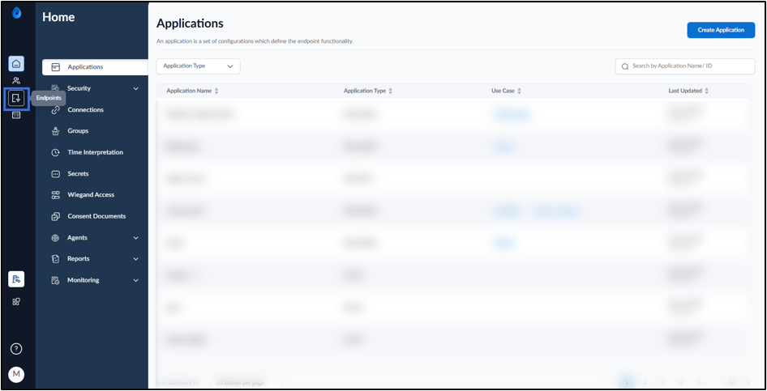
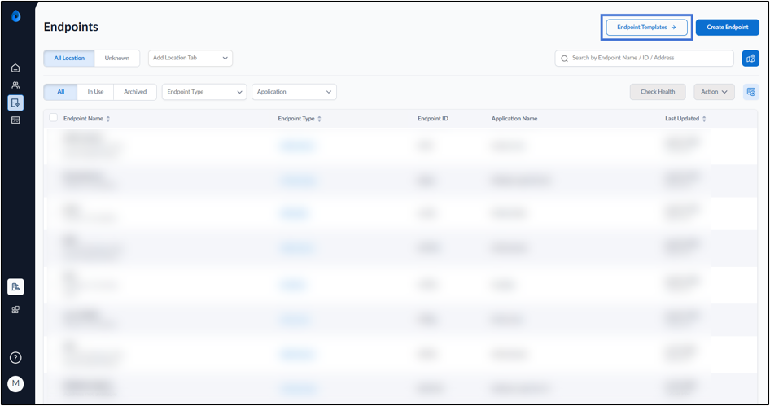
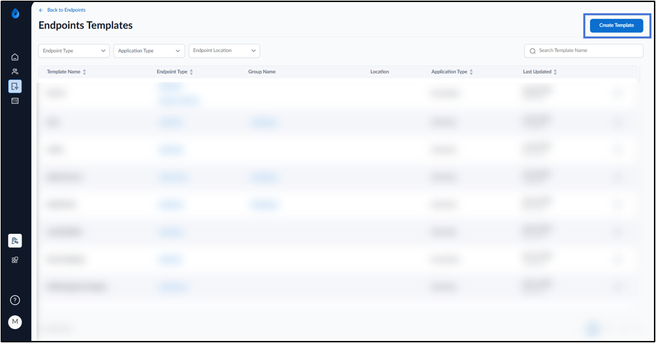
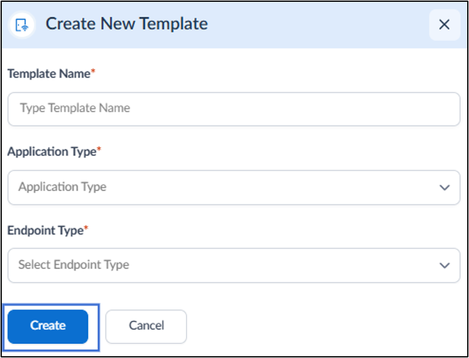

{/* Source: Intercom article 8217339 - https://oloid.help/en/articles/8217339-tenant-admin-portal-how-to-create-endpoint-template */}
{/* Generated by intercom_to_mintlify.py - re-running overwrites this file. */}

## Introduction

This document explains how to create an Endpoint Template in the Tenant Admin Portal. Endpoint Templates allow Tenant Admins to create reusable configurations that help standardize settings across multiple endpoints.

## Prerequisites

- You must have **Tenant Admin** access to the Tenant Admin Portal.
- The required application must already be created before creating an endpoint template.

## Steps to Create Endpoint Template

1. Log in to the **Tenant Admin Portal**.
2. On the Home page of the portal, click **Endpoints** on the left panel menu.

   

   The **Endpoints** page is displayed.
3. On the top right, click **Endpoint Templates**.

   

   The **Endpoints Templates** page is displayed.
4. On the top right, click **Create Template**.

   

   The **Create a New Template** pop-up box is displayed.
5. On the pop-up box, do the following:
   1. Enter **Template Name**.
   2. Select **Application Type** from **Application Type** drop-down.
   3. Select **Endpoint Type** from **Endpoint Type** dropdown.
   4. Click **Create**.

      

      The Endpoint template is created and listed on the **Endpoints Template** page.

      
