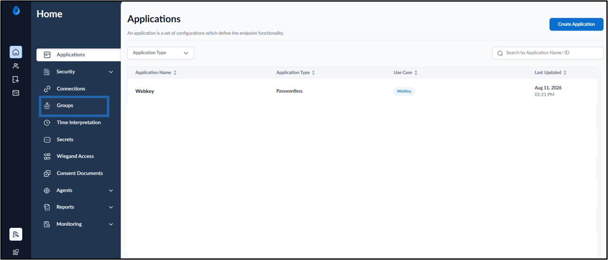
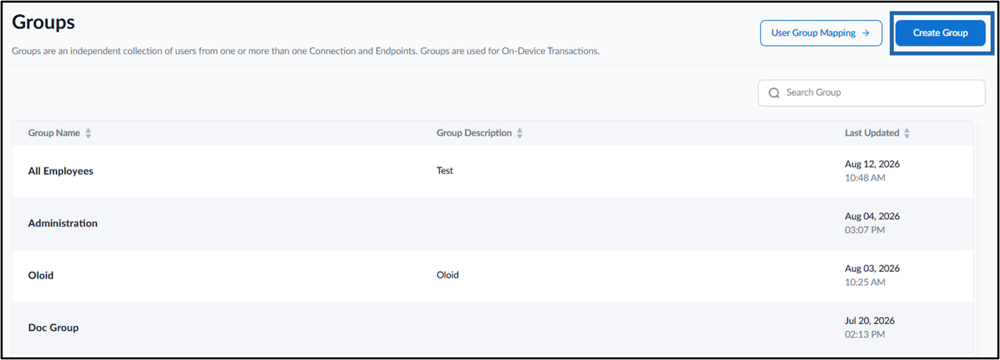
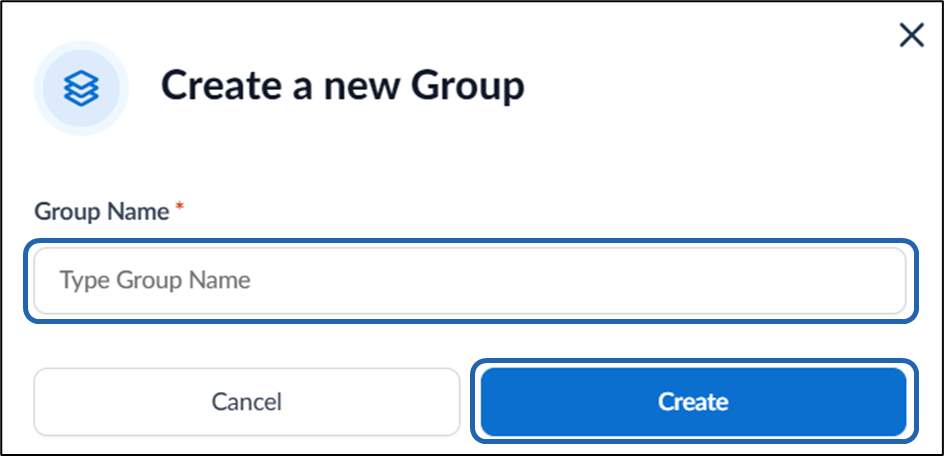
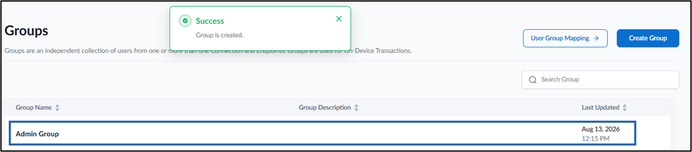

{/* Source: Intercom article 8294358 - https://oloid.help/en/articles/8294358-tenant-admin-portal-how-to-create-group */}
{/* Generated by intercom_to_mintlify.py - re-running overwrites this file. */}

## Introduction

This document provides instructions to create a group in the Tenant Admin Portal. Groups help organize users and endpoints for easier management and configuration.

## Prerequisite

You must have admin access to a Tenant Admin Portal.

## Steps to Create a Group

1. Log in to the **Tenant Admin Portal**.
2. On the home page of the portal, click **Groups** on the left menu panel.

   

   The **Groups** page is displayed.
3. Click **Create Group** on the top right corner.

   

   The **Create a new Group** pop-up box is displayed.

Enter **Group Name** and click **Create**.

The new group is created and listed on the Groups page.

#### Video Tutorials

4. **[How to create a Group in the Oloid Portal - Video Tutorial](/platform/tenant-admin-portal/videos/how-to-create-a-group-in-the-oloid-portal-video-tutorial)**
