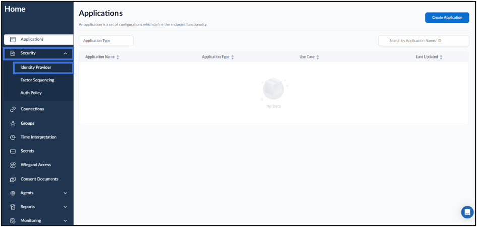
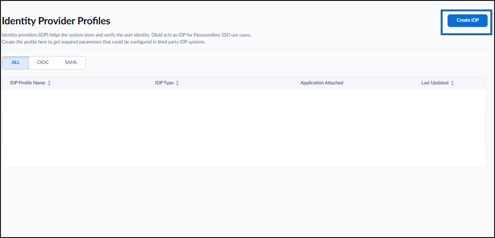
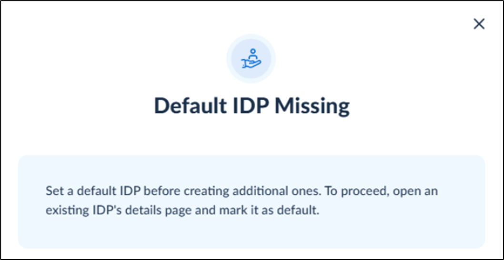
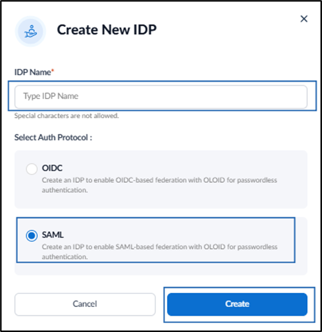
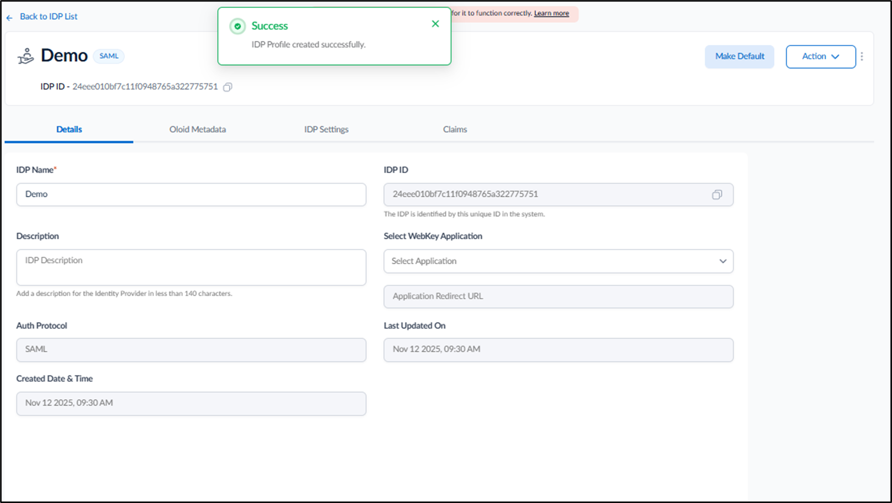

{/* Source: Intercom article 12808717 - https://oloid.help/en/articles/12808717-tenant-admin-portal-how-to-create-idp-profile-for-security-assertion-markup-language-saml */}
{/* Generated by intercom_to_mintlify.py - re-running overwrites this file. */}

## Introduction

This document explains how to create a **SAML Identity Provider (IdP) profile** in the Oloid Portal to enable SAML-based authentication.

## Prerequisite

You must have Admin access to the Tenant Admin Portal.

## Steps to Create SAML IDP Profile

1. Log in to the **Tenant Admin Portal**.
2. On the home page of the portal, select **Security** > **Identity Provider**.

   

   The **Identity Provider Profiles** page is displayed.
3. Select **Create IDP** in the top right corner.

   

   <Note>
     **Note:** You cannot create a new IDP unless a default IDP is already set. Please open an existing IDP and mark it as default before proceeding. For more details refer [How to make an IDP default](/platforms/web/webkey/webkey-how-to-link-webkey-with-an-identity-provider-idp-in-tenant).
   </Note>

   

   The **Create New IDP** pop-up box is displayed.
4. Do the following:
   1. Enter **IDP Name**.
   2. Select **SAML** asAuth Protocol.
   3. Click **Create**.

      

      The IDP Profile for SAML is successfully created.

      

---

##### Related Articles

[How to Configure Security Assertion Markup Language (SAML) - Okta IDP Profile in the Tenant Admin Portal](/platform/tenant-admin-portal/tenant-admin-portal-how-to-configure-security-assertion-markup)
