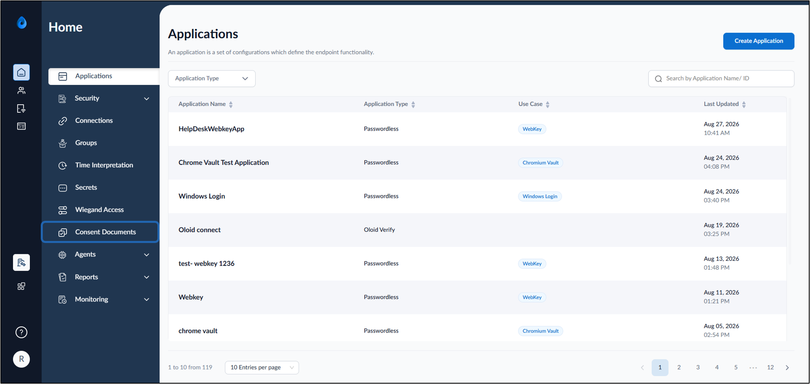
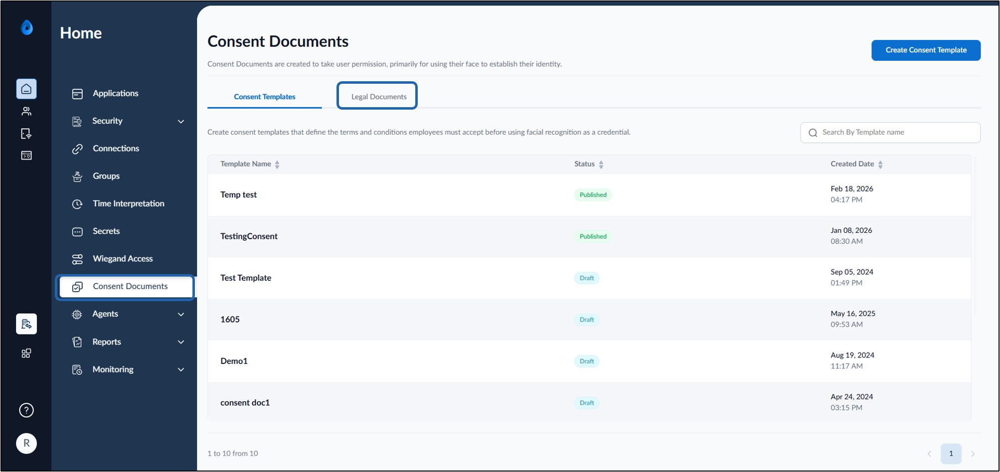
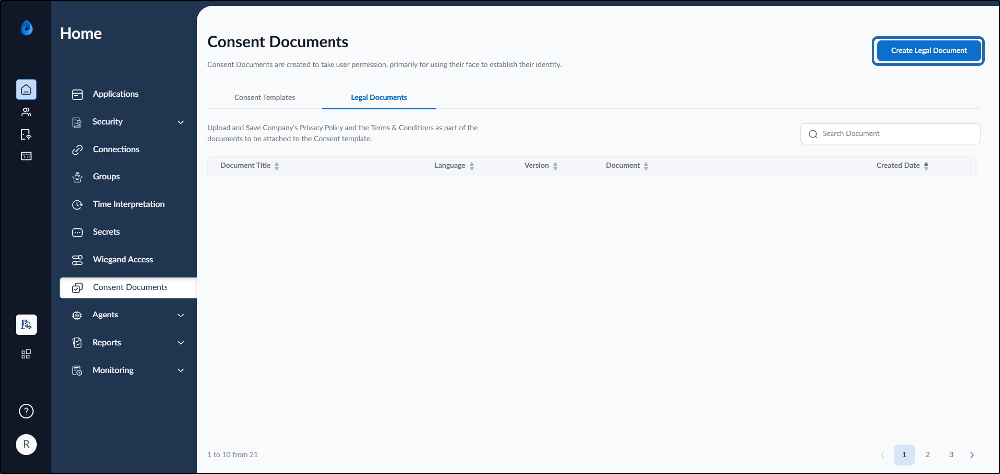
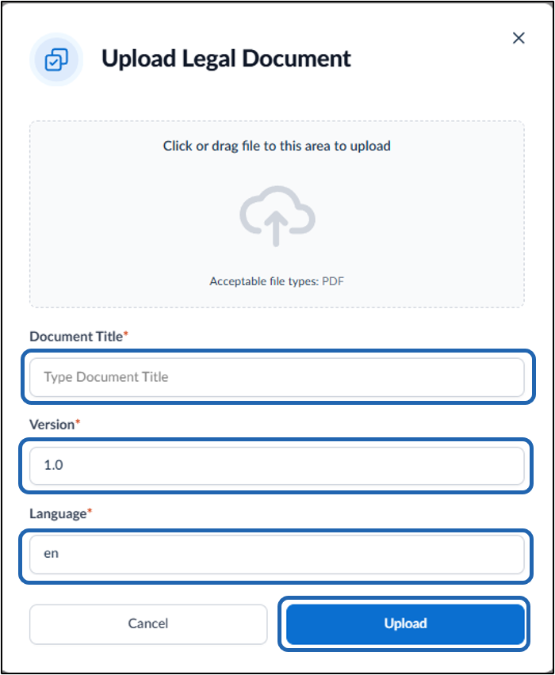
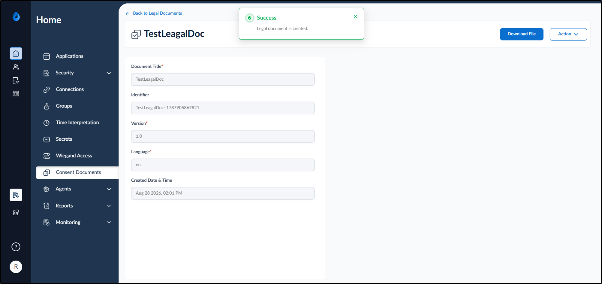
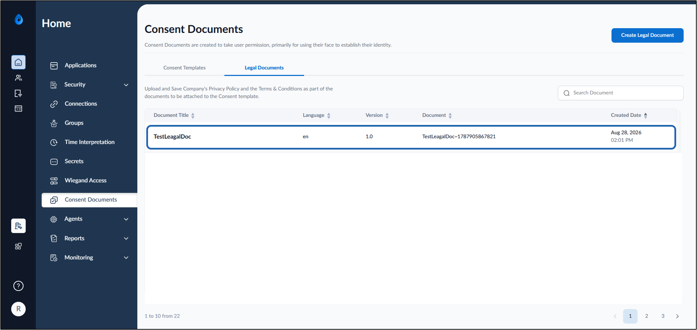

{/* Source: Intercom article 8329688 - https://oloid.help/en/articles/8329688-tenant-admin-portal-how-to-create-legal-document */}
{/* Generated by intercom_to_mintlify.py - re-running overwrites this file. */}

## Introduction

The **Legal Documents** feature allows Tenant Admins to upload and manage legal documents in the Tenant Admin Portal. Admins can upload a document and specify its **title, version, and language**, making it easier to organize and maintain different versions of legal documents for use within the platform.

## Prerequisites

- You must have a Tenant Admin account.
- Ensure the Legal Document PDF is ready for upload.

## Steps to create Legal Document

1. Log in to the **Tenant Admin Portal**.
2. On the home page of the portal, click **Consent Documents** on the left menu panel.

   

   The **Consent Documents** page is displayed.
3. On the **Consent Documents** page, click **Legal Documents** tab.

   

4. Click **Create Legal Document**.

   

   The **Upload Legal Document** pop-up box is displayed.
5. On the pop-up box, do the following:
   1. Click to browse the file or drag and drop the file to upload.
   2. Enter **Document Title**.
   3. Enter **Version**.
   4. Enter **Language**.
   5. Click **Upload**.

The document is uploaded successfully.

The document is listed on the **Consent Documents** page under the Legal Documents tab.

