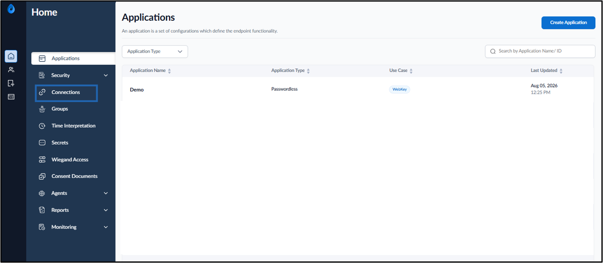
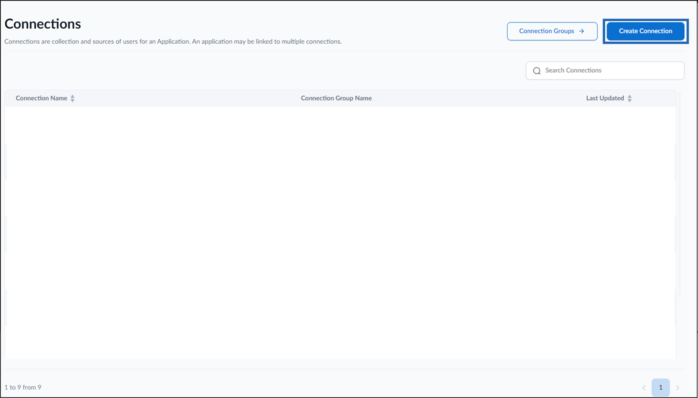
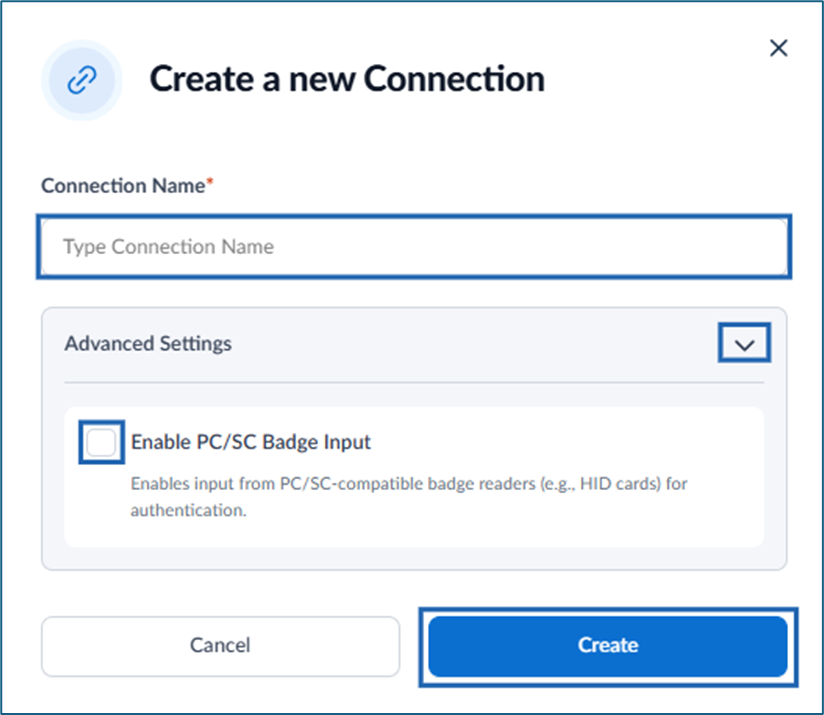
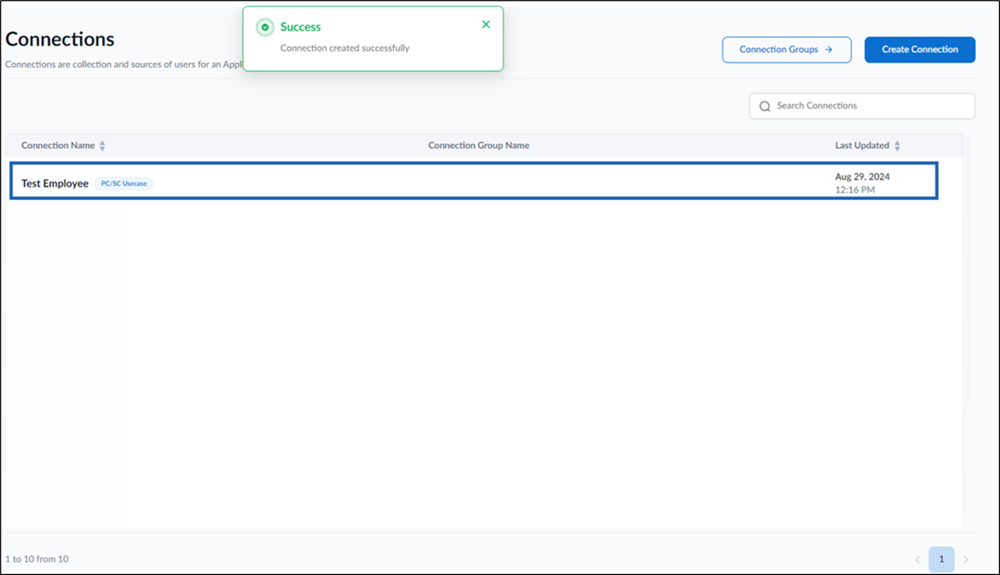

{/* Source: Intercom article 11686694 - https://oloid.help/en/articles/11686694-tenant-admin-portal-how-to-create-personal-computer-smart-card-pc-sc-badge-input-enabled-connections */}
{/* Generated by intercom_to_mintlify.py - re-running overwrites this file. */}

## Introduction

This document provides instructions to create a PC/SC-enabled connection in the Tenant Admin Portal. When creating a Connection, you can enable **PC/SC Badge Input** to allow authentication using PC/SC-compatible badge readers (for example, HID cards).

## Prerequisite

You must have an admin access to the Tenant Admin Portal.

## Steps to Create a Connection

1. Log in to the **Tenant Admin Portal**.
2. On the home page of the portal, click **Connections** on the left panel menu.

   

   The **Connections** page is displayed.
3. Click **Create Connection**.

   

   The **Create a new Connection** pop-up box is displayed.
4. Do the following:
   1. Enter **Connection Name**.
   2. Click the Advanced Settings drop-down menu and select **Enable PC/SC Badge Input** to allow input from PC/SC- compatible badge readers (e.g., HID cards) for authentication.

      <Note>
        **Note:** Once a connection is tagged as PC/SC-enabled, it cannot be reverted back to non-PC/SC use cases.
      </Note>

   3. Click **Create**.

A PC/SC enabled connection is created successfully and listed on the **Connections** page.

