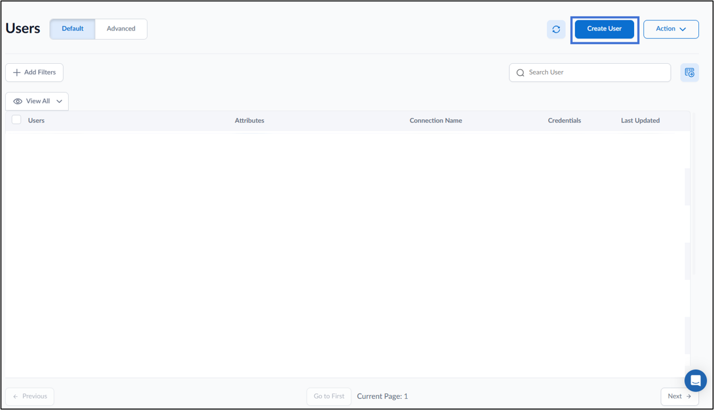
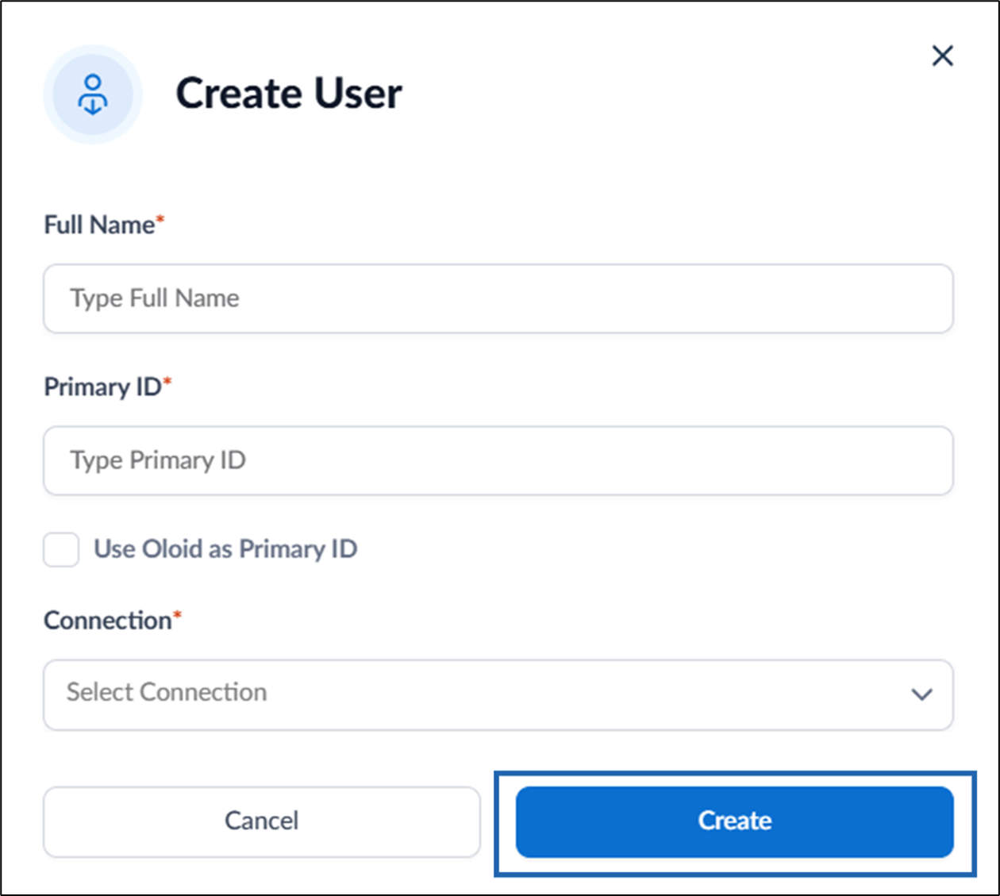
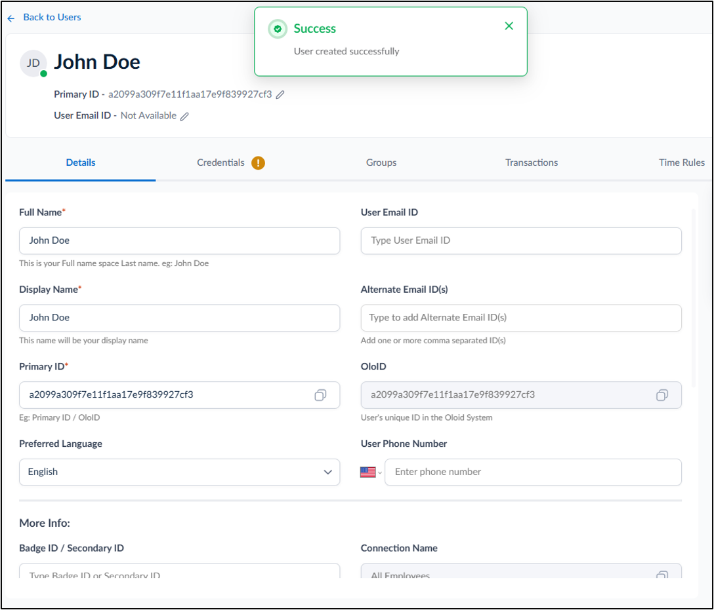

{/* Source: Intercom article 8185048 - https://oloid.help/en/articles/8185048-tenant-admin-portal-how-to-create-user */}
{/* Generated by intercom_to_mintlify.py - re-running overwrites this file. */}

## Introduction

This document provides step-by-step instructions to create a user in the Tenant Admin Portal by adding the required user details and assigning the user to a Connection.

## Prerequisite

You must have Tenant Admin Access.

## Steps to Create User

1. Log in to the **Tenant Admin Portal**.
2. On the homepage of the portal, click **Directory** on the left menu panel.

   

   The **Users** page is displayed.
3. Click **Create User**.

   

   The **Create User** pop-up box is displayed.
4. On the pop-up box, do the following:
   1. Enter **Full Name** of the user.
   2. Enter **Primary ID** or select **Use OloID as Primary ID** to use OloID as primary ID.
   3. Select **Connection** from the **Connection** list.
   4. Click **Create**.

The new user is successfully created.

---

##### Related Videos

[How to create a user in Tenant Admin Portal.](/platform/tenant-admin-portal/videos/how-to-create-a-user-in-the-tenant-admin-portal-video-tutorial)
