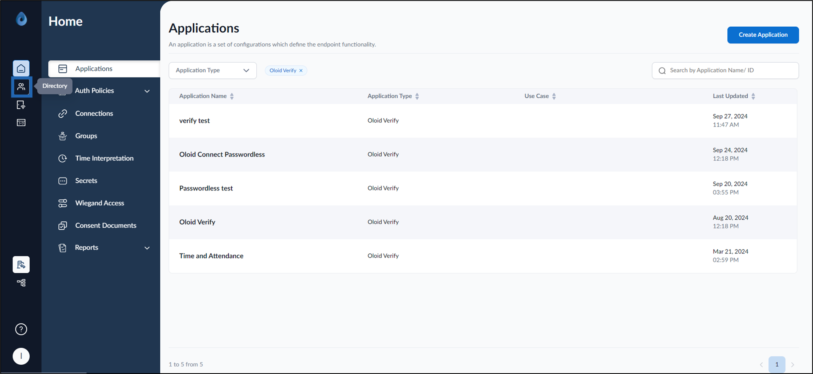
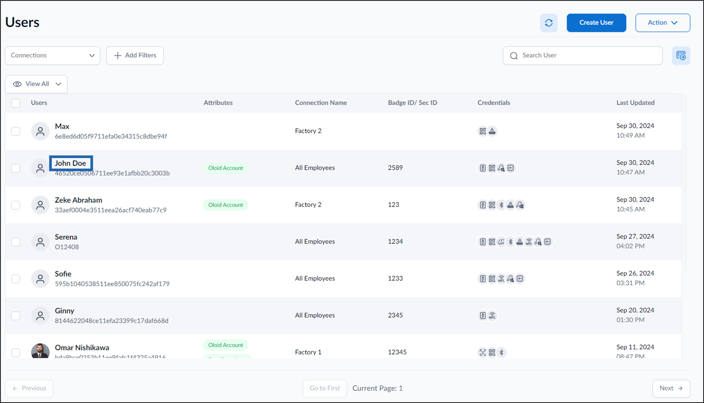
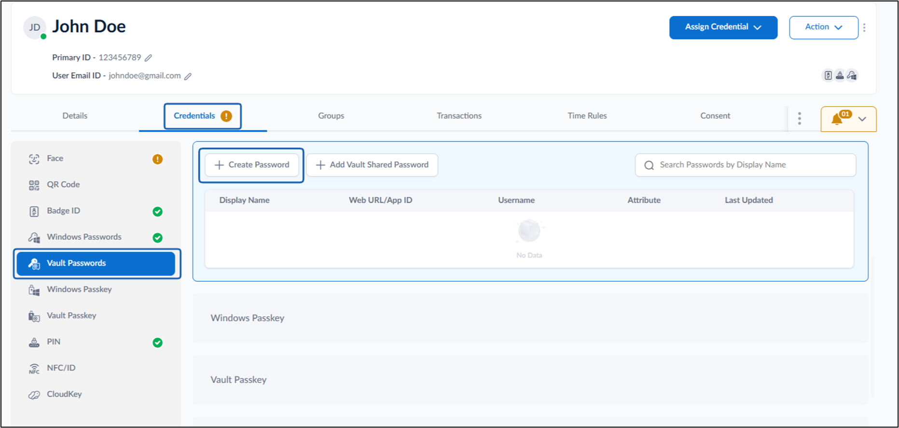
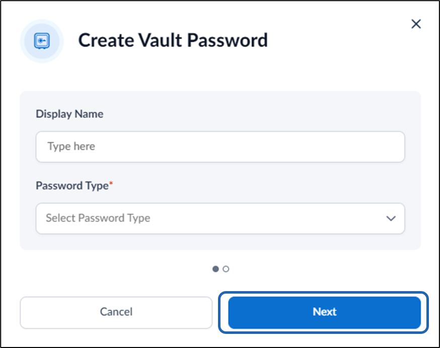
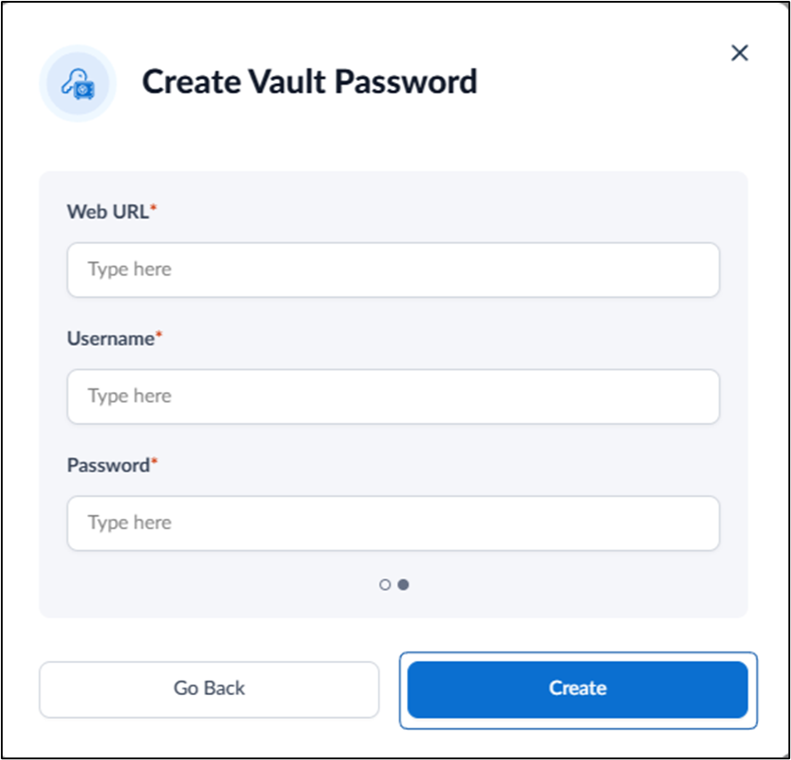
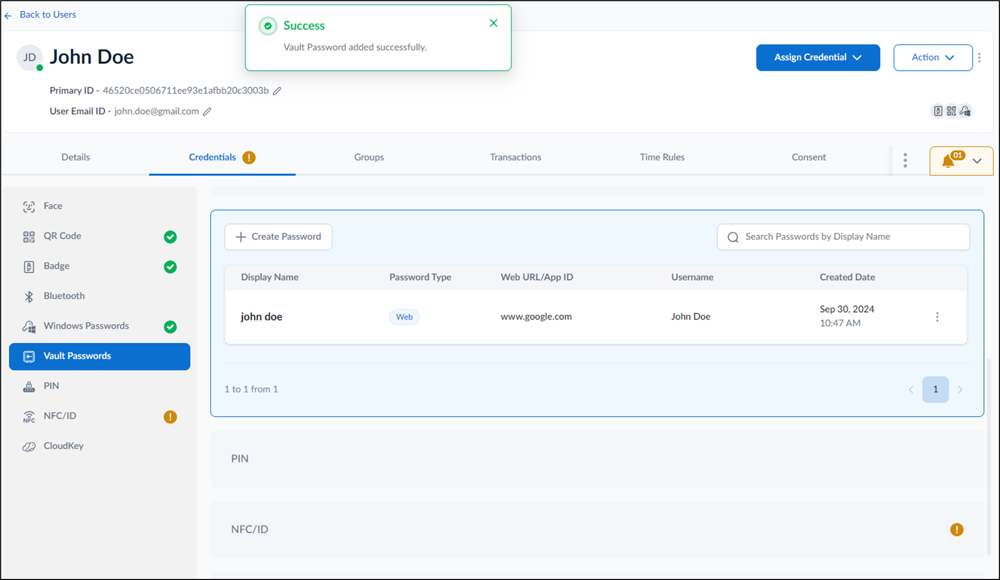

{/* Source: Intercom article 9936961 - https://oloid.help/en/articles/9936961-tenant-admin-portal-how-to-create-vault-password-for-a-user */}
{/* Generated by intercom_to_mintlify.py - re-running overwrites this file. */}

## Introduction

This document provides instructions to create a Vault password for a user in the Tenant Admin Portal.

## Prerequisites

- You must have admin access to the Tenant Admin Portal.
- The user must be created. For more, refer to [Tenant Admin Portal - How to Create User](/platform/tenant-admin-portal/tenant-admin-portal-how-to-create-user)
- The Oloid Vault application must be created and configured. For more, refer to [Oloid Vault (Chrome / Chromium) - How to Create and Configure Oloid Vault Application in the Tenant Admin Portal](/platforms/web/vault/chrome/oloid-vault-chrome-chromium-how-to-create-and-configure-oloid-vault)

## Steps to create Vault Password

1. Login to the Tenant Admin Portal.
2. On the homepage, click **Directory** from the left menu panel.

   

   The **Users** page is displayed.
3. Select preferred **Username** from the list.

   

   The **User details** page is displayed.

   

4. Go to **Credential** tab > **Vault Passwords** > **+ Create Password**.

   

   The **Create Vault Password** pop-up box is displayed.
5. Do the following
   1. Enter **Display Name**. (Optional)
   2. Select **Password Type** from the dropdown list.
   3. Click **Next**.

      

   4. Enter **Web URL**.
   5. Enter **Username**.
   6. Enter **Password**.
   7. Click **Create**.

      

The Vault Password is created successfully.

