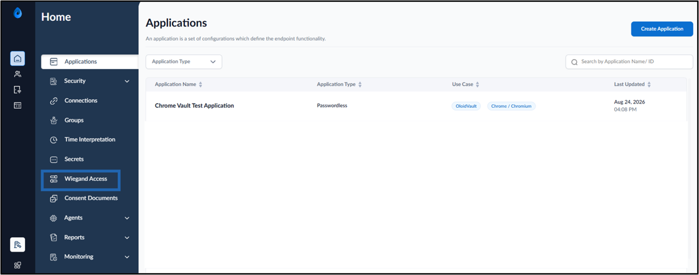
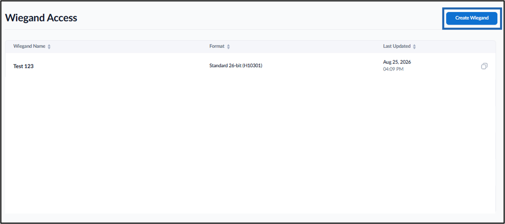
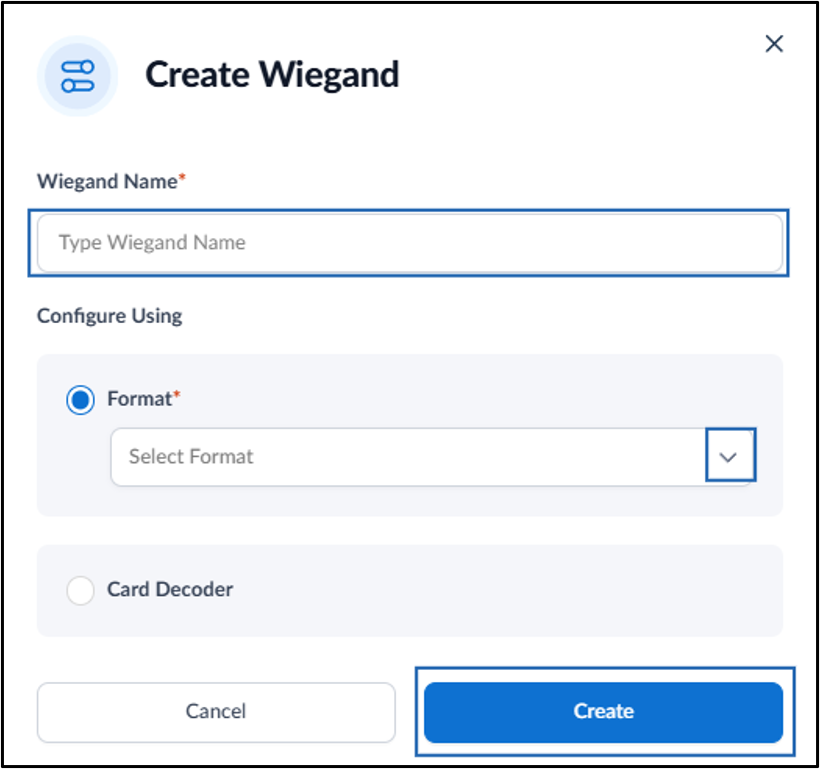
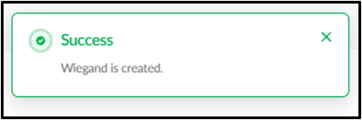

{/* Source: Intercom article 8492248 - https://oloid.help/en/articles/8492248-tenant-admin-portal-how-to-create-wiegand */}
{/* Generated by intercom_to_mintlify.py - re-running overwrites this file. */}

## Introduction

This document provides instructions to create a **Wiegand** configuration in the Tenant Admin Portal.

## Prerequisite

You must have admin access to the Tenant Admin Portal.

## Steps to Create Wiegand

1. Log in to the **Tenant Portal**.
2. On the home page, click **Wiegand Access** on the left menu panel.

   

   The **Wiegand Access** page is displayed.
3. Click **Create Wiegand**.

   

   The **Create Wiegand** pop-up box is displayed.
4. Do the following:
   1. Enter **Wiegand Name.**
   2. Under **Configure Using**, select **Format**.

      <Note>
        **Note:** To configure Wiegand using the **Card Decoder** option, contact [Oloid Support](mailto:support@oloid.ai).
      </Note>

   3. Select the Wiegand format from the **Select Format** drop-down list.
   4. Click **Create**.

      

The Wiegand is created successfully.

---

##### Related Article

[Tenant Admin Portal - How to Configure Wiegand](/platform/tenant-admin-portal/tenant-admin-portal-how-to-configure-wiegand)
