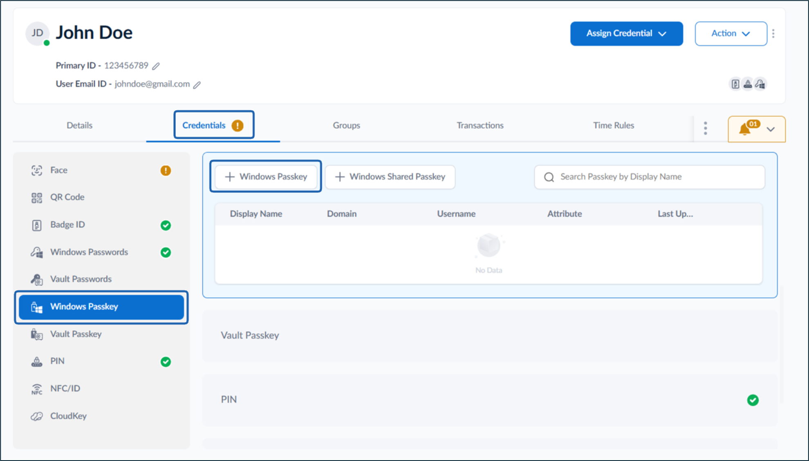
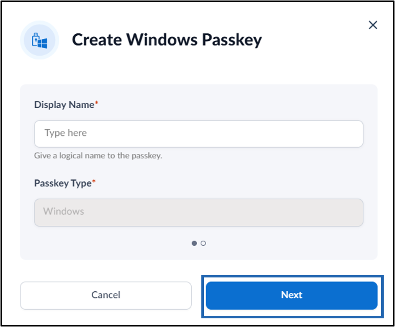
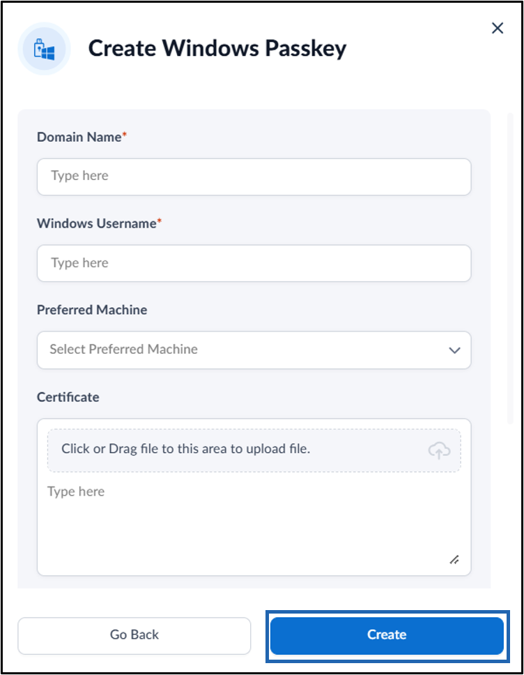
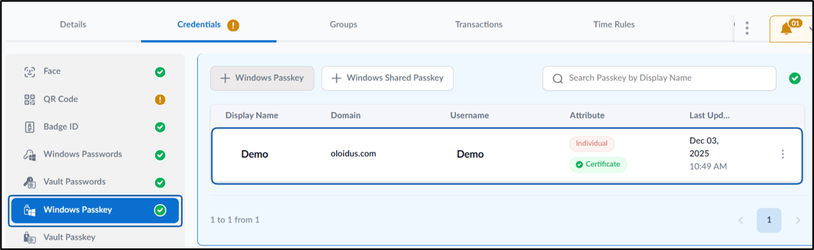

{/* Source: Intercom article 11058549 - https://oloid.help/en/articles/11058549-tenant-admin-portal-how-to-create-windows-passkey-as-credential-for-users */}
{/* Generated by intercom_to_mintlify.py - re-running overwrites this file. */}

## Introduction

This document provides instructions to create a Windows Passkey for a user in the Tenant Admin Portal.

## Prerequisites

- You must have admin access to the Tenant Admin Portal.
- Passkey must be enabled as a credential in the tenant settings. For further information, refer [Windows Login - How to enable Passkey in Tenant Admin Portal for Windows Login](/platforms/windows/windows-login/windows-login-how-to-enable-passkey-in-tenant-admin-portal-for).

## Steps to Create Windows Passkey

1. Log in to the Tenant Admin Portal.
2. On the home page of the portal, click **Directory** on the left menu panel.

   

   The **Users** page is displayed.
3. Click on the preferred **Username** to create the passkey.

   

   The **User Details** page is displayed.

   

4. Go to **Credentials tab** > **Windows Passkey** > **+ Windows Passkey**.

   

   The **Create Windows Passkey** section is displayed.
5. Do the following:
   1. Enter **Display Name**.
   2. Click **Next**.

      

   3. Enter **Domain Name** associated with the Windows account.
   4. Enter **Windows Username** for the user account.
   5. Select Preferred Machine from the **Preferred Machine** dropdown list. (Optional)
   6. Upload the **Certificate** file or drag it into the upload area. You may also type or paste the certificate contents manually in the text box.
   7. Upload the **Private Key** file or drag it into the upload area. You may also type or paste the key contents manually in the text box.

      <Note>
        **Note:** For Certificate and Private Key, please contact [Oloid Support](mailto:support@oloid.ai) or you can use your own certificate and private key.
      </Note>

   8. Click **Create**.

      

      The Windows Passkey is **created** successfully.

      
