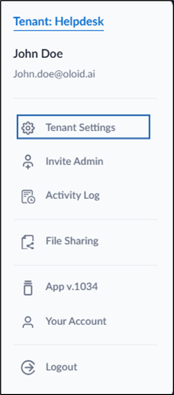
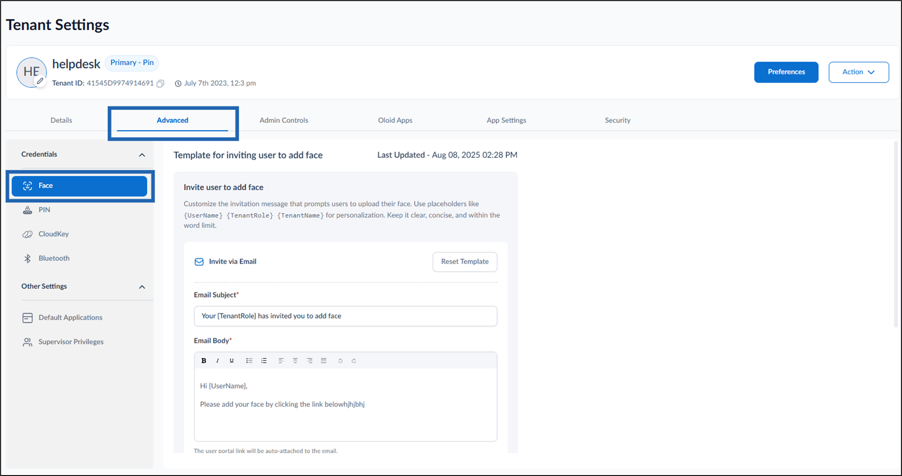
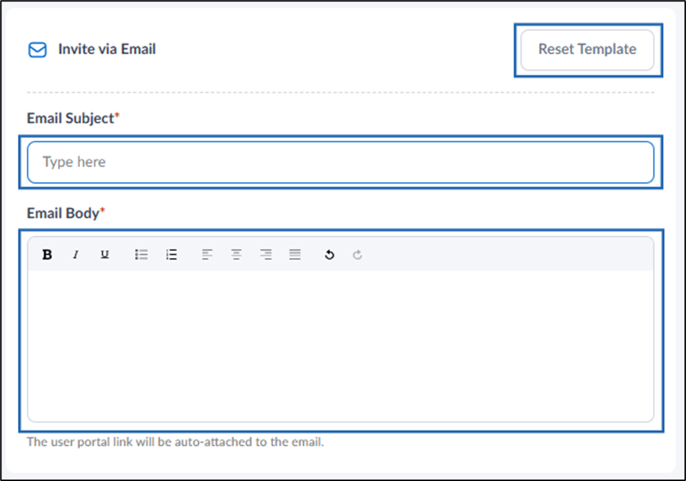
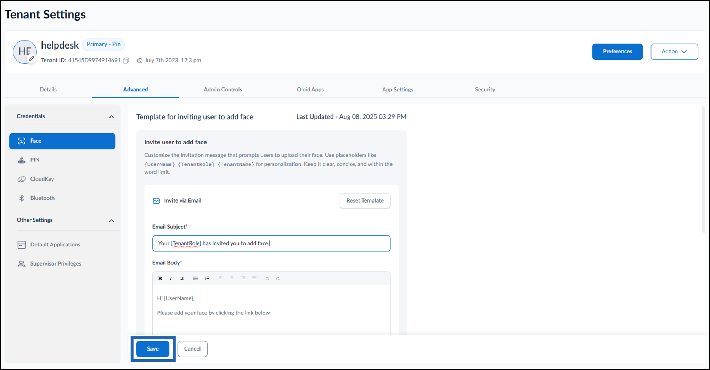
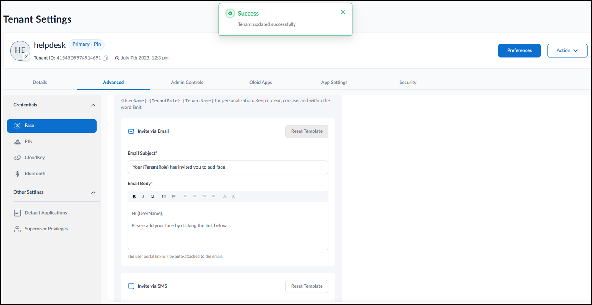

{/* Source: Intercom article 11968617 - https://oloid.help/en/articles/11968617-tenant-admin-portal-how-to-customize-email-invite-template-to-add-face-in-the-tenant-admin-portal */}
{/* Generated by intercom_to_mintlify.py - re-running overwrites this file. */}

## Introduction

The Tenant Admin Portal allows admin to invite users to add their face as an authentication method via email. This feature includes a customizable email invite template that can be tailored to your organization's messaging standard.

## Prerequisite

You must have a Tenant Admin account.

## Steps to customize email invite template

1. Log in to the **Tenant Admin Portal**.
2. On the homepage of the portal, click **user profile icon** on the bottom left.

   

   The **user profile menu** is displayed.
3. Select **Tenant Settings.**

   

   The **Tenant Setting** page is displayed.
4. Go to **Advanced tab** > select **Face** from the left menu panel.

   

5. Do the following under **Invite via Email:**
   1. Enter **email subject**.
   2. Enter message content in **email body** text field.

      <Note>
        **Note:**

        - The User Portal link will be auto-attached to the email.
      </Note>

   3. To restore the default email subject and email body, click **Reset Template**.

      

6. Click **Save**.

   

   The email invite template is updated successfully.

   
