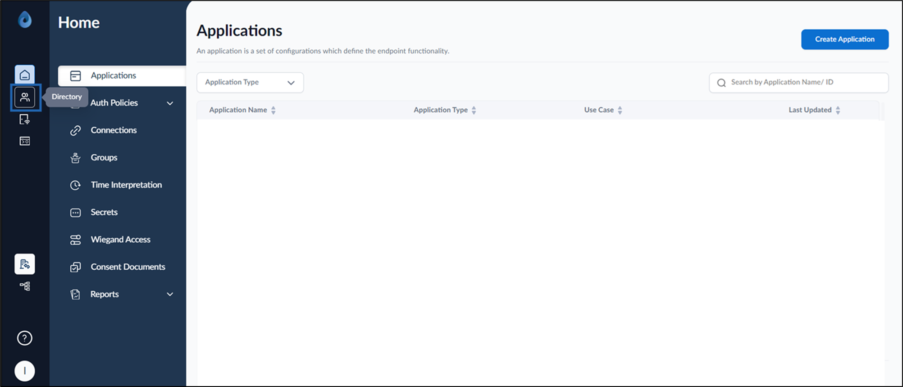
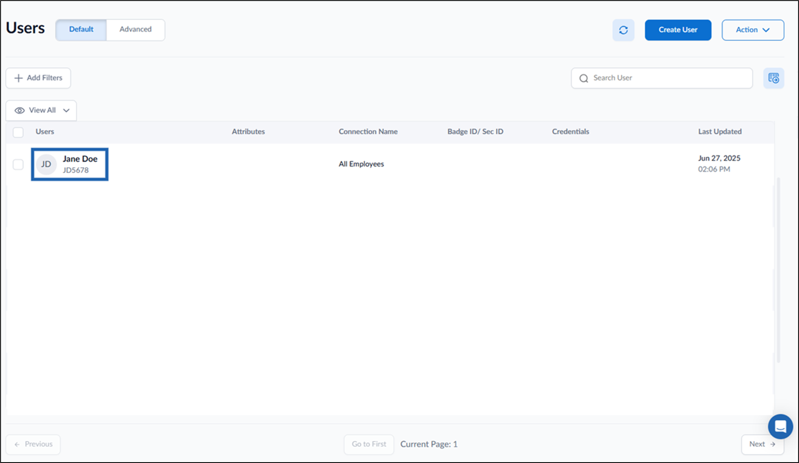
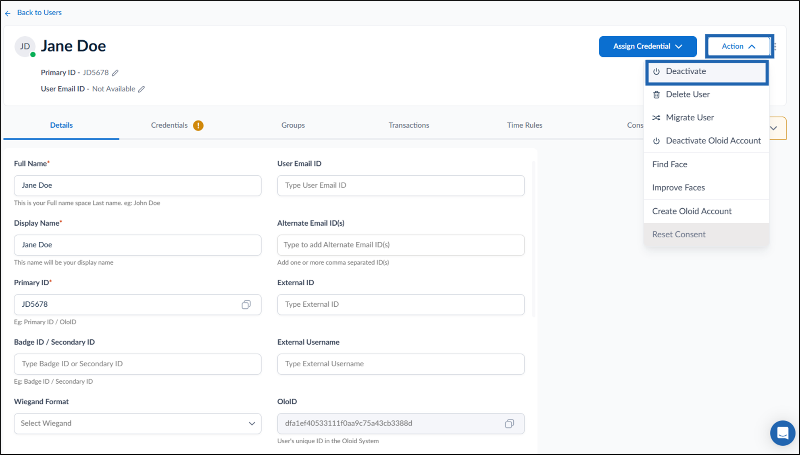
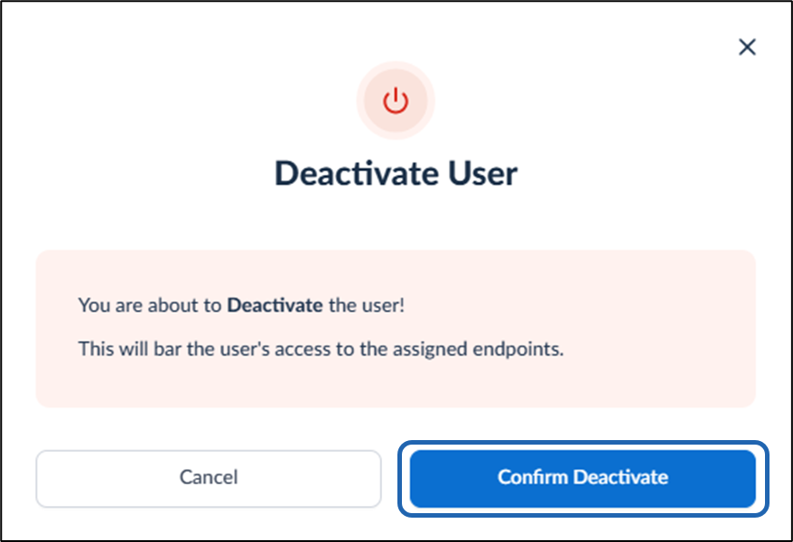
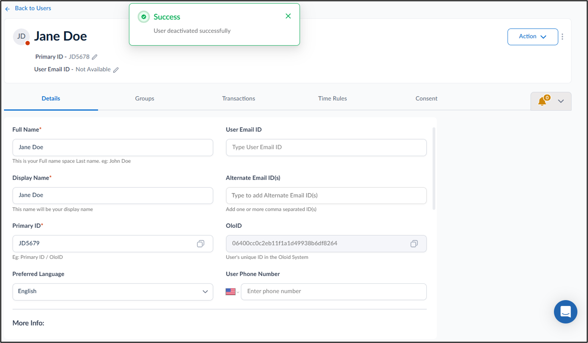

{/* Source: Intercom article 8424258 - https://oloid.help/en/articles/8424258-tenant-admin-portal-how-to-deactivate-user */}
{/* Generated by intercom_to_mintlify.py - re-running overwrites this file. */}

## Introduction

This document provides instructions to deactivate a user in the Tenant Admin Portal.

## Prerequisites

- You must have admin access to the Tenant Admin Portal.
- The user must be in **Active** status.

## Steps to Deactivate User

1. Log in to the **Tenant Admin Portal**.
2. On the home page of the portal, click **Directory** on the left menu panel.

   

   The **Users** page is displayed.
3. Click preferred **Username** to edit.

   

   The user details page is displayed.
4. On the top-right, go to **Action** > **Deactivate**.

   

   The **Deactivate User** pop-up box is displayed.

Click **Confirm Deactivate**.

The user is deactivated successfully.

