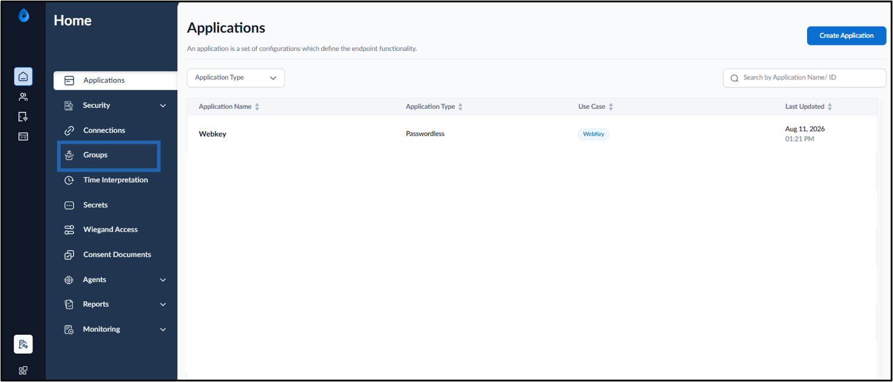
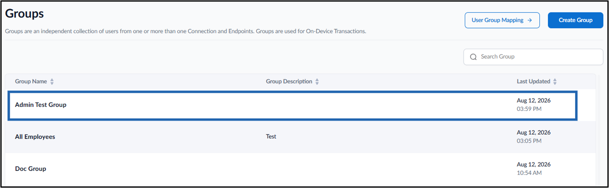
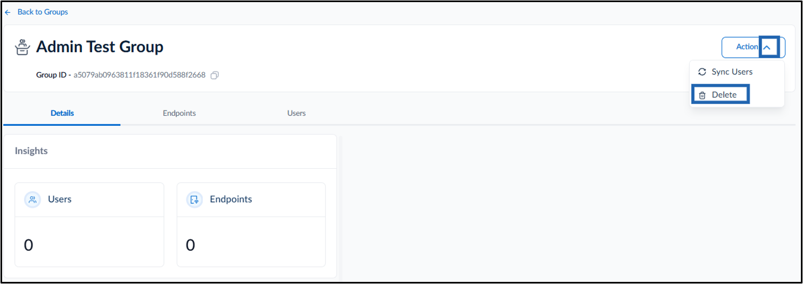
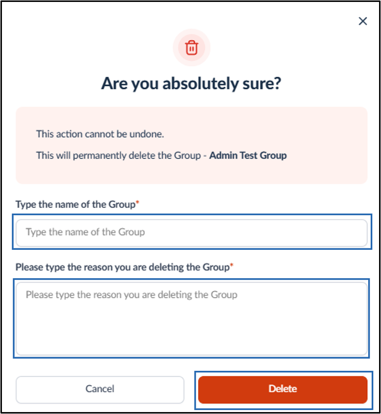
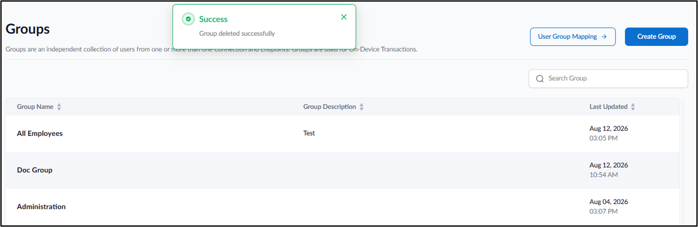

{/* Source: Intercom article 8493877 - https://oloid.help/en/articles/8493877-tenant-admin-portal-how-to-delete-a-group */}
{/* Generated by intercom_to_mintlify.py - re-running overwrites this file. */}

## Introduction

This document provides instructions to delete a group from the Tenant Admin Portal.

## Prerequisite

You must have admin access to the Tenant Admin Portal.

## Steps to Delete a Group

1. Log in to the **Tenant Admin Portal**.
2. On the home page, click **Groups** on the left menu panel.

   

   The **Groups** page is displayed.
3. Click the preferred group.

   

   The Group details page is displayed.
4. Go to **Action** drop-down and select **Delete**.

   

   The confirmation pop-up box is displayed.
5. DO the following:
   1. Enter the **Group Name**.
   2. Enter the **reason** to delete the group.
   3. Click **Delete**.

      

      The group is deleted successfully.

      
