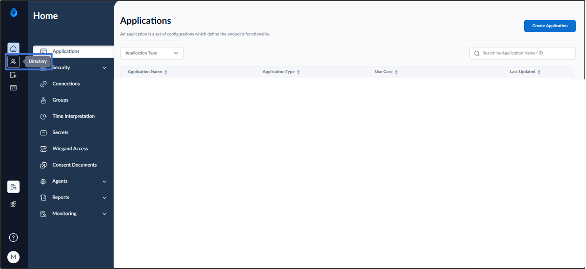
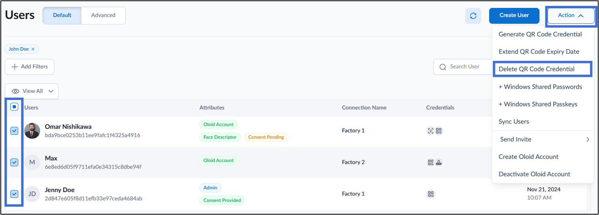
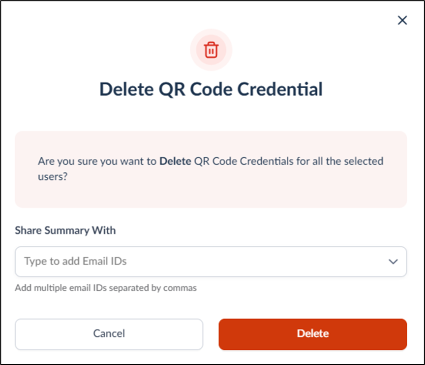

{/* Source: Intercom article 8488504 - https://oloid.help/en/articles/8488504-tenant-admin-portal-how-to-delete-qr-code-in-bulk */}
{/* Generated by intercom_to_mintlify.py - re-running overwrites this file. */}

## Introduction

This document provides step-by-step instructions to delete **QR Code credentials for multiple users in bulk** from the Tenant Admin Portal. Using the bulk delete option, you can select multiple users and remove their QR Code credentials in a single action

## Prerequisite

You must have Tenant admin access to the Tenant Admin Portal.

## Steps to Delete QR Code in bulk

1. Log in to the **Tenant Admin Portal**.
2. On the home page of the portal, click **Directory** on the left menu panel.

   

   The **Users** page is displayed.
3. Select users to delete QR Code.
4. Go to **Action > Delete QR Code Credential**.

   

   The **Delete QR Code Credential** pop-up box is displayed.
5. On the pop-up box, do the following:
   1. Enter user email ID under **Share Summary With** field enter the email ID(s) with whom you want to share the QR Code summary. (**optional**)
   2. Click **Delete**.

      

      The QR Code credential is successfully deleted for the users. The QR Code summary of these users is shared over email ID(s).

      

## Video Tutorial

Watch the video [How to delete QR code credential of multiple users in the Tenant Admin Portal - Video Tutorial](/platform/tenant-admin-portal/videos/how-to-delete-qr-code-credential-of-multiple-users-in-the-tenant)
