{/* Source: Intercom article 17062899 - https://oloid.help/en/articles/17062899-tenant-admin-portal-how-to-download-adoption-metrics-reports-from-the-insights-dashboard */}
{/* Generated by intercom_to_mintlify.py - re-running overwrites this file. */}

## Introduction

The **Adoption Metrics** tab under **Insights** provides administrators with visibility into user adoption and engagement across the organization. It helps measure how actively users are using the platform by tracking successful transactions, daily active users, adoption rates across connections or groups, and week-over-week usage trends.

## Prerequisite

You must have admin access to the Tenant Admin Portal.

## Steps to Download Adoption Metrics

1. Log in to the **Tenant Admin Portal.**
2. From the left navigation menu, click **Insights** icon.

   

   The Insights dashboard screen is displayed.
3. Click **Adoption Metrics** tab.

   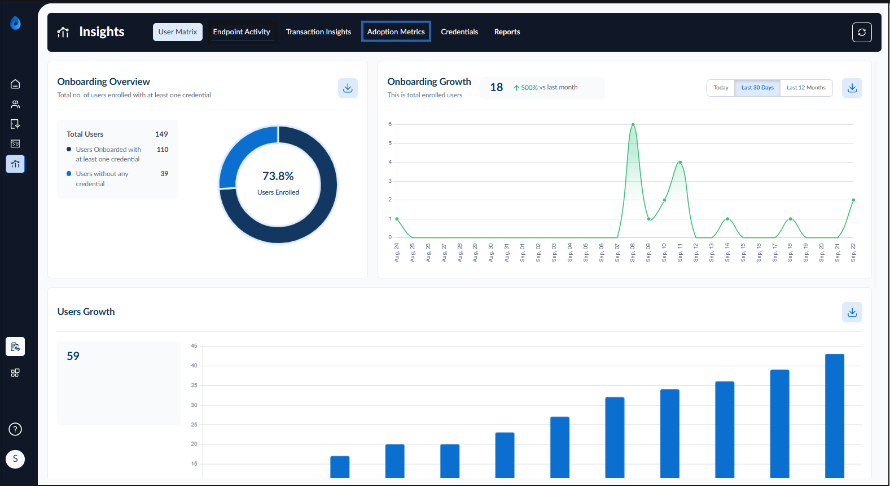

   The Adoption Metrics page is displayed.
4. You can view and download the following reports.
   1. [Tenant level user adoption](#tenant-level-user-adoption)
   2. [Daily Active Users](#daily-active-users)
   3. Users Adoption by Connection/Groups
   4. [Week-over-Week Usage](#week-over-week-usage)

      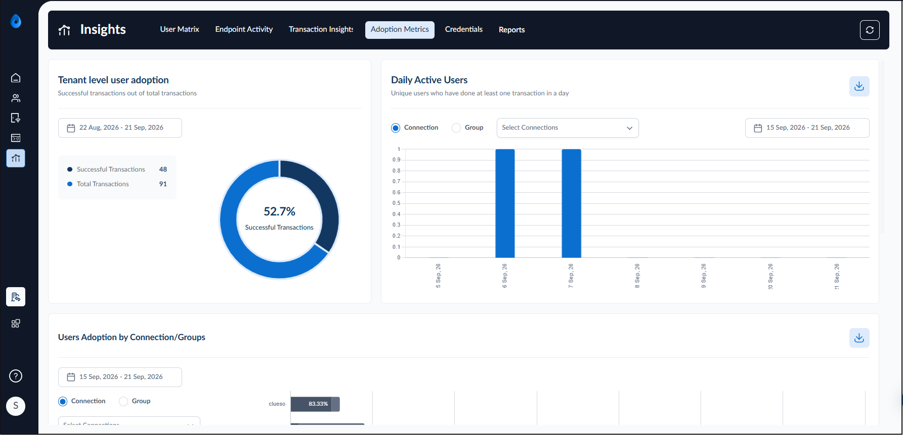

### Tenant Level User Adoption

The **Tenant Level User Adoption** section displays the percentage of successful transactions out of the total transactions performed during the selected period.

<Note>
  **Note:** The center of the chart displays the **Successful Transactions** percentage.
</Note>

The chart includes the following metrics:

- **Successful Transactions:** The total number of transactions completed successfully.
- **Total Transactions:** The total number of transactions processed during the selected period.
- **User Adoption Percentage:** The percentage of successful transactions compared to total transactions.

**Do the following:**

1. Select the required **date** range and click **OK**.

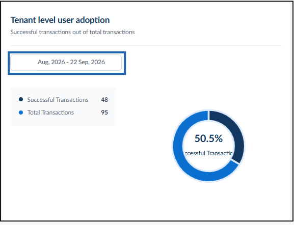

The percentage of successful transactions is displayed.

### Daily Active Users

The **Daily Active Users** section displays the number of unique users who completed at least one transaction during the selected period.

1. Do one of the following:
   1. **Connection**
      1. Select **Connection**.
      2. Select preferred one or more connections from the **Connections** drop-down list and click **Apply.**
      3. Select the specific **date** and click **OK**.

         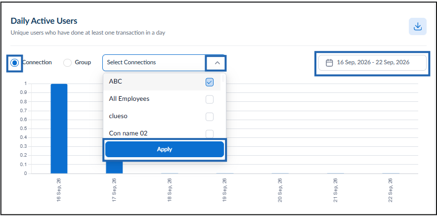

         OR
   2. **Group**
      1. Select **Group**.
      2. Select preferred one or more groups from the **Groups** drop-down list and click **Apply.**
      3. Select the specific **date** and click **OK**.

         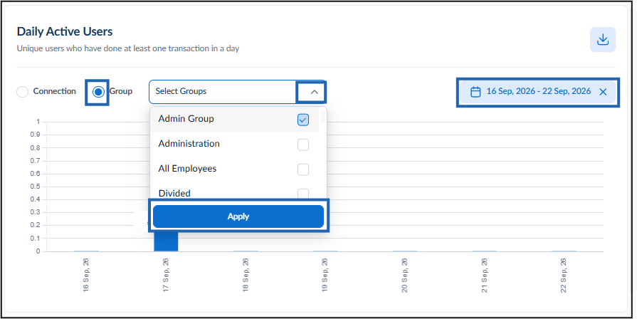

2. Click the **Download** icon and select **CSV** or **Excel**.

   <Note>
     **Note:** You can download the Daily Active Users report in CSV or Excel format.
   </Note>

   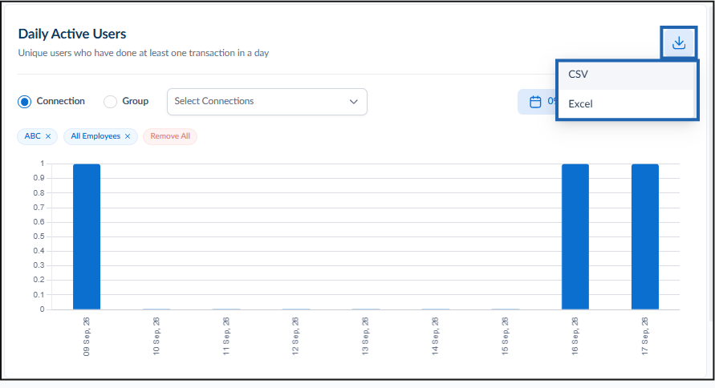

   The Daily Active Users report is successfully downloaded.

### User Adoption by Connection/Groups

The **User Adoption by Connection/Groups** section displays adoption metrics for selected connections or groups during the specified period.

1. Do one of the following:
   1. **Connection**
      1. Select **Connection**.
      2. Select preferred one or more connections from the **Connections** drop-down list and click **Apply.**
      3. Select the specific **date** and click **OK**.

         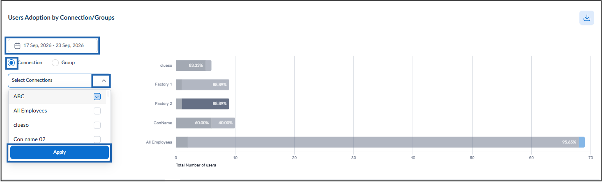

         OR
   2. **Group**
      1. Select **Group**.
      2. Select preferred one or more groups from the **Groups** drop-down list and click **Apply.**
      3. Select the specific **date** and click **OK**.

         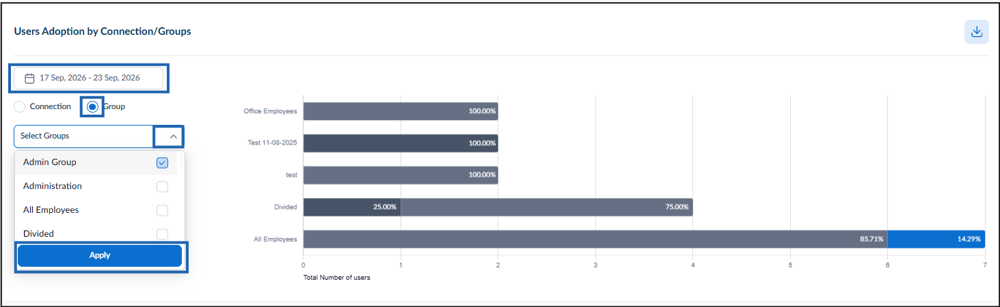

2. Click the **Download** icon and select **CSV** or **Excel**.

   <Note>
     **Note:** You can download the User Adoption by Connection/Groups report in CSV or Excel format.
   </Note>

   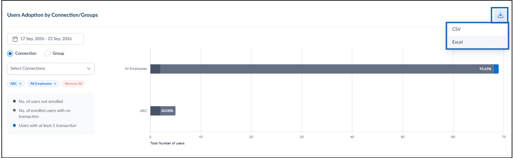

   The User Adoption by Connection/Groups report is successfully downloaded.

### Week-over-Week Usage

The **Week-over-Week Usage** section displays transaction trends by comparing usage across consecutive weeks for selected connections or groups.

1. Do one of the following:
   1. **Connection**
      1. Select **Connection**.
      2. Select preferred one or more connections from the **Connections** drop-down list and click **Apply.**
      3. Select the specific **date** and click **OK**.

         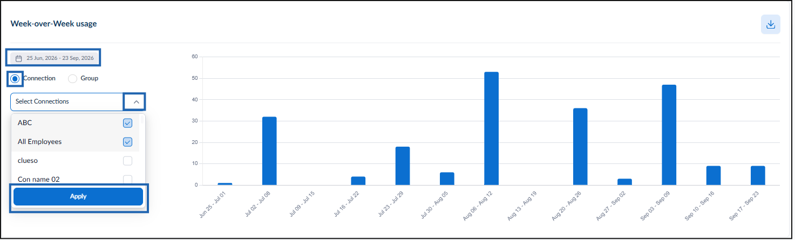

         OR
   2. **Group**
      1. Select **Group**.
      2. Select preferred one or more groups from the **Groups** drop-down list and click **Apply.**
      3. Select the specific **date** and click **OK**.

         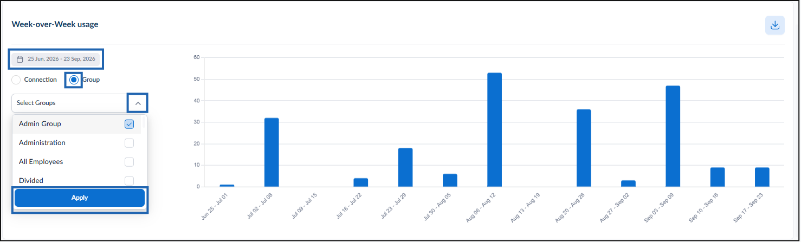

2. Click the **Download** icon and select **CSV** or **Excel**.

   <Note>
     **Note:** You can download the Week-over-Week Usage report in CSV or Excel format.
   </Note>

   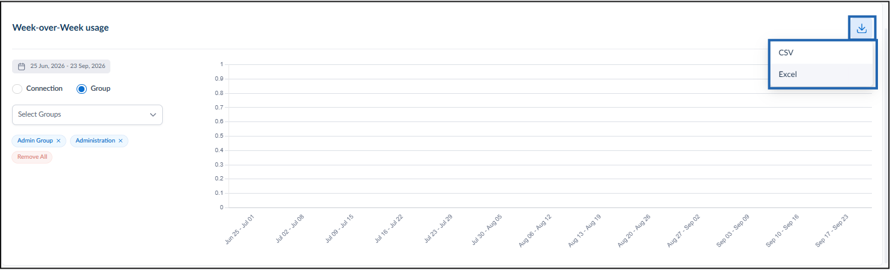

   The Week-over-Week Usage report is successfully downloaded.
