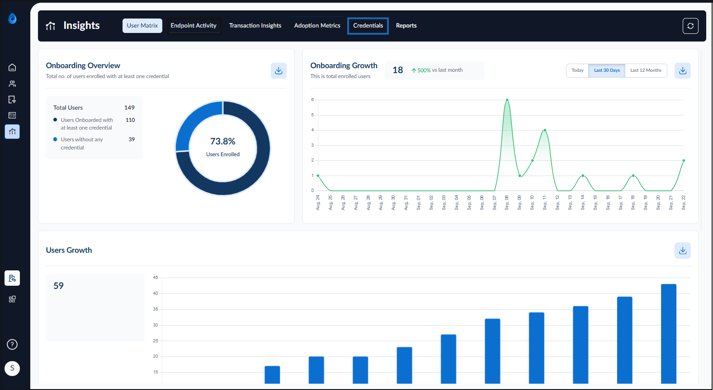
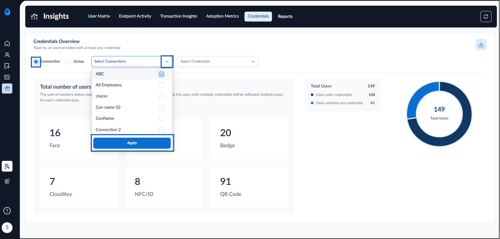
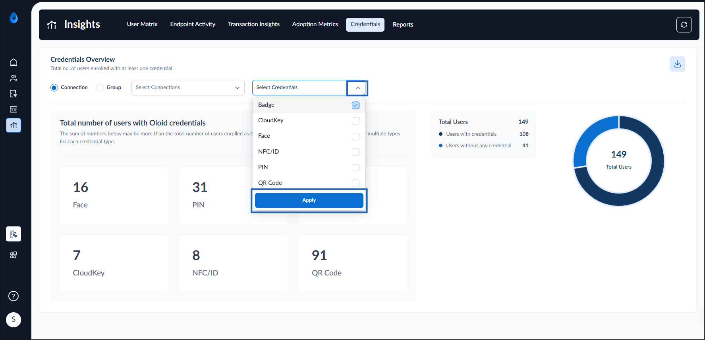
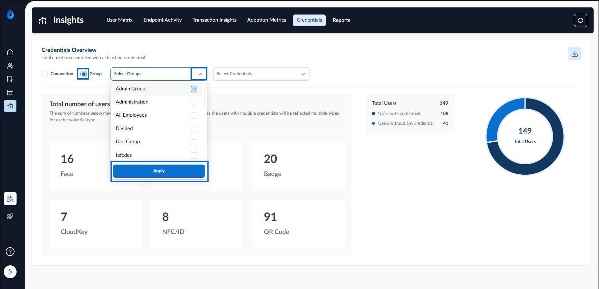
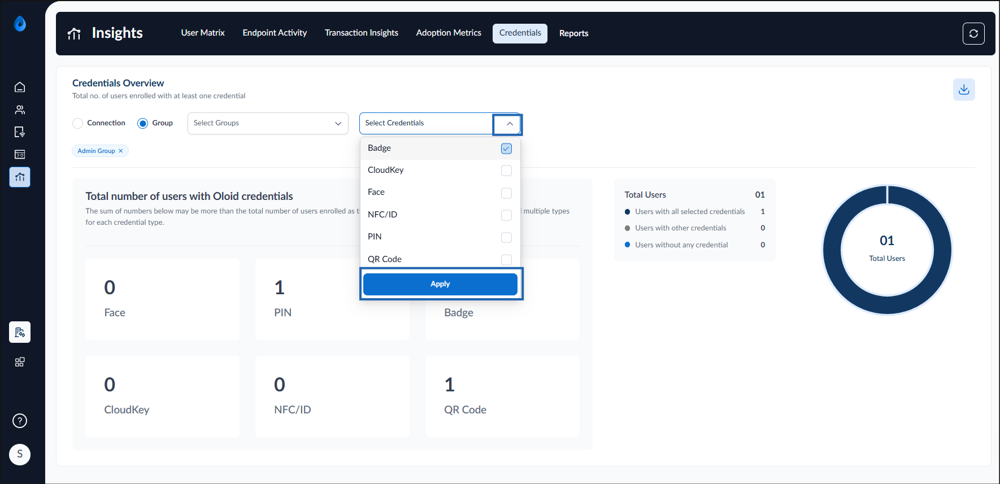
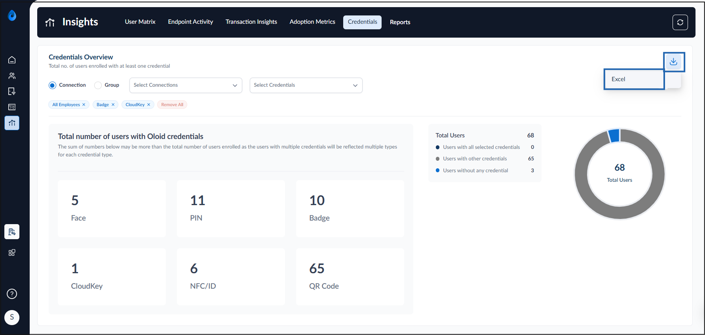
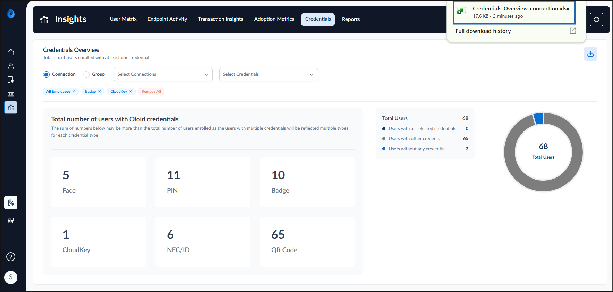

{/* Source: Intercom article 13228799 - https://oloid.help/en/articles/13228799-tenant-admin-portal-how-to-download-credentials-reports-from-the-insights-dashboard */}
{/* Generated by intercom_to_mintlify.py - re-running overwrites this file. */}

## Introduction

This document provides instructions on how to view credential data and download the **Credentials Report** from the Tenant Admin Portal.

## Prerequisite

You must have admin access to the Tenant Admin Portal.

## Steps to Download the Credentials Reports

1. Log in to the **Tenant Admin Portal.**
2. From the left navigation menu, click **Insights** Icon.

   

   The Insights dashboard screen is displayed.
3. Select the **Credentials** tab.

   

   The Credentials Insights dashboard is displayed.
4. Do one of the following:
   1. **Connection**
      1. Select **Connection** to filter users based on directory connections.
      2. Select one or more preferred connections from the **Connections** drop-down list and click **Apply**.

         

      3. Select one or more preferred credentials from the **Credentials** drop-down list and click **Apply**.

         

         OR
   2. **Group**
      1. Select **Group** to filter users based on specific user groups.
      2. Select one or more preferred groups from the **Groups** drop-down list and click **Apply.**

         

      3. Select one or more preferred credentials from the **Credentials** drop-down and click **Apply**.

         

         The **Credentials Report** page is displayed.
5. Click **Download** icon > select **excel**.

   

   The **Credentials Report** is successfully downloaded.

   

##### Note

The sum of users across credential types may be greater than the total number of users, as a user can be enrolled with multiple credential types.

##### User Categories

- **Users with credentials**: Users enrolled with at least one credential.
- **Users without any credential**: Users who have not enrolled any credential.

The center of the pie chart displays the **Total Users** count.
