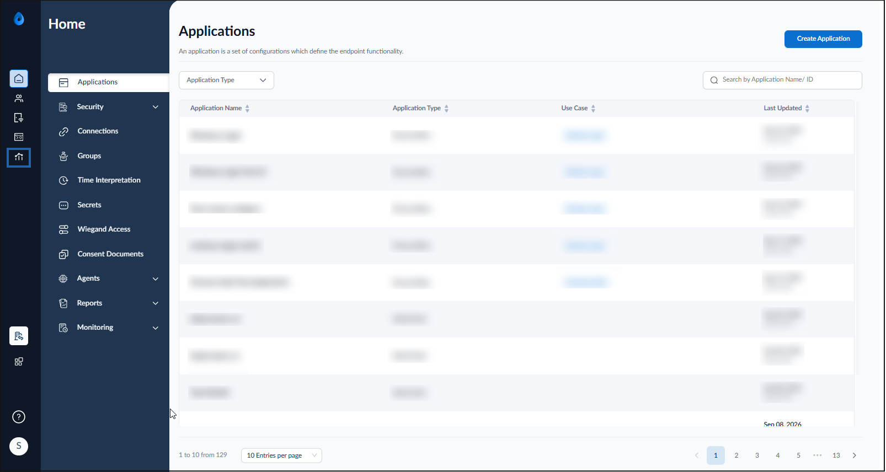
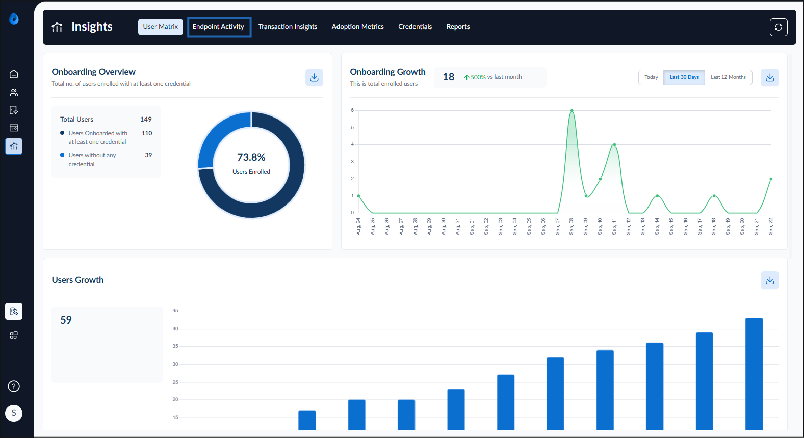
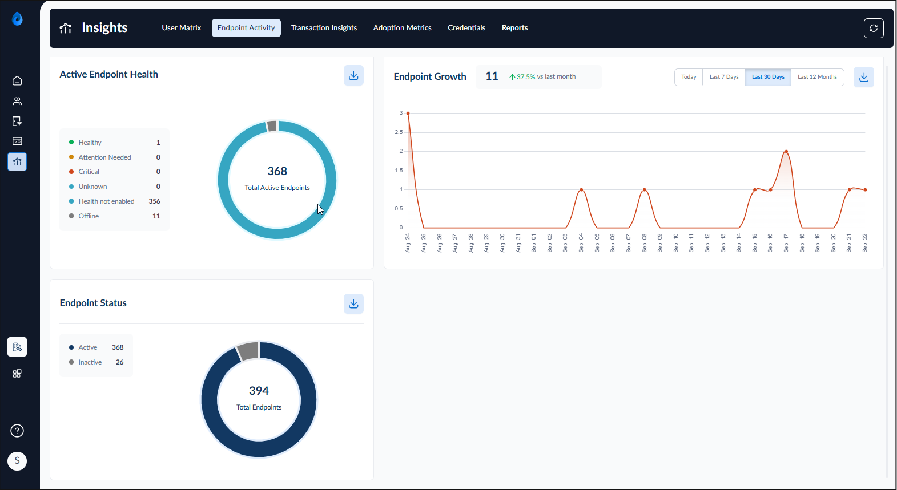
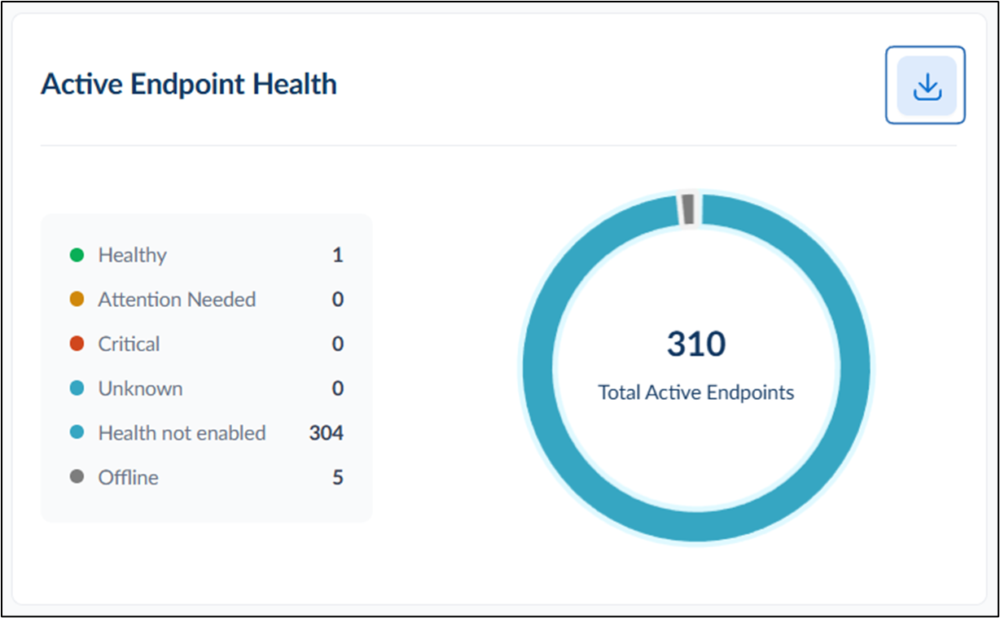
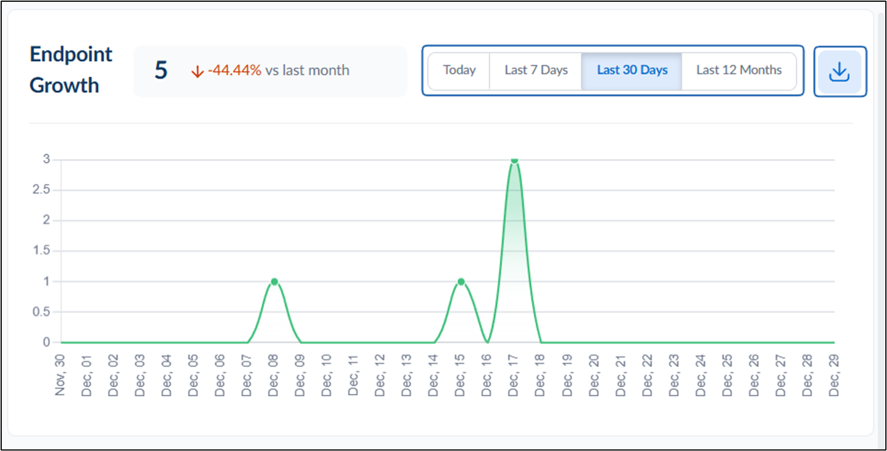
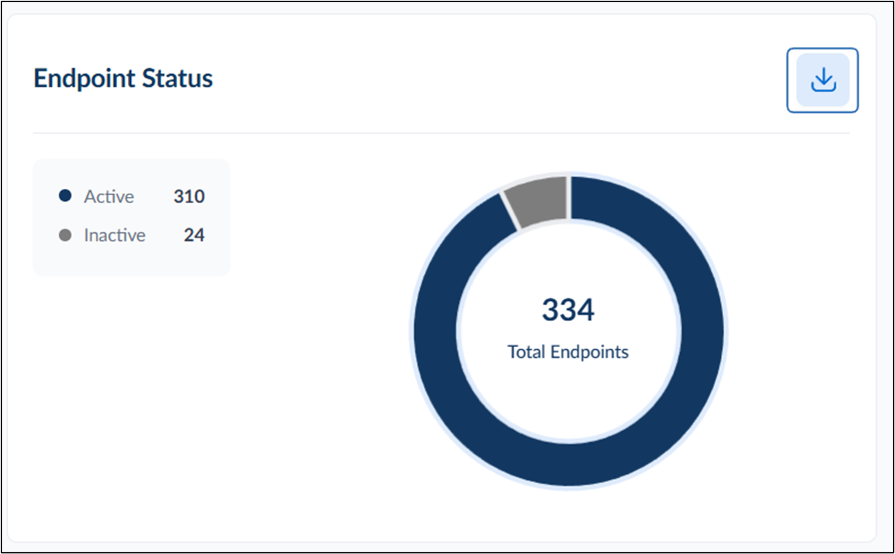

{/* Source: Intercom article 13228751 - https://oloid.help/en/articles/13228751-tenant-admin-portal-how-to-download-endpoint-activity-reports-from-the-insights-dashboard */}
{/* Generated by intercom_to_mintlify.py - re-running overwrites this file. */}

## Introduction

This document provides instructions on how to view and download **Endpoint Activity** reports from the **Insights** section of the Tenant Admin Portal.

The **Endpoint Activity** section provides admin with a consolidated view of endpoint health, growth, and status across the organization.

## Prerequisites

- You must have admin access to the Tenant Admin Portal.
- Endpoints must be configured in the application for endpoint data to appear.

## Steps to Download Endpoint Activity

1. Log in to the **Tenant Admin Portal.**
2. From the left navigation menu, click **Insights** Icon.

   

   The Insights dashboard screen is displayed.
3. Select the **Endpoint Activity** tab.

   

   The **Endpoint Activity** dashboard is displayed.
4. You can view and download the following Endpoint Activity report
   1. [Active Endpoint Health](#active-endpoint-health)
   2. [Endpoint Growth](#endpoint-growth)
   3. [Endpoint Status](#endpoint-status)

      

### Active Endpoint Health

The **Active Endpoint Health** section displays the health status of all active endpoints in the system.

<Note>
  **Note:** The center of the chart displays the **Total Active Endpoints** count.
</Note>

Active Endpoint Health is categorized into the following statuses:

- **Healthy:** Endpoints that are functioning normally.
- **Attention Needed:** Endpoints that require review due to warnings or potential issues.
- **Critical:** Endpoints with serious issues that require immediate attention.
- **Unknown:** Endpoints whose health status cannot be determined.
- **Health Not Enabled:** Endpoints for which health monitoring is not configured.
- **Offline:** Endpoints that are currently unreachable.

**Do the following:**

1. View the **Active Endpoint Health** chart to see the distribution of endpoints across the different health statuses.
2. Click the **Download** icon and select **CSV** or **Excel**.

   <Note>
     **Note:** You can download the Active Endpoint Health report in CSV or Excel format.
   </Note>

The Active Endpoint Health report is downloaded successfully.

### Endpoint Growth

The **Endpoint Growth** section displays changes in the number of endpoints over a selected period.

<Note>
  **Note:**

  - The growth percentage is compared with the previous corresponding period (for example, today compared with yesterday).
  - If no data is available for the selected time range, the **“No data to show yet”** message is displayed.
</Note>

**Do the following:**

1. Select a time range to view endpoint growth:
   - Today
   - Last 7 Days
   - Last 30 Days
   - Last 12 Months
2. Click the **Download** icon and select **CSV** or **Excel**.

   <Note>
     **Note:** You can download the Endpoint Growth report in CSV or Excel format.
   </Note>

   

The **Endpoint Growth** report is downloaded successfully.

### Endpoint Status

The **Endpoint Status** section displays the overall status of all endpoints in the system.

<Note>
  **Note:** The center of the chart displays the **Total Endpoints** count, which includes both active and inactive endpoints.
</Note>

Endpoint status is categorized into the following types:

- **Active:** Endpoints that are currently in use and available.
- **Inactive:** Endpoints that are registered in the system but are not currently active.

**Do the following:**

1. View the **Endpoint Status** chart to see the distribution of active and inactive endpoints.
2. Click the **Download** icon and select **CSV** or **Excel**.

   <Note>
     **Note:** You can download the Endpoint Status report in CSV or Excel format.
   </Note>

The **Endpoint Status** report is downloaded successfully.
