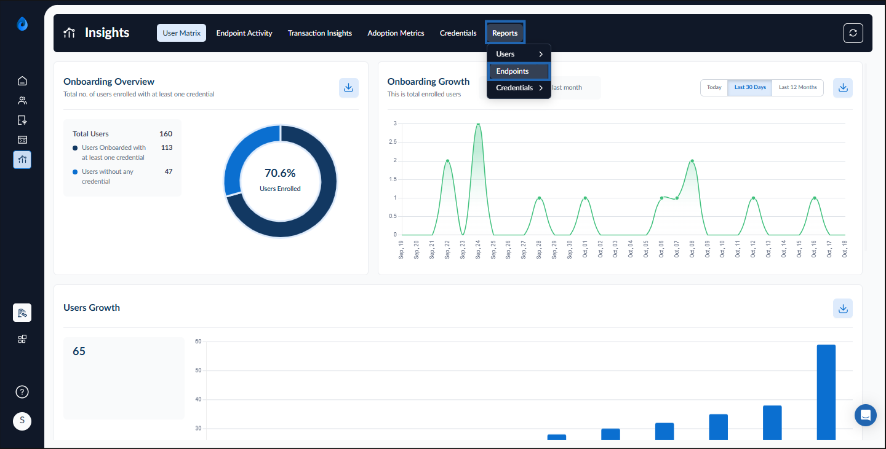
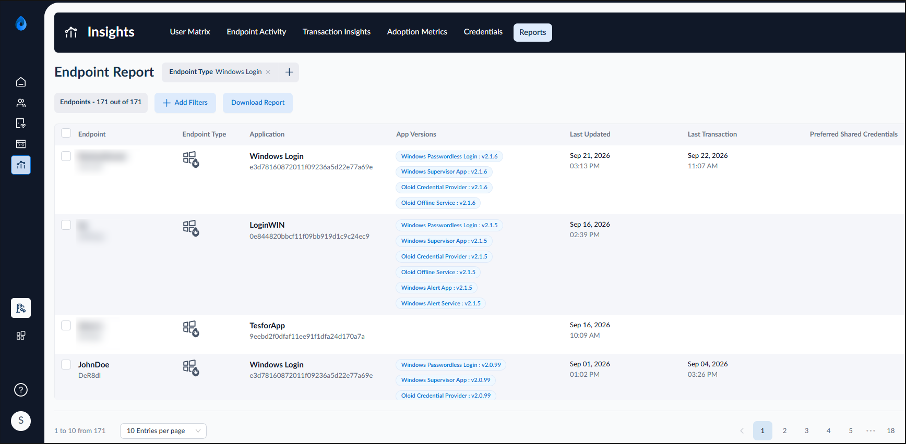
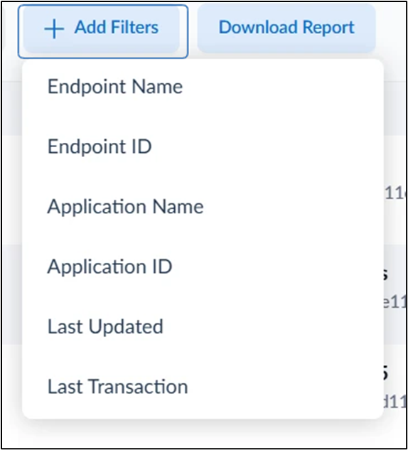
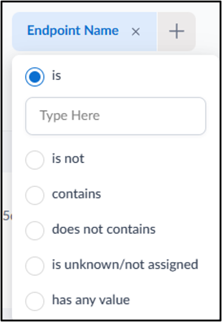
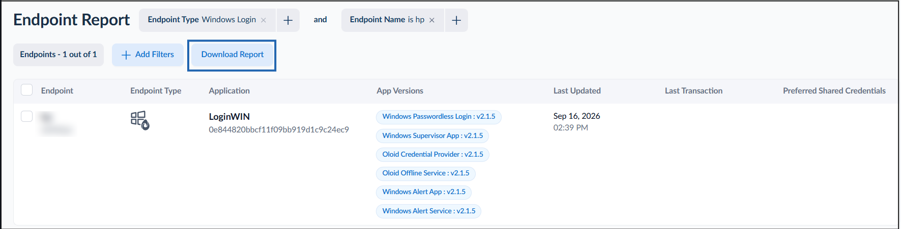
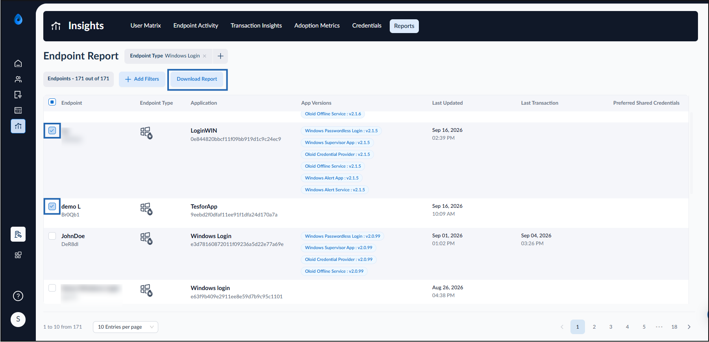
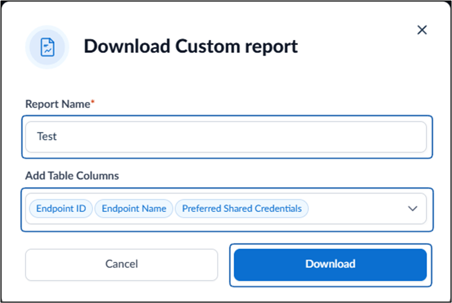
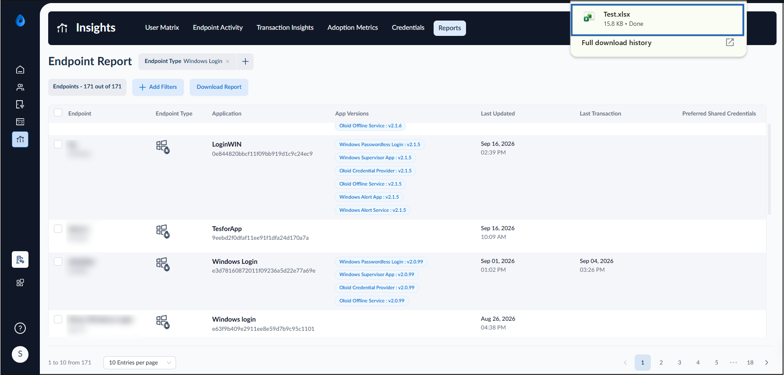

{/* Source: Intercom article 13256453 - https://oloid.help/en/articles/13256453-tenant-admin-portal-how-to-download-endpoint-reports-from-the-insights-dashboard */}
{/* Generated by intercom_to_mintlify.py - re-running overwrites this file. */}

## Introduction

The **Endpoints Report** in the Insights Dashboard provides detailed information about endpoints configured in the Oloid platform. This guide explains how to filter endpoints, select the required records, and download the report from the Tenant Admin Portal for analysis and reporting purposes.

## Prerequisite

You must have admin access to the Tenant Admin Portal.

## Steps to Download Endpoint Report

1. Log in to the **Tenant Admin Portal.**
2. From the left navigation menu, click **Insights** Icon.

   

   The Insights dashboard screen is displayed.
3. Select **Reports** > **Endpoints.**

   

   **Endpoint report** is displayed.

   

4. Do one of the following:
   1. [Filter Endpoints.](#filter-endpoints)
   2. [Select Endpoints.](#select-endpoints)

### Filter Endpoints

Use the **Add Filter** option to narrow down and view only the specific endpoints you want. This feature helps you quickly locate relevant endpoints from the list.

1. Click **Add Filters**.
2. Select the required filter from the **Add Filter** drop-down.

   

3. Select the radio button for the required endpoint.
4. Enter the endpoint name in the **Type Here** field.

   

5. Click **Download Report**.

   

### Select Endpoints

The Download Endpoint Report option allows admin to export endpoint report for selected Windows Login application endpoints. Administrators can select the required endpoints and choose the table columns to include in the report before downloading it. This provides a convenient way to save and review endpoint details outside the Tenant Admin Portal.

1. Select the **checkbox** for the required endpoint(s).

   

2. Enter the **Report Name.**
3. From the **Add Table Columns** dropdown, select the columns you want to include in the report. **By default, the report includes Endpoint ID, Endpoint Name, and Preferred Shared Credentials.** (Optional) Add or remove columns as needed.
4. Click **Download.**

   

   The Endpoints report is successfully downloaded.

   
