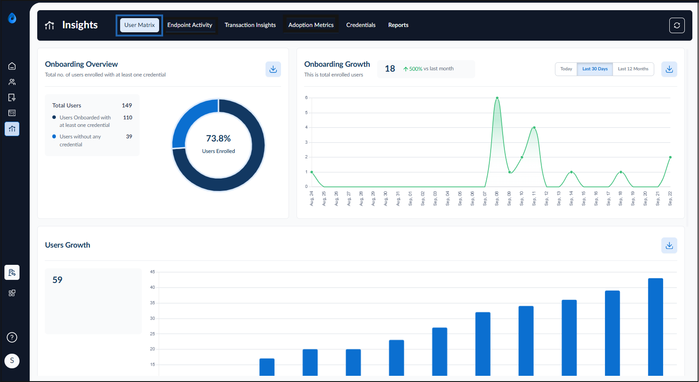
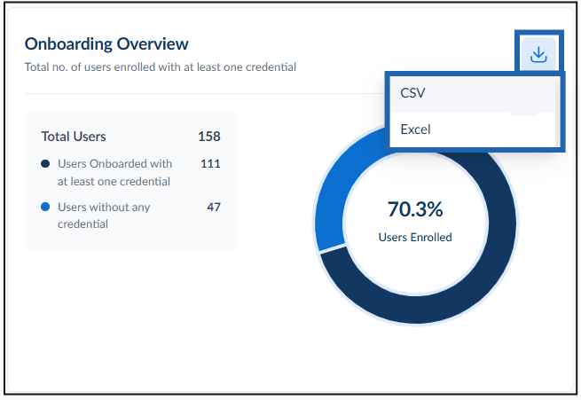
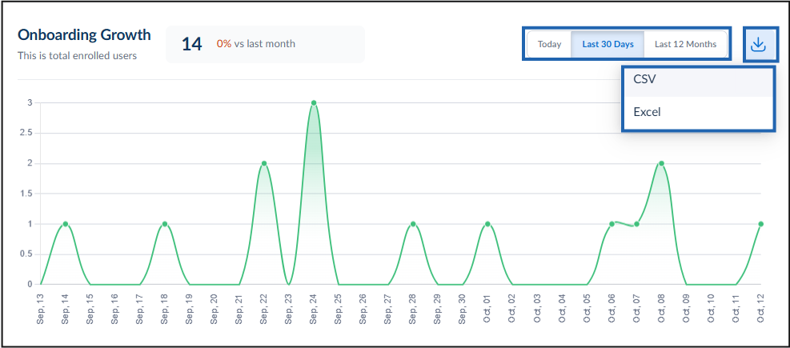
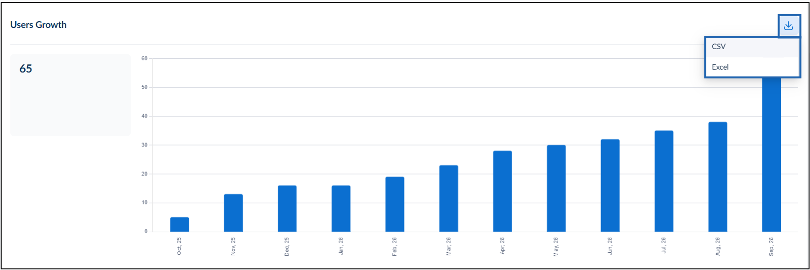
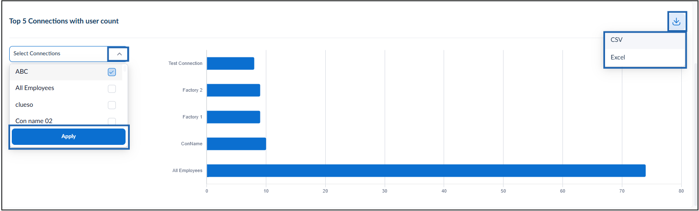

{/* Source: Intercom article 13001607 - https://oloid.help/en/articles/13001607-tenant-admin-portal-how-to-download-user-matrix-reports-from-the-insights-dashboard */}
{/* Generated by intercom_to_mintlify.py - re-running overwrites this file. */}

## Introduction

The **User Matrix** page in the **Insights** module provides visibility into user onboarding, credential enrollment, and growth trends across the organization. This document provides a step-by-step guide on how to download User Matrix reports from the Tenant Admin Portal.

## Prerequisites

- You must have admin access to the Tenant Admin Portal.
- Users must be added to the tenant directory for onboarding data to appear.

## Steps to Download User Matrix

1. Log in to the Tenant Admin Portal.
2. From the left navigation panel, click **Insights** Icon.

   

   The Insights dashboard screen is displayed.
3. Select the **User Matrix** tab.

   

   The User Matrix dashboard is displayed.
4. You can view and download the following User Matrix reports:
   1. [Onboarding Overview](#onboarding-overview)
   2. [Onboarding Growth](#onboarding-growth)
   3. [Users Growth](#users-growth)
   4. [Top 5 Connections with User Count](#top-5-connections-with-user-count)

### Onboarding Overview

The **Onboarding Overview** section provides a summary of user onboarding progress across the tenant.

<Note>
  **Note:** The center of the chart displays the **Onboarding Percentage**.
</Note>

1. The Onboarding Overview section includes the following metrics:
   1. **Total Users:** The total number of users in the tenant.
   2. **Users Onboarded with at least one Credential:** Users who have completed onboarding by registering at least one credential.
   3. **Users without any Credential:** Users who have not registered any credentials.
   4. **Onboarding Percentage:** The percentage of users who have completed onboarding.
2. To download the report, click **download** iconand select **CSV** or **Excel**.

   <Note>
     **Note:** You can download the Onboarding Overview report in CSV or Excel format.
   </Note>

   

   The Onboarding Overview report is downloaded successfully.

### Onboarding Growth

The **Onboarding Growth** section displays onboarding trends by showing how many users were onboarded during a selected time period.

Do the following:

1. Filter the data using one of the available time ranges:
   - Today
   - Last 30 Days
   - Last 12 Months
2. Click the **Download** icon and select **CSV** or **Excel**.

   <Note>
     **Note:** You can download the Onboarding Growth report in CSV or Excel format.
   </Note>

   

   The Onboarding Growth report is downloaded successfully.

### Users Growth

The **Users Growth** section displays the number of users added to the system and provides a visual representation of user growth trends over time.

1. Users Growth includes the following details:
   1. **Total Users Added:** The total number of users added during the selected time period.
   2. **Growth Chart:** A bar chart that displays user growth trends over time.
2. To download the User growth report,click the **Download** icon and select **CSV** or **Excel**.

   <Note>
     **Note:** You can download the Users Growth report in CSV or Excel format.
   </Note>

   

   The Users Growth report is downloaded successfully.

### Top 5 Connections with User Count

The **Top 5 Connections with User Count** section displays the connections with the highest number of users and provides a comparison of user distribution across connections.

**Do the following:**

1. Select one or more preferred connections from the **Connections** drop-down list > click **Apply (Optional)**.
2. Click the **Download** icon and select **CSV** or **Excel**.

   <Note>
     **Note:** You can download the Top 5 Connections with User Count report in CSV or Excel format.
   </Note>

   

   The Top 5 Connections with user count report is downloaded successfully.
