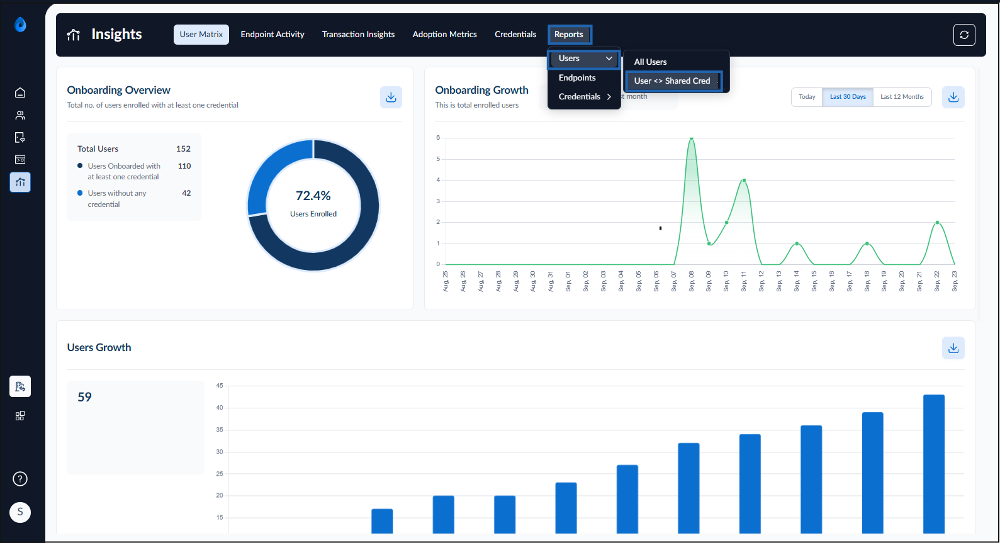
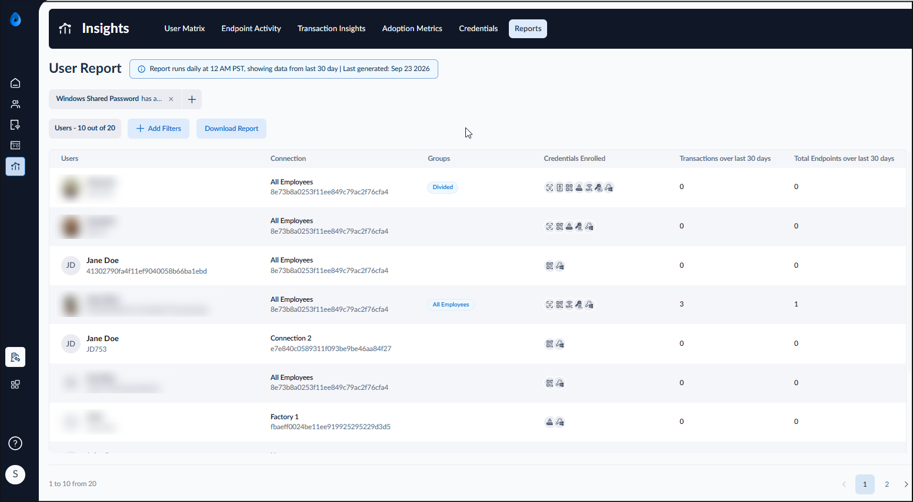
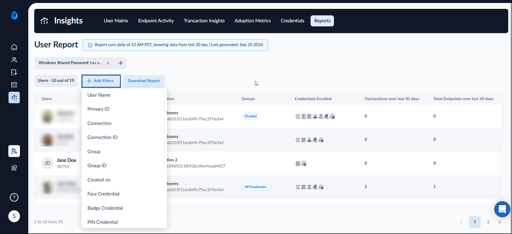
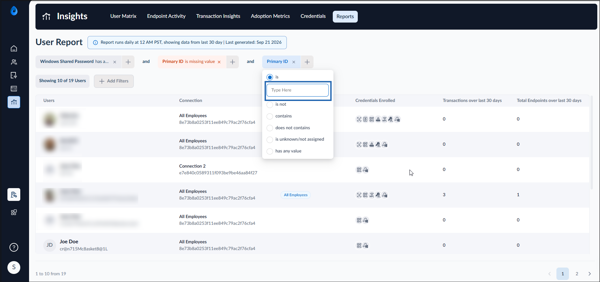
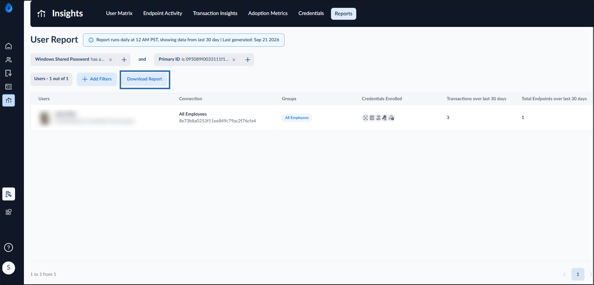
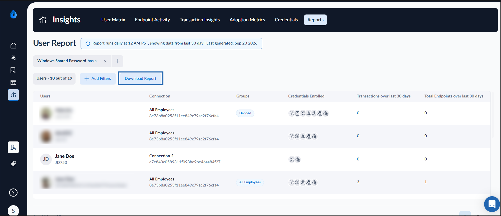
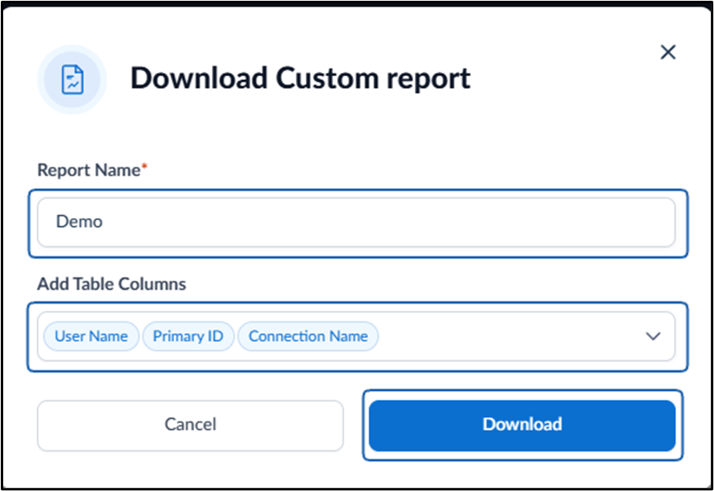
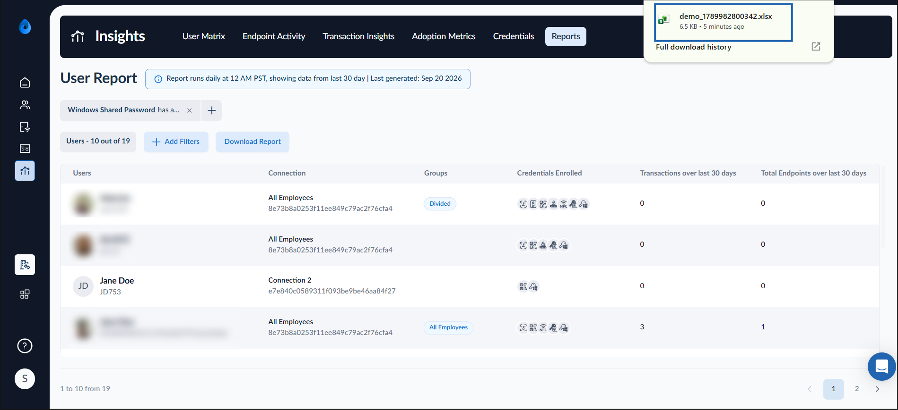

{/* Source: Intercom article 13256388 - https://oloid.help/en/articles/13256388-tenant-admin-portal-how-to-download-users-shared-credential-reports-from-the-insights-dashboard */}
{/* Generated by intercom_to_mintlify.py - re-running overwrites this file. */}

## Introduction

The **Shared Credential Report** in the Insights Dashboard provides information about shared credentials configured and used within the Oloid platform. This guide explains how to access, filter, and download the report from the Tenant Admin Portal.

## Prerequisites

- You must have admin access to the Tenant Admin Portal.
- At least one shared credential must be assigned to a user. For more informatio, refer: [Tenant Admin Portal - How to associate users with Window Shared credentials in the Tenant Admin Portal](/platform/tenant-admin-portal/tenant-admin-portal-how-to-associate-users-with-window-shared)

## Steps to Download the Users Shared Credential Report

1. Log in to the **Tenant Admin Portal.**
2. From the left navigation menu, click **Insights** Icon.

   

   The Insights dashboard screen is displayed.
3. Select the **Reports** tab > **Users** > **Users &lt;> Shared Cred**

   

   The **User Shared Cred Report** page is displayed.

   

4. Do one of the following
   1. [Filter User and Download the Report.](#filter-user-and-download-the-report)
   2. [Download the Complete User Report.](#download-the-complete-user-report)

### Filter User and Download the Report

Use filters to narrow down the user list and download a report containing only the users that match the specified criteria.

Do the following:

1. Click **Add Filters**.
2. Select the required filter from the drop-down list.

   

3. Select the required filter option.
4. Enter the required value in the **Type Here** field.

   

5. Click **Download Report**.

   

### Download the Complete User Report

Download a report containing all available user shared credential records without applying any filters.

1. Click **Download Report**.

   

   The Download Custom report pop-up box is displayed.
2. Do the following:
   1. Enter **Report Name** and select the required table columns.
   2. From the **Add Table Columns** dropdown,

      <Note>
        **Note:** select the columns you want to include in the report. **By default, the report includes Endpoint ID, Endpoint Name, and Preferred Shared Credentials.** (Optional) Add or remove columns as needed.
      </Note>

   3. Click **Download**.

      

      The Report is successfully downloaded.

      

---

<Note>
  **Note:** Report Generation Details
</Note>

- The report runs **daily at 12:00 AM PST**.
- It displays data from the **last 30 days**.
- The **Last generated** date and time is shown at the top of the page.
- Use the pagination controls at the bottom of the page to navigate through multiple pages of users.
