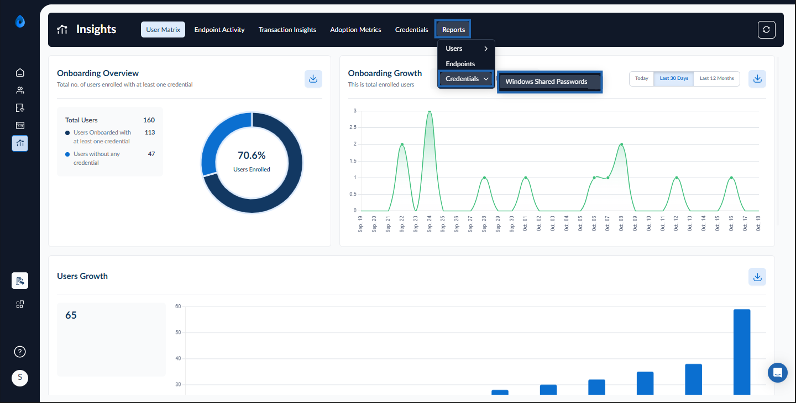
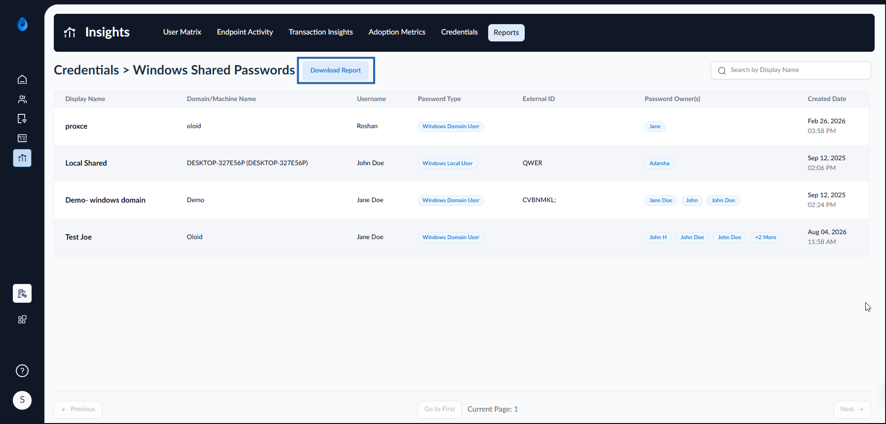
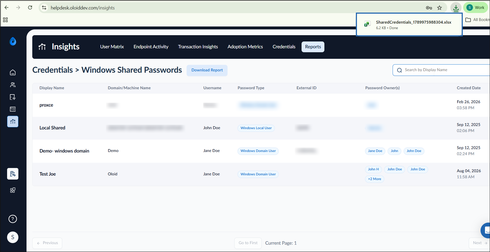

{/* Source: Intercom article 13256535 - https://oloid.help/en/articles/13256535-tenant-admin-portal-how-to-download-windows-shared-passwords-reports-from-the-insights-dashboard */}
{/* Generated by intercom_to_mintlify.py - re-running overwrites this file. */}

## Introduction

The **Windows Shared Passwords Report** provides detailed information about shared credentials configured for Windows endpoints. This document walks you through the steps to access and download the report from the Insights Dashboard in the Tenant Admin Portal.

## Prerequisite

You must have admin access to the Tenant Admin Portal.

## Steps to Download Windows Shared Passwords Report

1. Log in to the **Tenant Admin Portal.**
2. From the left navigation menu, click **Insights**.

   

   The Insights dashboard screen is displayed.
3. Select **Reports** tab > **Credentials** > **Windows Shared Passwords.**

   

   The Windows Shared Passwords page is displayed.
4. Click **Download Report**.

   

   The Windows Shared Passwords Report is successfully downloaded.

   
