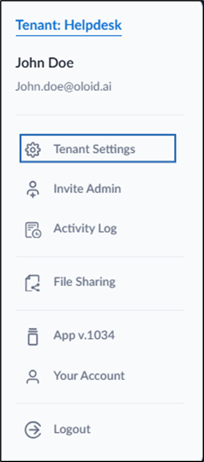
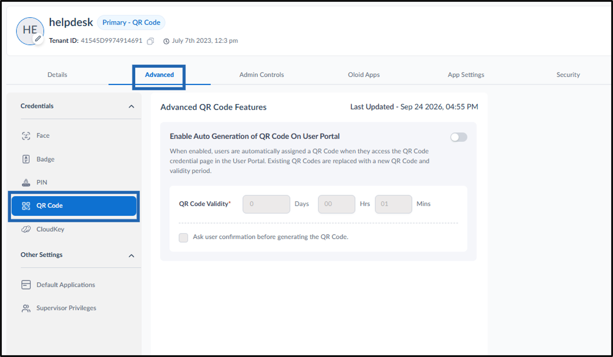
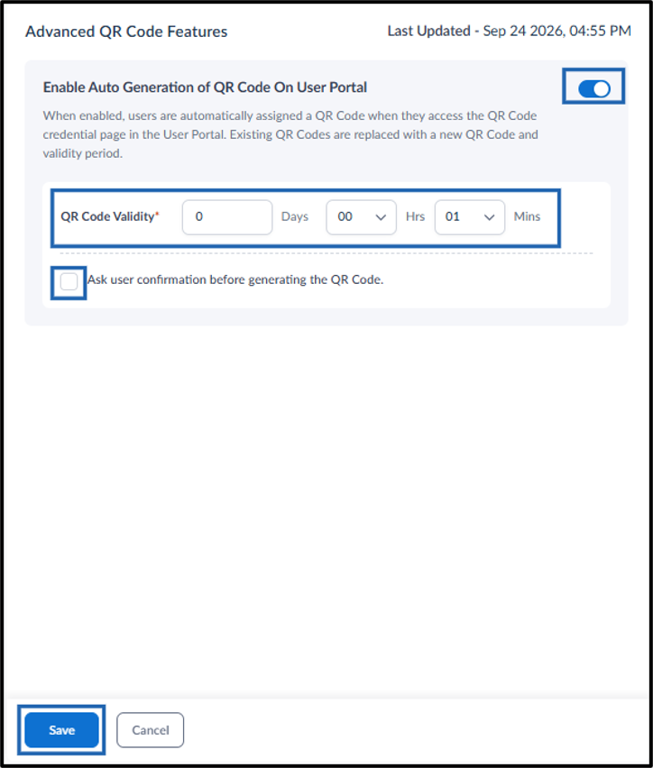

{/* Source: Intercom article 17212630 - https://oloid.help/en/articles/17212630-tenant-admin-portal-how-to-enable-auto-generation-of-qr-code */}
{/* Generated by intercom_to_mintlify.py - re-running overwrites this file. */}

## Introduction

This document provides instructions to update QR code validity at the tenant level. The configured validity period will apply to all users in the tenant.

## Prerequisite

You must have an admin access in the Tenant Admin Portal.

## Steps to Enable Auto Generation of QR Code

1. Log in to the **Tenant Admin Portal**.
2. On the homepage of the portal, click **user profile icon** on the bottom left.

   

   The **user profile menu** is displayed.
3. Select **Tenant Settings**.

   

   The **Tenant Settings** page is displayed.
4. Go to **Advanced** tab > select **QR Code** from the left menu panel.

   

   The **Advanced QR Code Features** section is displayed.
5. Do the following:
   1. Toggle **Enable Auto Generation of QR Code on User Portal** to ON.

      <Note>
        **Note:** When enabled, users are automatically assigned a QR code when they access the QR Code credential page in the User Portal. Existing QR codes are replaced with a new QR code and validity period.
      </Note>

   2. In **QR Code Validity**, enter the required values in the **Days**, **Hrs**, and **Mins** fields.
   3. (Optional) Select **Ask user confirmation before generating the QR Code** if users should confirm before a new QR code is generated for them.
   4. Click **Save**.

      

      The auto-generated QR code feature is now enabled and will apply based on the validity period configured above.
