{/* Source: Intercom article 11324573 - https://oloid.help/en/articles/11324573-tenant-admin-portal-how-to-enable-consent-to-add-face-for-the-user-using-oloid-user-portal */}
{/* Generated by intercom_to_mintlify.py - re-running overwrites this file. */}

## Introduction

This document explains how to **Enable Consent** for a connection in the **Tenant Admin Portal** and verify the consent experience in the **Oloid User Portal**. When consent is enabled, users must review and accept the configured consent form before they can enroll their face.

This document includes the following:

- [Enable Consent in the Tenant Admin Portal](#enable-consent-in-the-tenant-admin-portal)
- [Test Consent in the Oloid User Portal](#test-consent-in-the-oloid-user-portal)

## Enable Consent in the Tenant Admin Portal

### Prerequisites

- You must have a tenant admin account.
- User must be part of the connection.

### Steps to Enable Consent

1. Log in to Tenant Admin Portal.
2. On the home page of the portal, click **Connections** on the left menu panel.

   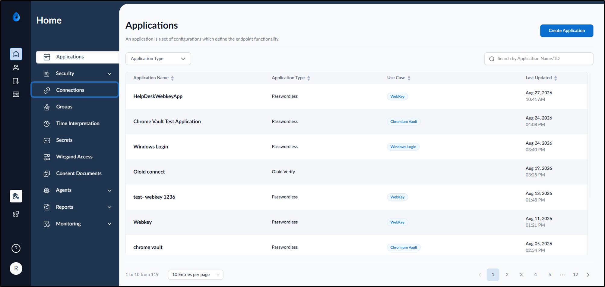

   The **Connections** page is displayed.
3. Click the connection that you want to configure.

   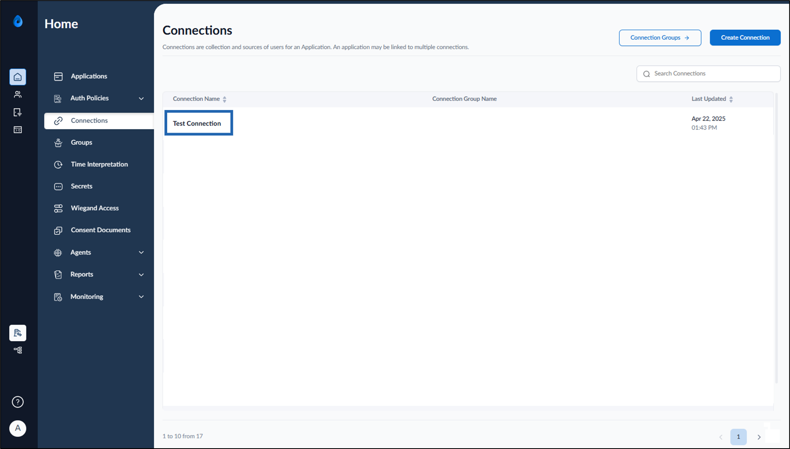

   The Connection detail page is displayed.

   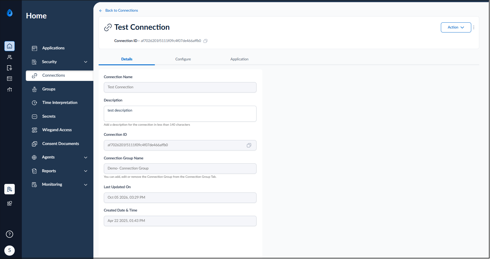

4. Go to **Configure** tab.

   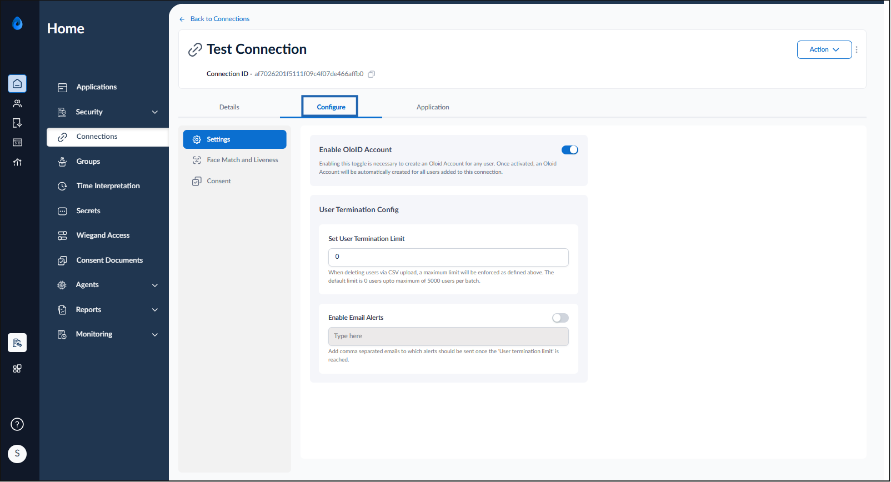

   The **Configure** Tab is displayed.
5. Click **Consent** > Click **Enable Consent**.

   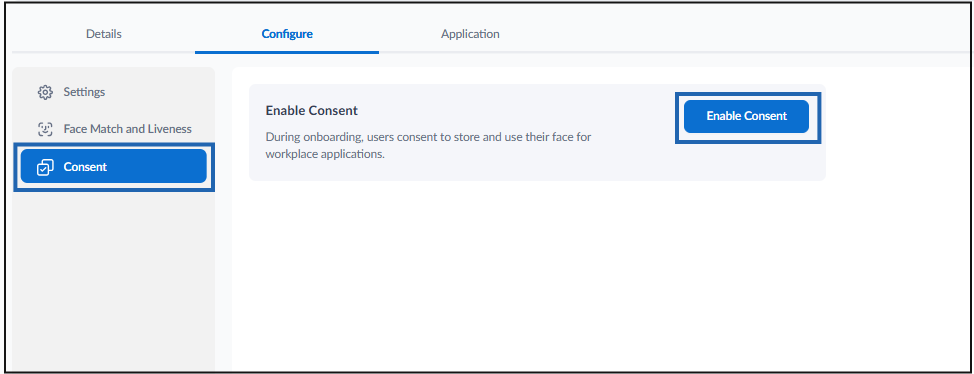

   The **Enable Consent** pop-up window is displayed.
6. Select the required consent template from **consent template** dropdown > Click **Next.**

   <Note>
     **Note:** To create a consent template, refer [How to create a Consent Template](/platform/tenant-admin-portal/tenant-admin-portal-how-to-create-and-configure-consent-template).
   </Note>

   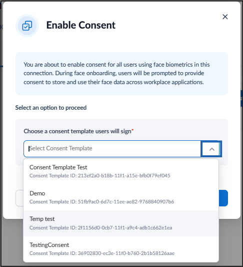

7. Select the applicable user set. By default, **All Users** is selected. Alternatively, select **New Users Only** to require consent only from users added after consent is enabled. Existing users who have already provided consent will not be prompted again > Click **Next**.

   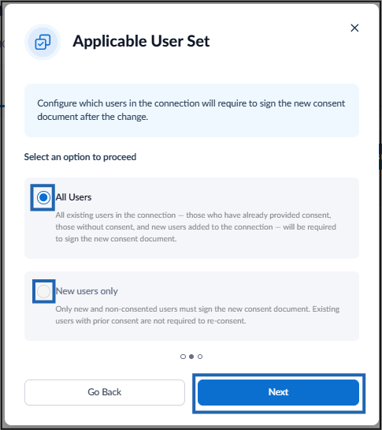

8. Select **No end-date** if you do not want to set a consent expiration date, or select **Permit authentication until the set date** and choose a date from the **Set Date** field if you want consent to expire on a specific date > Click **Confirm**.

   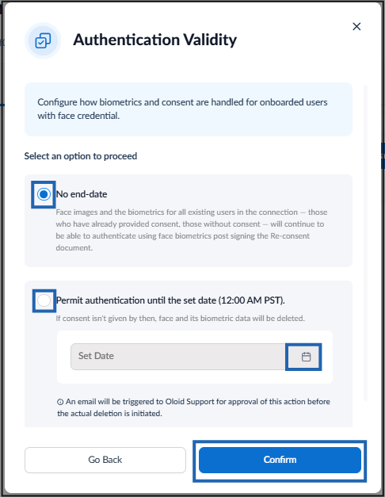

   The **Consent Updated** pop-up window is displayed.
9. Click **Okay**.

   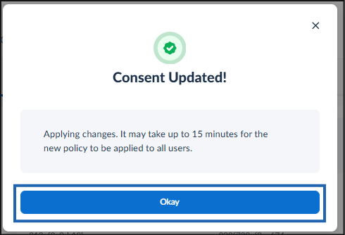

   The consent is successfully enabled, and the consent details are displayed under **Active Consent**.

   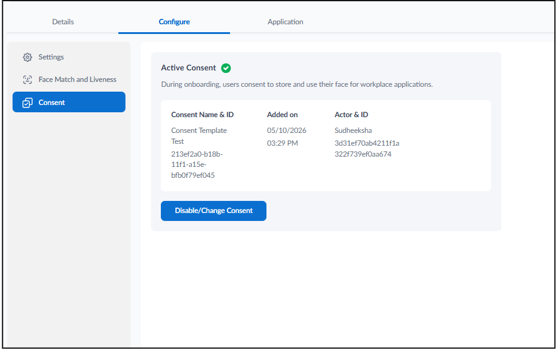

## Test Consent in the Oloid User Portal

### Prerequisites

- A user must be created in the Tenant Admin Portal.
- Consent must be enabled for the connection in the Tenant Admin Portal.

### Steps to Test Consent

1. Log in to the **Oloid User Portal**.
   The Oloid User Portal login page is displayed.
2. Select **Login with Email**.

   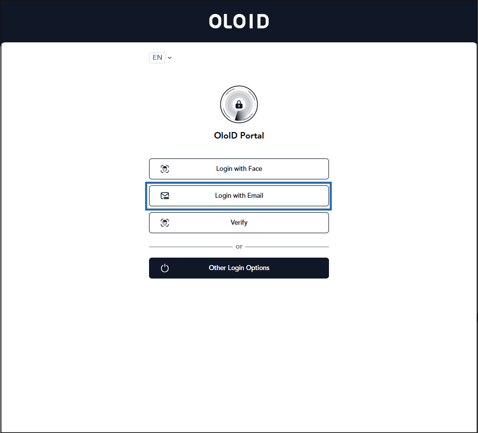

   The **Login with Email** page is displayed.
3. Enter your email address in the **Email ID** field > Click **Get Verification Code**.

   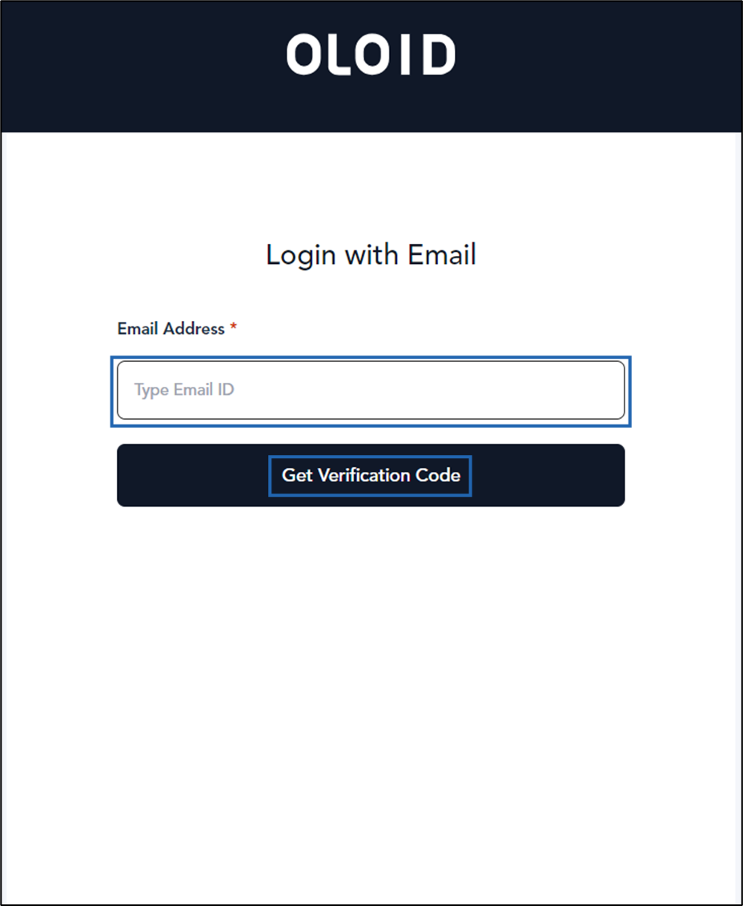

4. A verification code is sent to your registered email ID. Enter the **Verification code**> Click **Login**.

   <Note>
     **Note:** The One Time Verification Code expires after 60 seconds.
   </Note>

   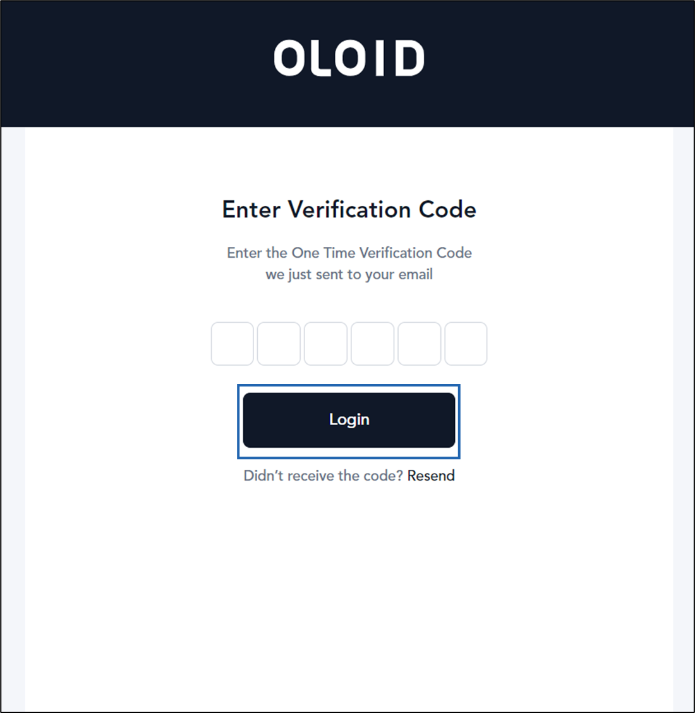

   The Oloid User Portal is displayed.
5. On the homepage , click **Faces**.

   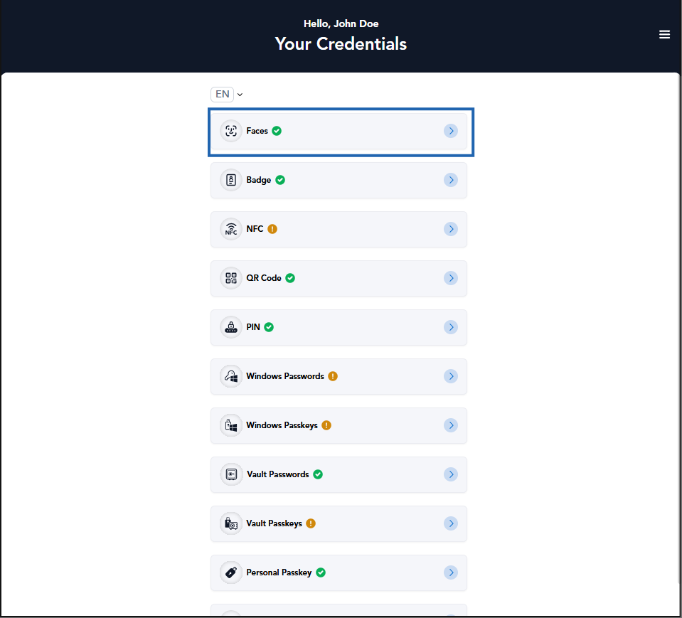

   The **Face Credential** page is displayed.
6. Click **Submit Consent**.

   <Note>
     **Note:** The user must provide their consent to proceed to the next steps if consent is enabled in the Tenant Admin Portal.
   </Note>

   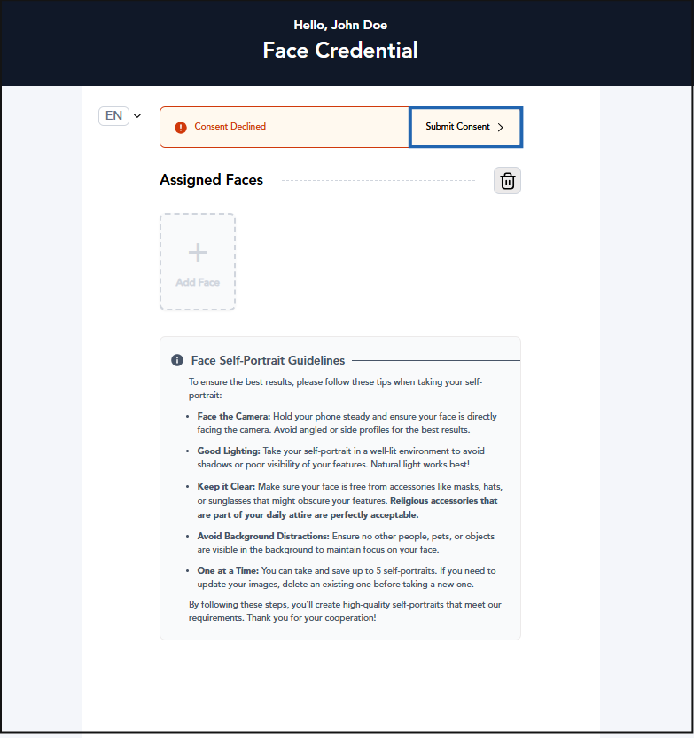

7. Review the consent document and any associated legal documents, and then **Agree** to provide consent.

   <Note>
     **Note:** Click **Disagree** if you do not want to provide consent.
   </Note>

   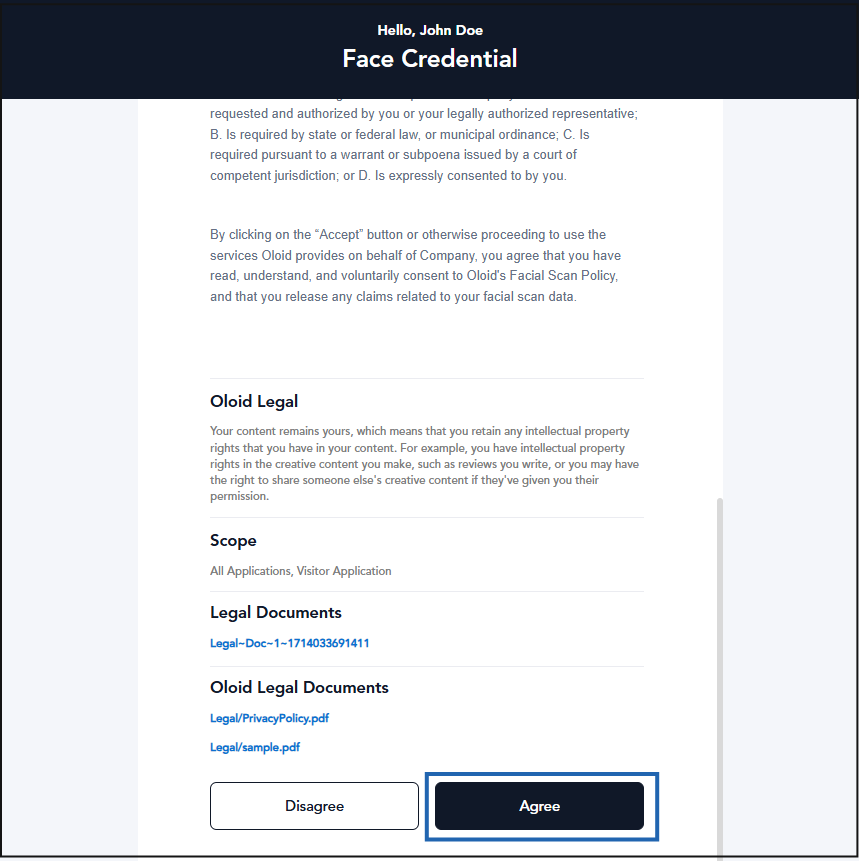

8. Click **Add Face** to complete facial enrollment.

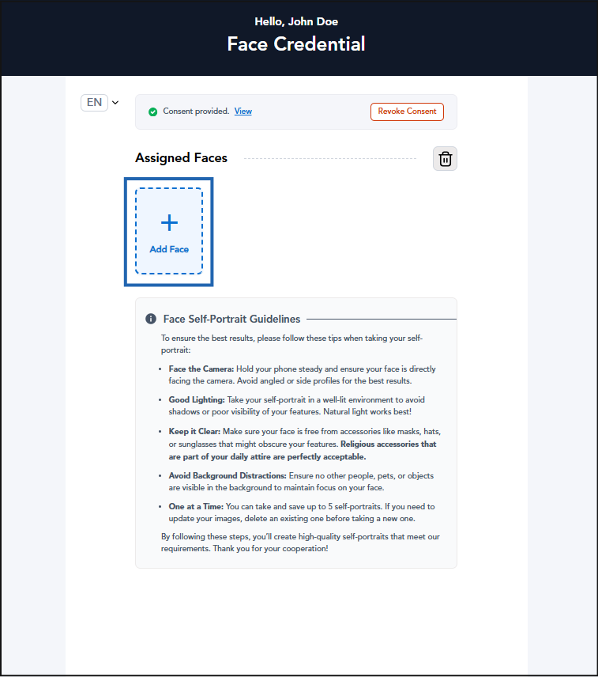
