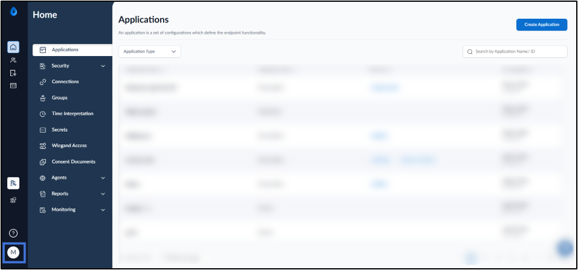
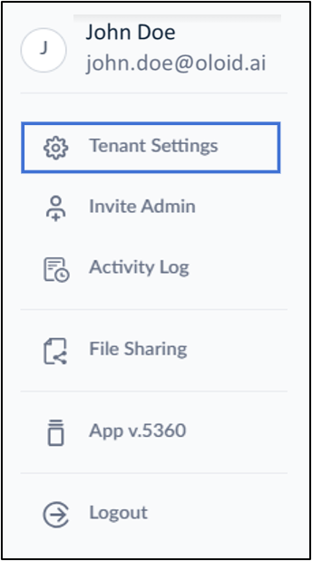
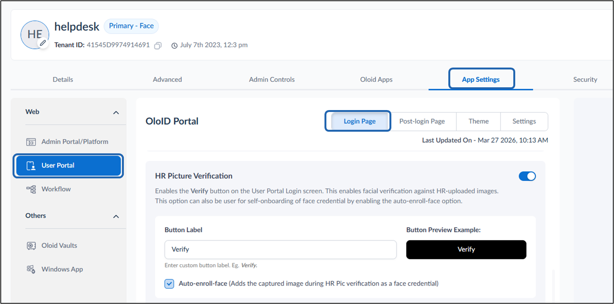
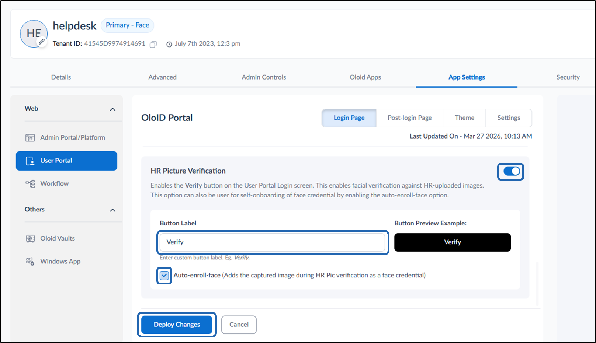
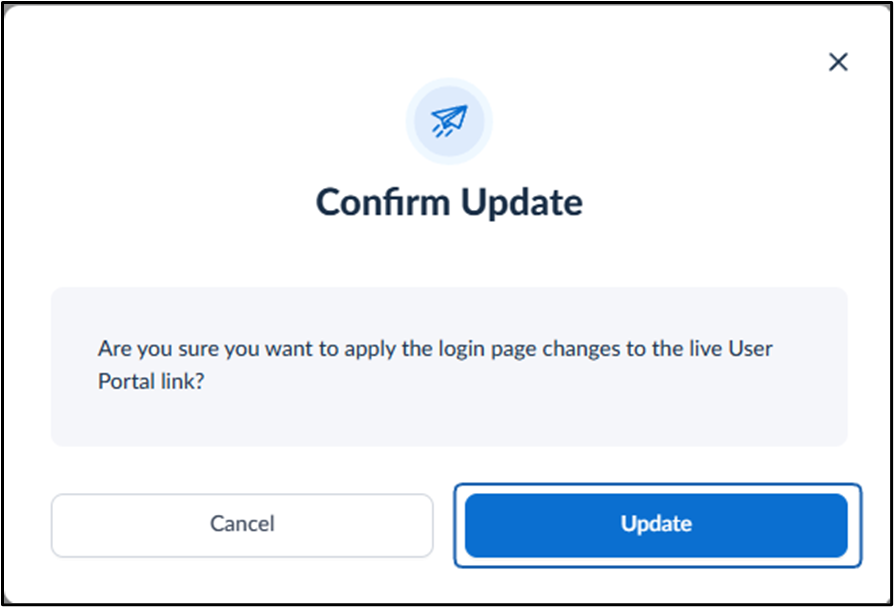
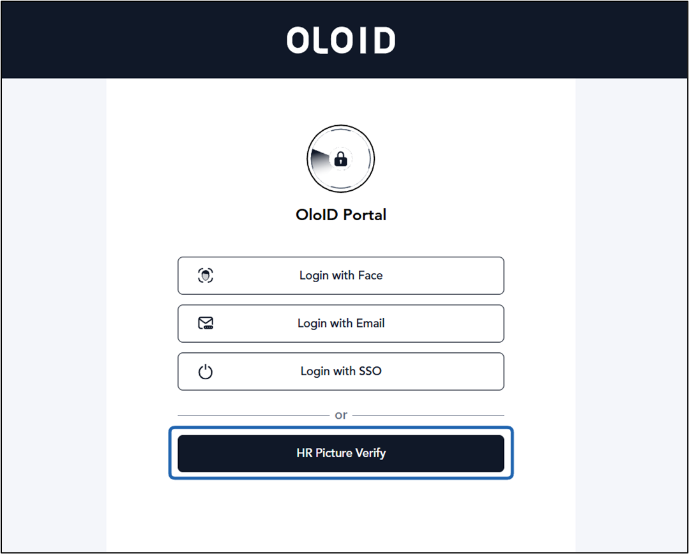
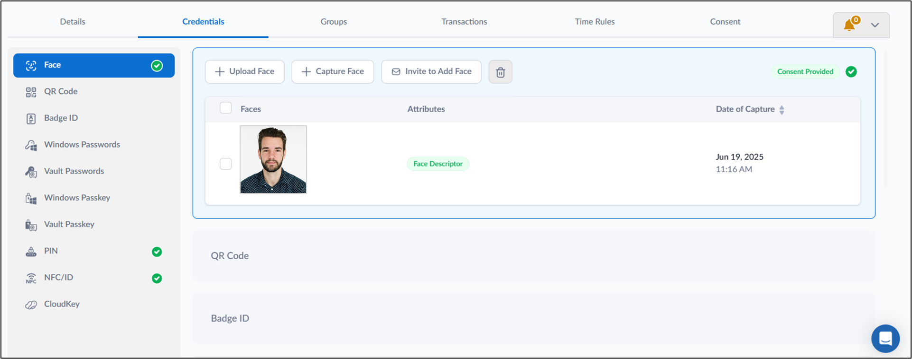

{/* Source: Intercom article 13570122 - https://oloid.help/en/articles/13570122-tenant-admin-portal-how-to-enable-hr-picture-verification-for-oloid-user-portal */}
{/* Generated by intercom_to_mintlify.py - re-running overwrites this file. */}

## Introduction

The **HR Picture Verification** feature enables Tenant Admins to verify employee identities by comparing uploaded HR images with user-submitted photos for enrollment and authentication.

## Prerequisites

- You must have Tenant Admin access to Tenant Admin Portal.
- The user’s picture must be added under HR Picture Verification. For more, refer to [How to Import Faces for HR Picture Verification](/platform/tenant-admin-portal/how-to-import-faces-for-hr-picture-verification)

## Steps to Configure HR PictureVerification

1. Log in to the **Tenant Admin Portal**.
2. On the homepage of the portal, click **user profile icon** on the bottom left corner of the menu panel.

   

   The user profile menu is displayed.
3. Click **Tenant Settings**.

   

   The **Tenant Settings** page is displayed.
4. Select **App Settings** > select **User Portal** > select **Login Page**

   

5. Do the following:
   1. Enable the **HR Picture Verification** toggle.
   2. Select the **Auto Enroll Face** checkbox. (Optional)

      <Note>
        **Note:** Enabling **Auto Enroll Face** allows the image captured for login to be saved as credential if the user face was not previously added.
      </Note>

   3. Enter **Button Label**. (Optional)

      <Note>
        **Note:** The Button Label entered here will show on the User portal login screen as authentication option.
      </Note>

      

   4. Click **Deploy Changes.**
      The Confirmation pop-up box is displayed.

Click **Update**.

Oloid User Portal settings are successfully updated.

---

##### Sample screen on the User Portal Login Page

On the User Portal login page, the **HR Picture Verify** button is displayed.

<Note>
  **Note:** Button label will appear based on configuration in the Tenant Admin Portal.
</Note>

<Note>
  **Note:** When Auto Enroll Face is enabled, a user’s face is added to the Credentials tab after login if it has not already been enrolled.
</Note>

