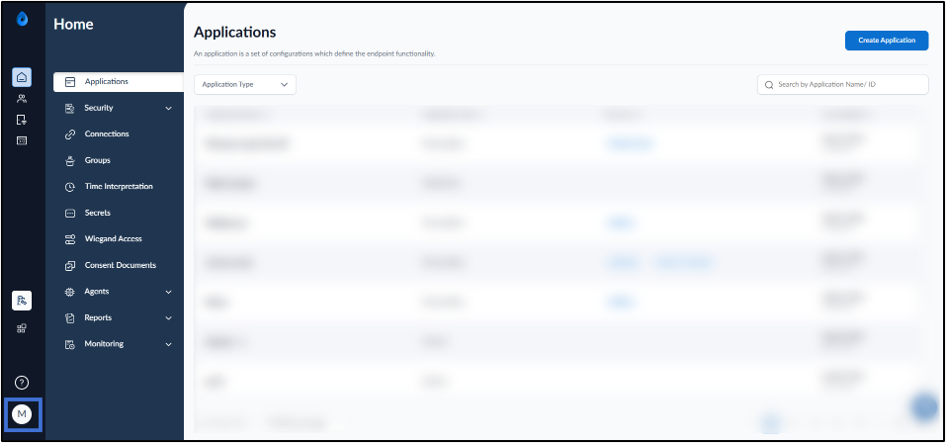
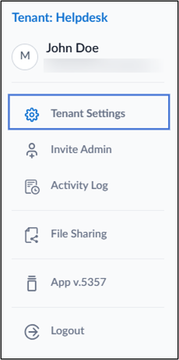
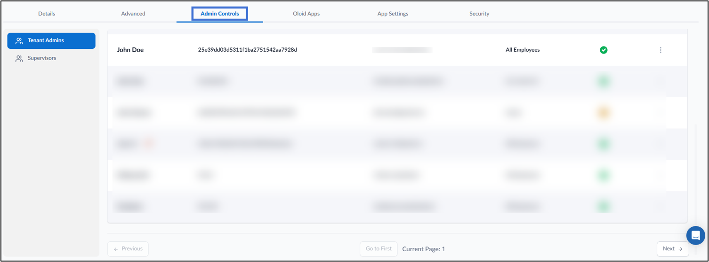
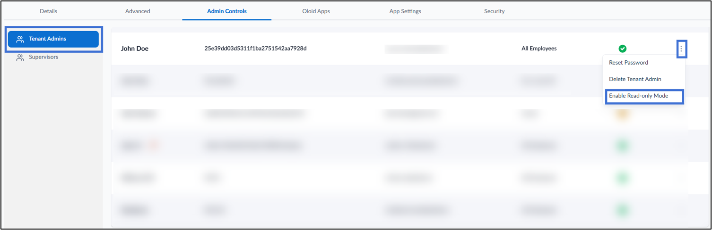
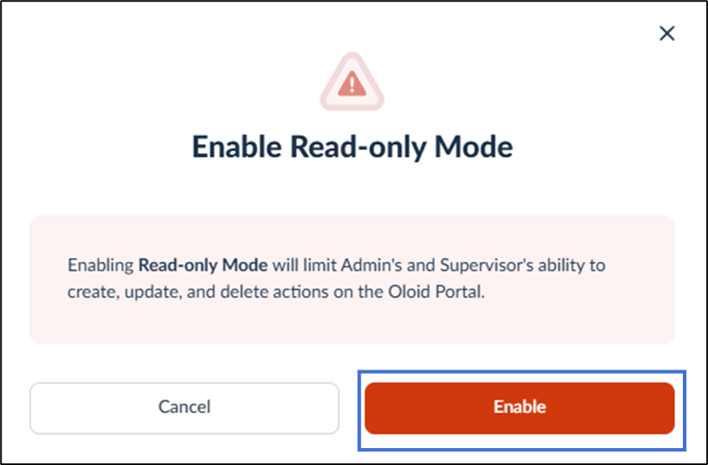
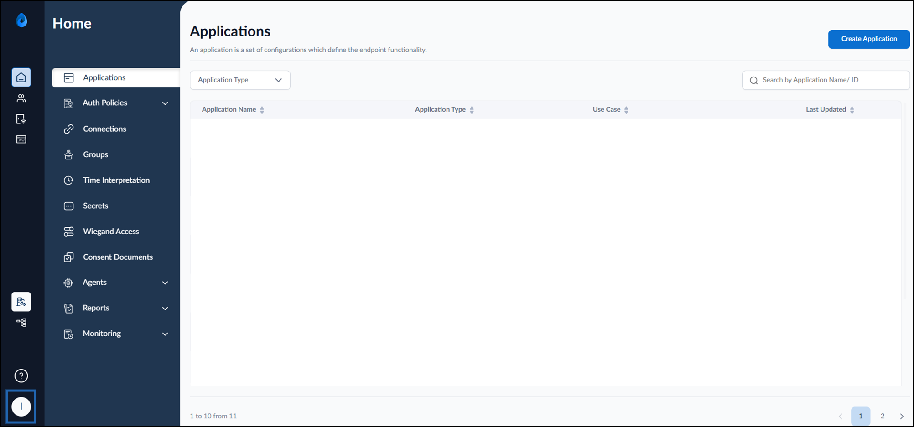
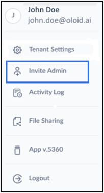
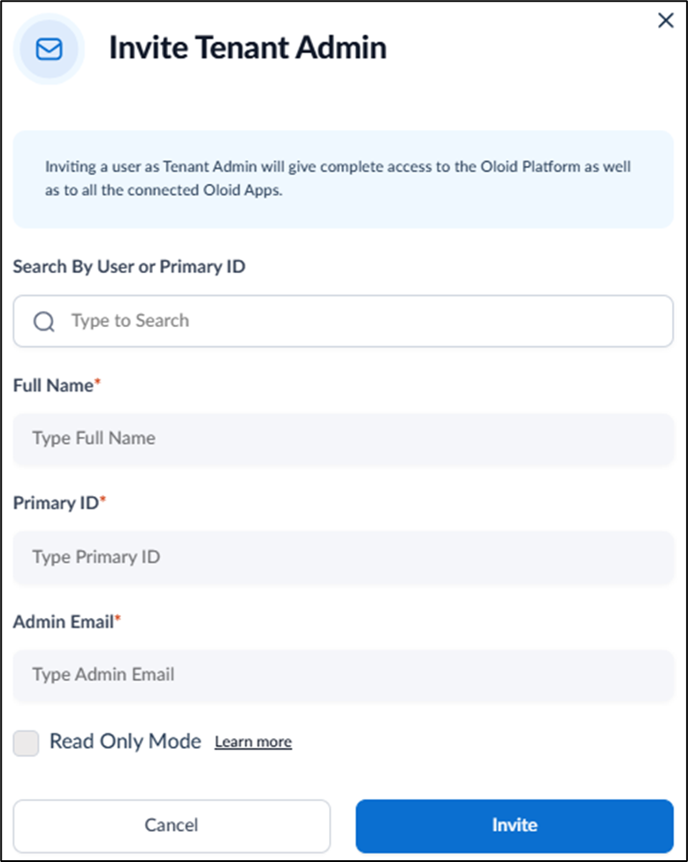
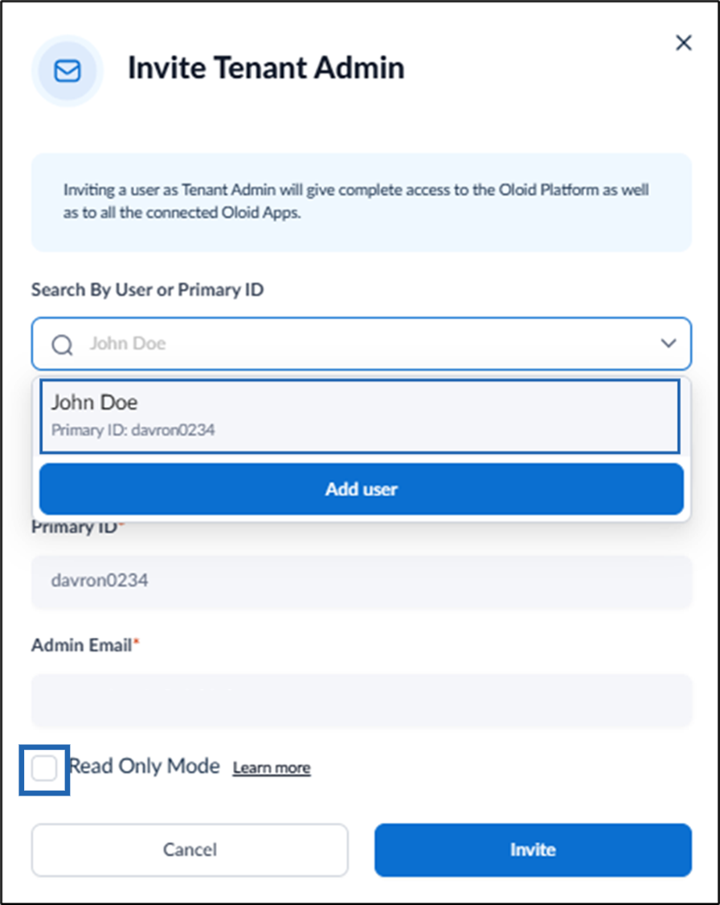
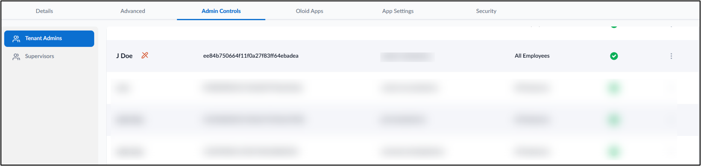

{/* Source: Intercom article 10660395 - https://oloid.help/en/articles/10660395-tenant-admin-portal-how-to-enable-read-only-mode-for-tenant-admin */}
{/* Generated by intercom_to_mintlify.py - re-running overwrites this file. */}

## Introduction

**Read-only Mode** allows Admin to view configurations, Activity Logs, and Transactions logs. Admin can download the Transaction reports.

## Prerequisites

- You must have Tenant Admin access to the **Tenant Admin Portal**.
- The user must be an existing Tenant Admin.

## Steps to enable Read-only Mode for existing Tenant Admin

1. Log in to the **Tenant Admin Portal**.
2. On the homepage of the portal, click **user profile icon** on the bottom left corner of the menu panel.

   

   The user profile menu is displayed.
3. Click **Tenant Settings**.

   

   The **Tenant Settings** page is displayed.
4. Go to **Admin Controls** tab.

   

5. In the **Tenant Admins** tab, click **kebab menu** (three vertical dots) and select **Enable Read-Only Mode** for the particular Tenant Admin.

   

   The **Enable Read-only Mode** confirmation pop-up box is displayed.
6. Click **Enable**.

   

   The Read-only Mode is enabled for the admin successfully.

   

<Note>
  **Note:** Once the Read-only mode is enabled, the admin cannot perform any action. A Read-only disclaimer is displayed at the top of every web page, and an editing disabled icon () is displayed next to the user name.
</Note>

## Steps to Enable Read-only Mode while inviting Tenant Admin

1. Log in to the **Tenant Admin Portal**.
2. On the homepage of the portal, click **user profile icon** on the bottom left.

   

   The **user profile menu** is displayed.
3. Click **Invite Admin**.

   

   The **Invite Tenant Admin** pop-up box is displayed.

   

4. On the pop-up box, do the following:
   1. Enter **User name** or **Primary ID** of existing User in the search field.
   2. Select the accurate user name from the drop-down list.
   3. Select **Read Only Mode** to restrict the admin from performing any action in the Tenant Admin Portal.

Select **Invite.**

---

4. The user is successfully invited as a Tenant Admin with Read-only Mode enabled.

   

   <Note>
     **Note:** Once the Read-only mode is enabled, the admin cannot perform any action. A Read-only disclaimer is displayed at the top of every web page, and an editing disabled icon () is displayed next to the user name.
   </Note>
