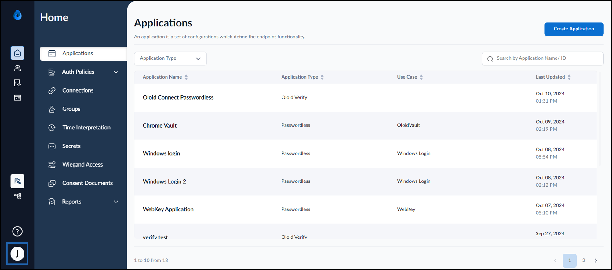
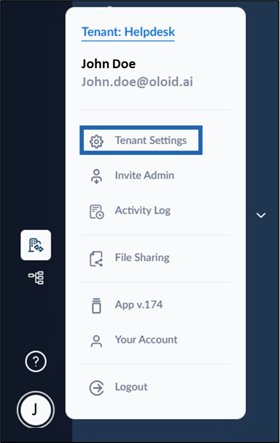
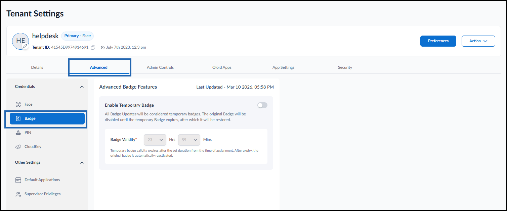
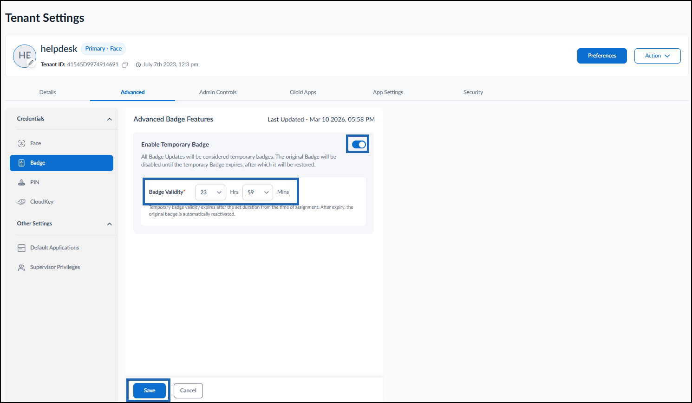
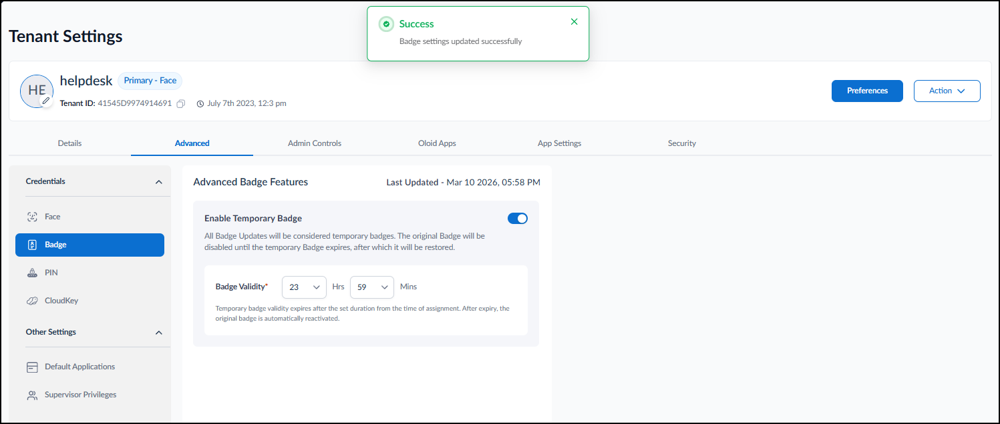

{/* Source: Intercom article 14066354 - https://oloid.help/en/articles/14066354-tenant-admin-portal-how-to-enable-temporary-badge-in-the-tenant-admin-portal */}
{/* Generated by intercom_to_mintlify.py - re-running overwrites this file. */}

## Introduction

This document explains how to **enable and configure a Temporary Badge in the Tenant Admin Portal**. The Temporary Badge feature allows configuration of a badge credential with a defined validity period for badge authentication.

## Prerequisite

You must have **access** to the Tenant Admin Portal.

## Steps to Enable the Temporary Badge

1. Log in to the **Tenant Admin Portal**.
2. On the homepage of the portal, click **user profile icon** on the bottom left corner of the menu panel.

   

   The user profile menu is displayed.
3. Select **Tenant Settings**.

   

   The **Tenant Settings** page is displayed.
4. Go to **Advanced** tab > **Badge**.
   The **Advanced Badge Features** section is displayed.

   

5. Do the following:
   1. Turn on the **Enable Temporary Badge** toggle.

      <Note>
        **Note:** When a temporary badge is assigned, the original badge becomes inactive. After the temporary badge expires, the original badge becomes active again.
      </Note>

   2. Select the **Badge Validity** from the drop-down button.

      <Note>
        **Note:** The maximum badge validity that can be configured is 23 hours and 59 minutes.
      </Note>

   3. Click **Save**.

      

The Temporary Badge is enabled successfully.

##### Related Document

   [How to Assign Temporary Badge to a User in the Tenant Admin Portal](/platform/tenant-admin-portal/how-to-assign-temporary-badge-to-a-user-in-the-tenant-admin-portal)
