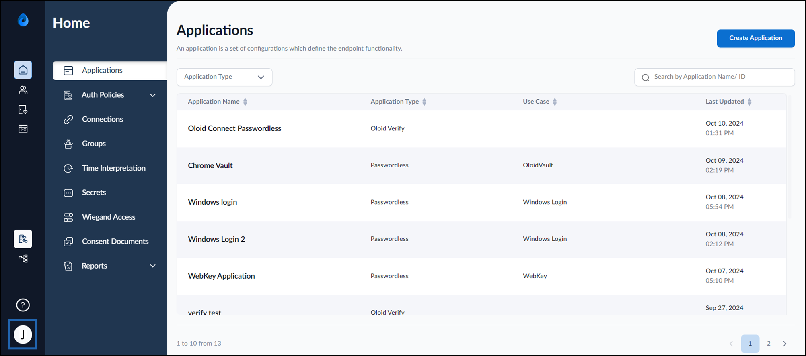
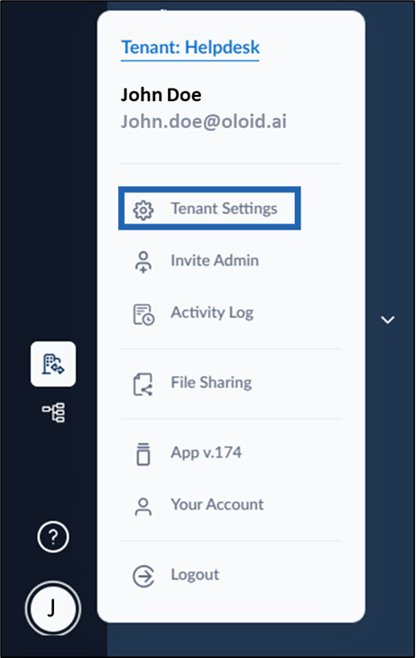
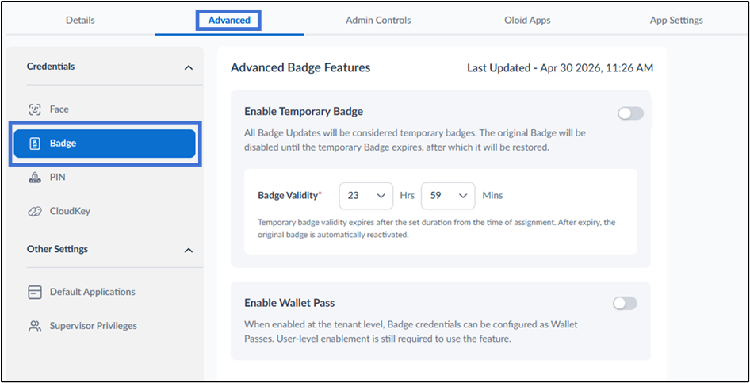
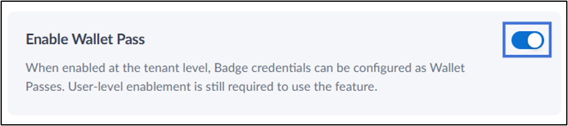
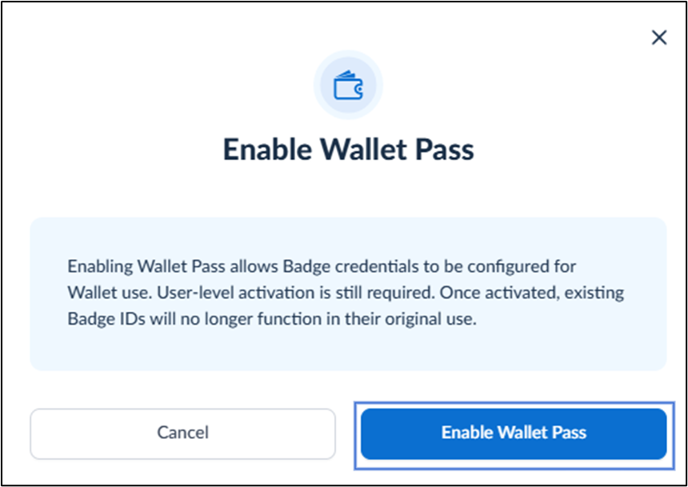
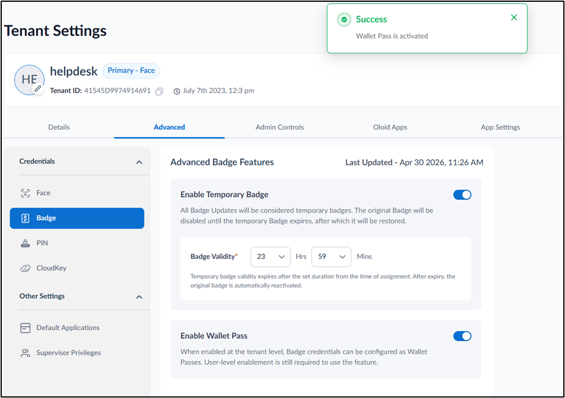

{/* Source: Intercom article 14885173 - https://oloid.help/en/articles/14885173-tenant-admin-portal-how-to-enable-wallet-pass */}
{/* Generated by intercom_to_mintlify.py - re-running overwrites this file. */}

## Introduction

This document explains how to enable wallet pass **in the Tenant Admin Portal**. By enabling Wallet Pass in the Tenant Admin Portal, administrators can make wallet-based Badge credential available to users.

## Prerequisite

You must have access to the Tenant Admin Portal.

## Steps to Enable Wallet Pass

1. Log in to the **Tenant Admin Portal**.
2. On the homepage of the portal, click **user profile icon** on the bottom left corner of the menu panel.

   

   The user profile menu is displayed.
3. Select **Tenant Settings**.

   

   The **Tenant Settings** page is displayed.
4. Go to **Advanced** tab > **Badge**.

   

   The **Advanced Badge Features** section is displayed.
5. **Enable Wallet Pass** toggle.

   

   The **Enable Wallet Pass** pop-up box is displayed.

Select **Enable Wallet Pass.**

The Wallet Pass is enabled successfully.

