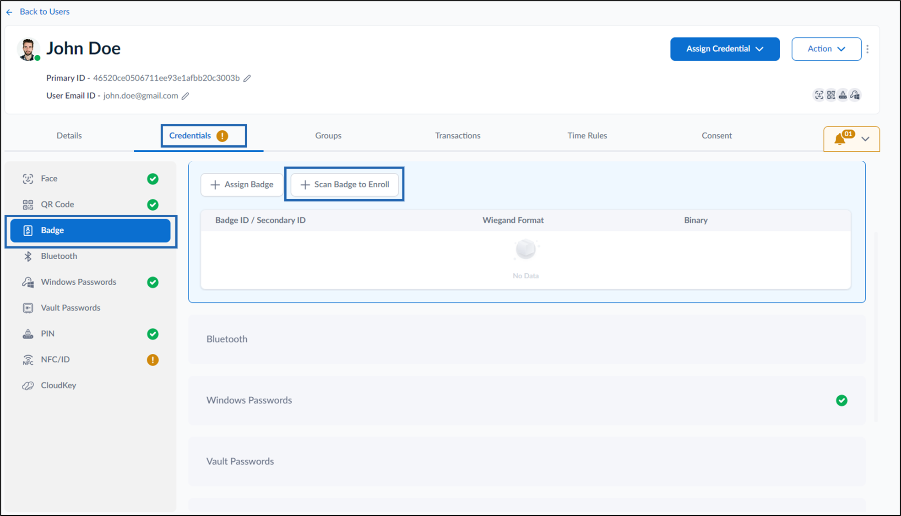
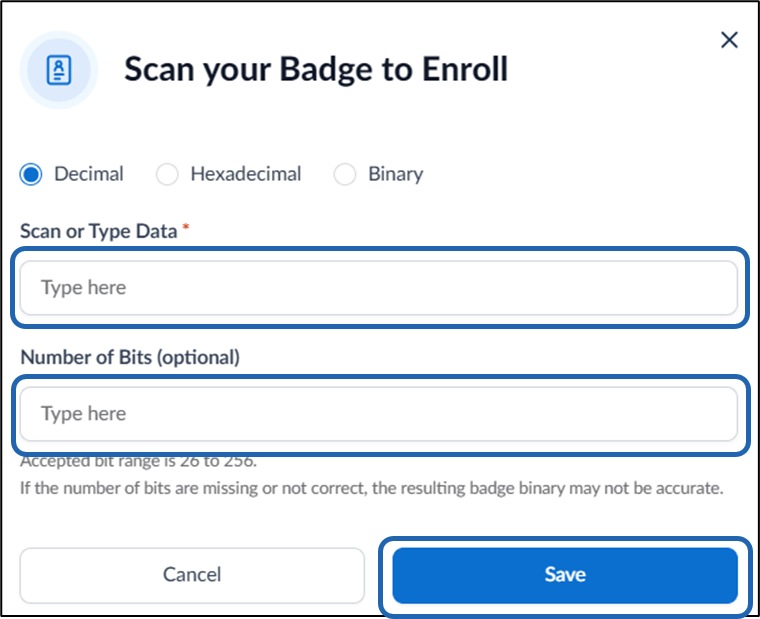
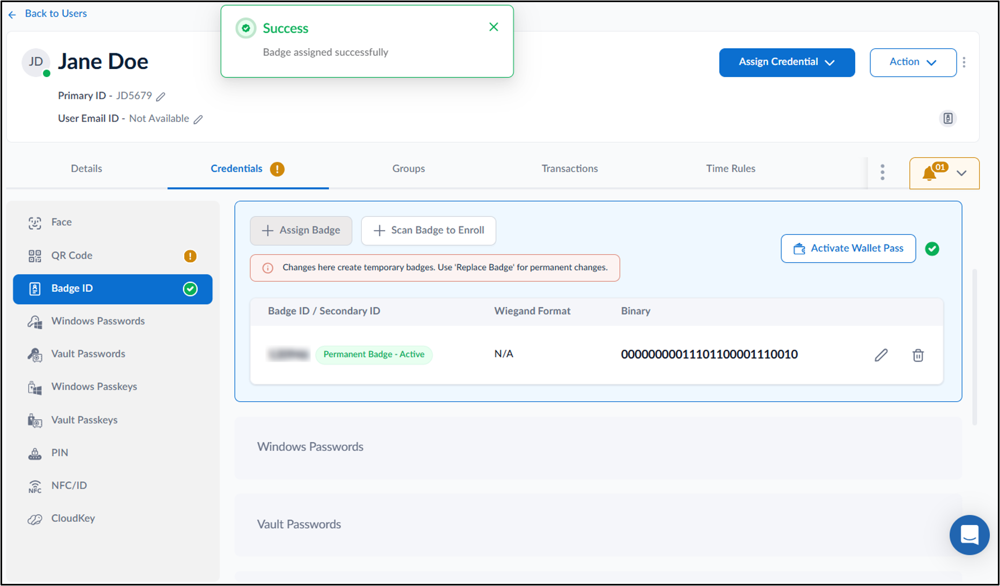

{/* Source: Intercom article 8937141 - https://oloid.help/en/articles/8937141-tenant-admin-portal-how-to-enroll-a-badge-for-a-user */}
{/* Generated by intercom_to_mintlify.py - re-running overwrites this file. */}

## Introduction

This document provides instructions to enroll a user's badge using badge scan in the Tenant Admin Portal.

## Prerequisites

- You must have admin access to the Tenant Admin Portal.
- The user must already be created in the Tenant Admin Portal.
- To scan a badge, a card reader must be connected to your device.

## Steps to enroll user using badge scan

1. Log in to the **Tenant Admin Portal**.
2. On the home page of the portal, click **Directory** on the left menu panel.

   

   The **Users** page is displayed.
3. Click preferred **Username** to edit.

   

   The **user details** page is displayed.

   

4. Go to **Credentials** tab > **Badge** > **+ Scan Badge to Enroll**.

   

   The **Scan your Badge to Enroll** pop-up box is displayed.
5. On the pop-up box, do the following:
   1. Select the preferred badge format (**Decimal**, **Hexadecimal**, or **Binary**).

      <Note>
        **Note:** Make sure to select the badge format (**Decimal**, **Hexadecimal**, or **Binary**) that matches the badge you are scanning.
      </Note>

   2. Enter your badge ID by scanning your badge or manually type it in the **Scan or Type Data** field.

      <Note>
        **Note:** To scan the badge, card reader should be connected to your device.
      </Note>

   3. Enter the bits in the **Number of Bits** field. (Optional)
   4. Click **Save**.

      

      The badge is assigned to the user successfully and displayed on the Badge tab.

      
