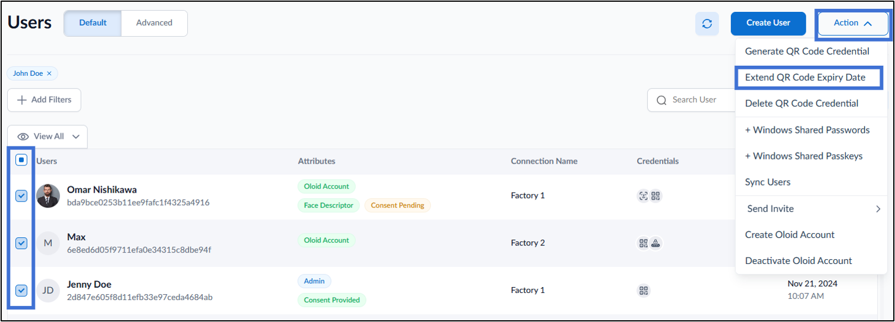
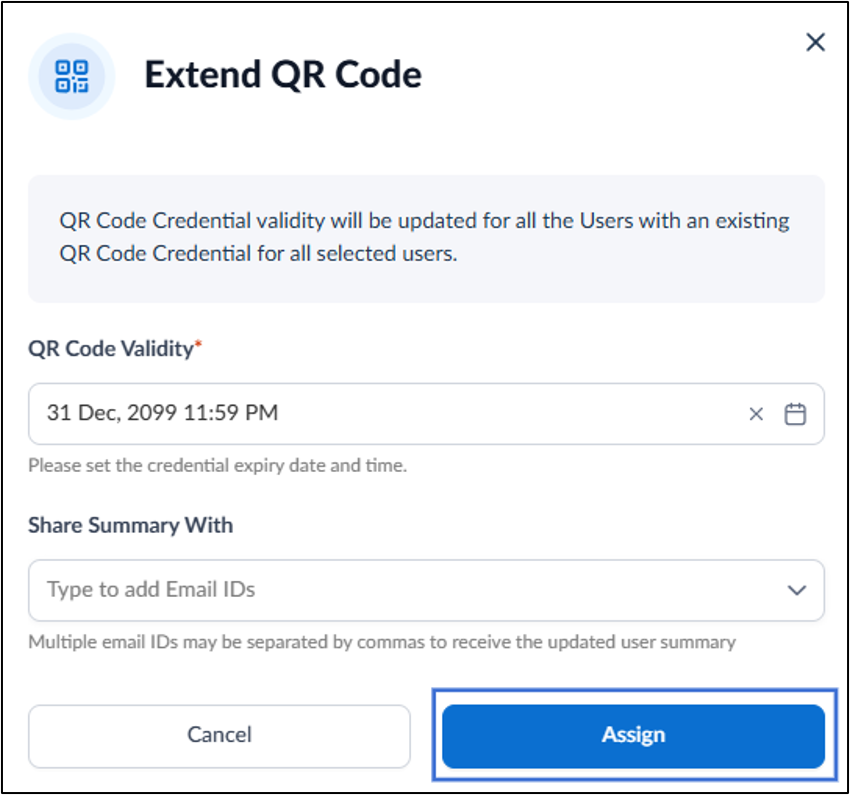

{/* Source: Intercom article 8479750 - https://oloid.help/en/articles/8479750-tenant-admin-portal-how-to-extend-qr-code-expiry-date-in-bulk */}
{/* Generated by intercom_to_mintlify.py - re-running overwrites this file. */}

## Introduction

QR Code credentials can be configured with a specific validity period for user authentication. When the expiry date of QR Code credentials needs to be extended for multiple users, Tenant Admins can update the validity period in bulk from the Tenant Admin Portal.

## Prerequisites

- You must have Tenant admin access to the Tenant Admin Portal.
- Users must have QR code credentials assigned to extend their QR codes. For more information, refer: [Tenant Admin Portal - How to Create and Share QR Code Credential with User](/platform/tenant-admin-portal/tenant-admin-portal-how-to-create-and-share-qr-code-credential-with)

## Steps to Extend QR Code Expiry Dates in Bulk

1. Log in to the **Tenant Admin Portal**.
2. On the home page of the portal, click **Directory** on the left menu panel.

   

   The **Users** page is displayed.
3. Select users.
4. Go to **Action** > **Extend QR Code Expiry Date**.

   

   The **Extend QR Code** pop-up box is displayed.
5. In the **Extend QR Code** pop-up window, do the following:
   1. In the **QR Code Validity** field, select the new expiry date and time using the calendar icon.
   2. In the **Share Summary With** field, enter the email address(es) with whom you want to share the QR Code summary (**optional**).
   3. Click **Assign**.

      

      The QR Code credential is successfully extended for the selected users. The QR Code summary of these users is shared over email ID(s) and is available for download in the attachments.

      
