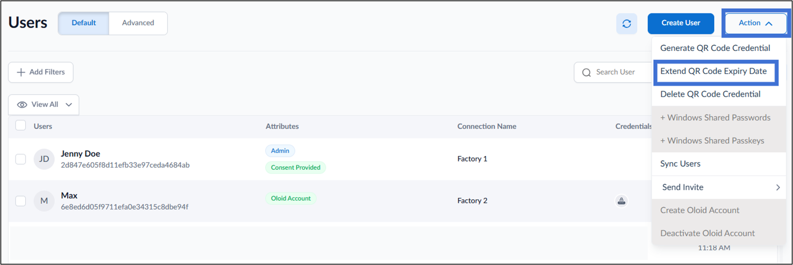
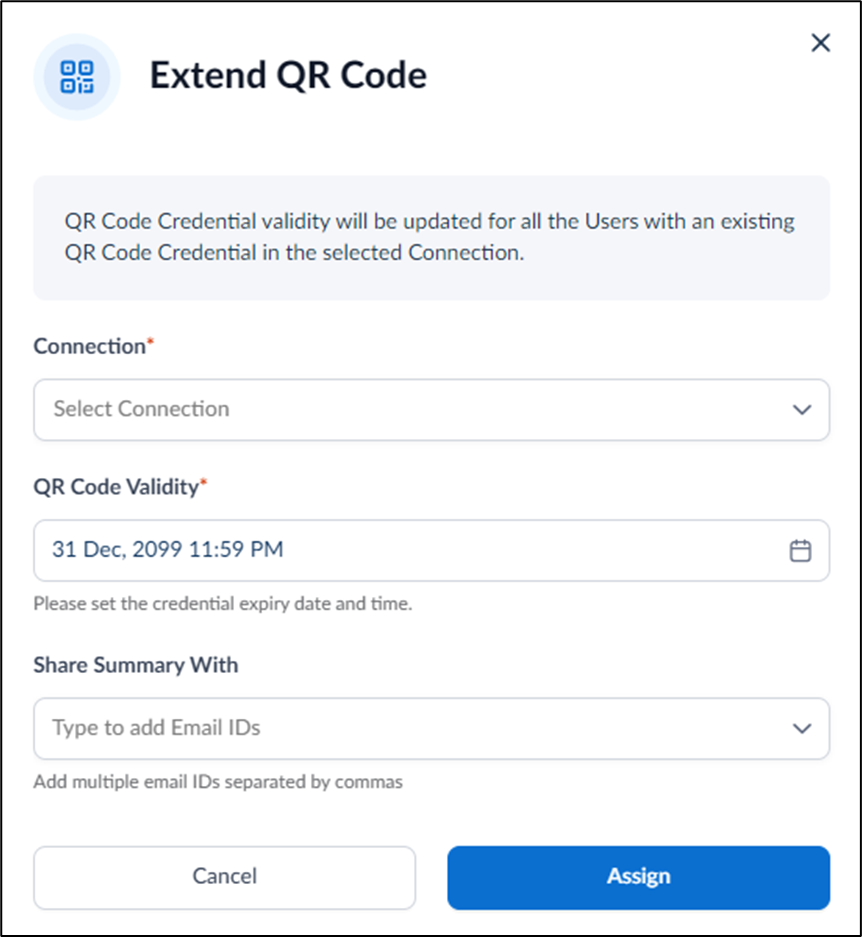

{/* Source: Intercom article 8479549 - https://oloid.help/en/articles/8479549-tenant-admin-portal-how-to-extend-qr-code-expiry-date-of-users-in-a-connection */}
{/* Generated by intercom_to_mintlify.py - re-running overwrites this file. */}

## Introduction

This document provides instructions to **extend the expiry date of QR Code credentials for users in a selected Connection** in the Tenant Admin Portal. You can select the Connection, update the QR Code validity date and time.

## Prerequisite

You must have Tenant Admin Access.

## Steps to Extend QR Code expiry date for a Connection

1. Log in to the **Tenant Admin Portal**.
2. On the home page of the portal, click **Directory** on the left menu panel.

   

   The **Users** page is displayed.
3. Go to **Action** > **Extend QR Code Expiry Date**.

   

   The **Extend QR Code** pop-up box is displayed.
4. On the pop-up box, do the following:
   1. Select a connection from the **Connection** dropdown list.
   2. Under **QR Code Validity** field adjust the date and time from the calendar icon.
   3. Under **Share Summary With** field enter the email ID(s) with whom you want to share the QR Code summary. (**optional**)
   4. Click **Assign**.

      

The QR Code is successfully extended for users in the selected connection. The QR Code summary of these users is shared over email ID(s) and is available for download in the attachments.

##### Video Tutorial

   Watch the video[How to extend QR Code expiry date of Users in a Connection-Video Tutorial](/platform/supervisor-portal/videos/how-to-extend-qr-code-expiry-date-of-users-in-a-connection-video)
