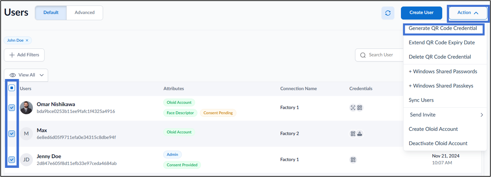
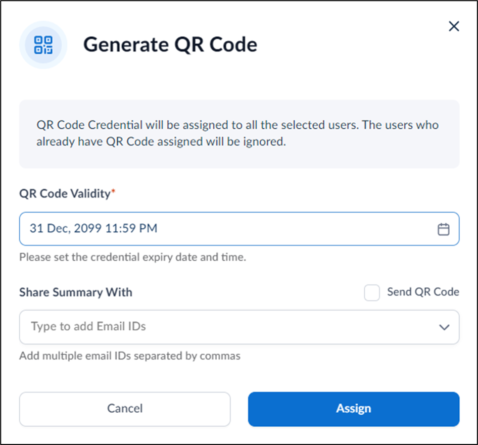

{/* Source: Intercom article 8469163 - https://oloid.help/en/articles/8469163-tenant-admin-portal-how-to-generate-qr-code-in-bulk */}
{/* Generated by intercom_to_mintlify.py - re-running overwrites this file. */}

## Introduction

This document provides instructions to generate and assign **QR Code credentials in bulk** to multiple users in the Tenant Admin Portal.

## Prerequisite

You must have Tenant Admin Access.

## Steps to Generate QR Code in Bulk

1. Log in to the **Tenant Admin Portal**.
2. On the home page of the portal, click **Directory** on the left menu panel.

   

   The **Users** page is displayed.
3. Select user(s) to generate QR Code.
4. Go to **Action > Generate QR Code Credential**.

   

   The **Generate QR Code** pop-up box is displayed.
5. Do the following:
   1. Under **QR Code Validity** field adjust the date and time from the calendar icon.
   2. Under **Share Summary With** field enter the email ID(s) with whom you want to share the QR Code summary.(**optional**)
   3. Select **Send QR Code** to get the generated QR codes with summary. (**optional**)
   4. Click **Assign**.

      

      The QR Code credential is successfully assigned to the users. The QR Code summary of these users is shared over email ID(s) and is available for download in the attachments.

      
