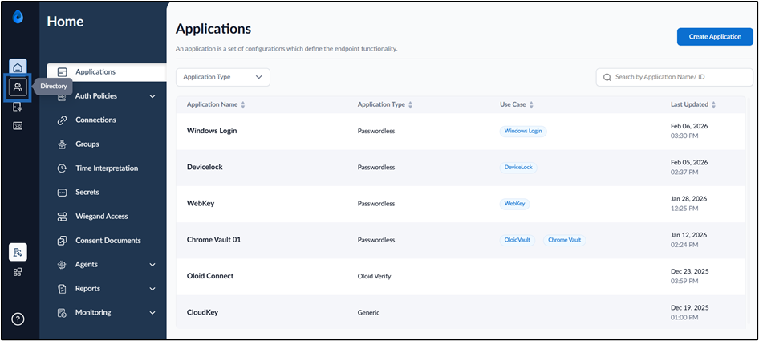
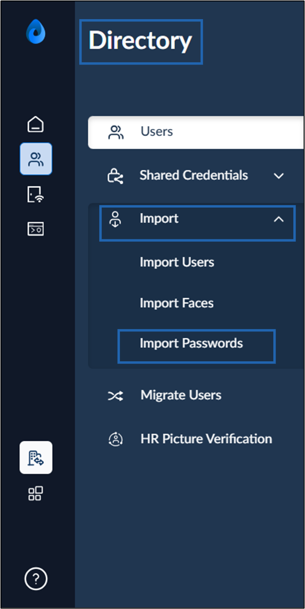
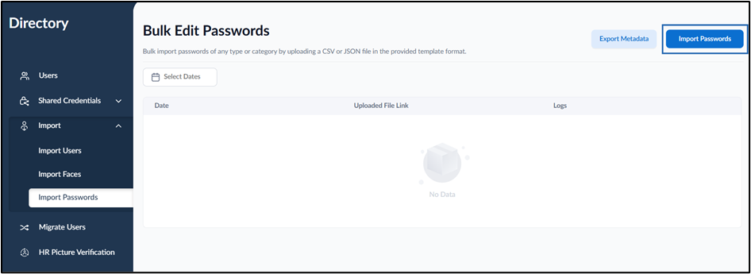
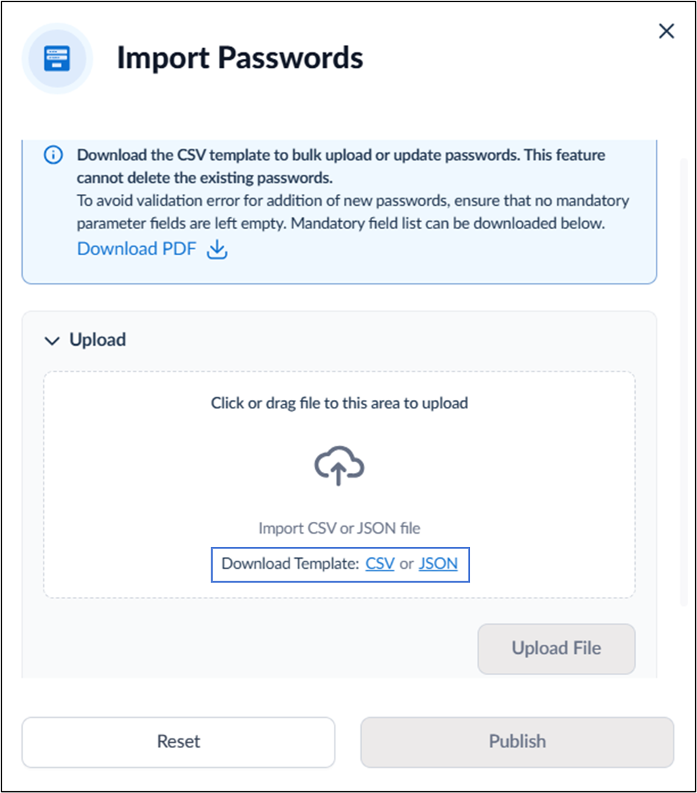
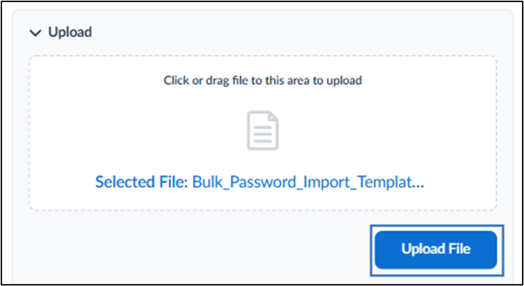
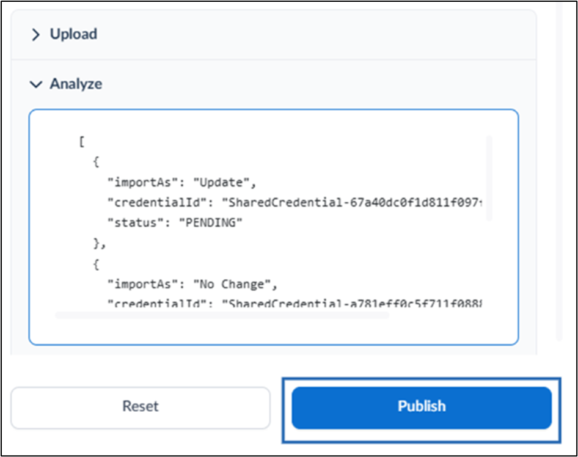
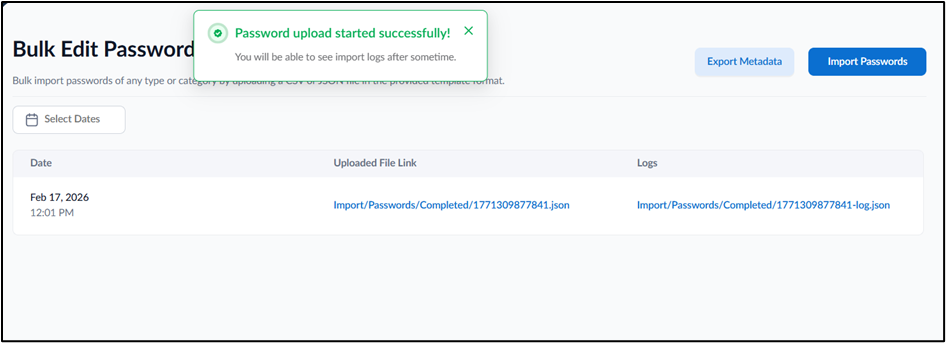
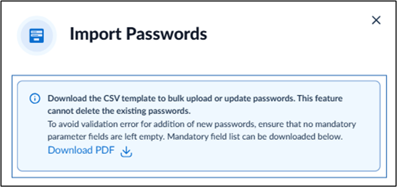

{/* Source: Intercom article 13714002 - https://oloid.help/en/articles/13714002-tenant-admin-portal-how-to-import-bulk-passwords */}
{/* Generated by intercom_to_mintlify.py - re-running overwrites this file. */}

## Introduction

This document provides instructions to import Passwords in bulk using the **Import Passwords** feature in the Tenant Admin Portal. This process allows admin to upload multiple shared credentials at once instead of creating them manually.

## Prerequisites

- You must have Tenant Admin access to the Tenant Admin Portal.
- The shared credential file must be prepared in the supported format (for example, CSV or JSON applicable)

## Steps to Import Bulk Passwords

1. Log in to the **Tenant Admin Portal**.
2. On the homepage of the portal, click **Directory icon** on the bottom left corner of the menu panel.

   

   The **Directory** Panel is displayed.
3. On the **Directory** Panel > Go to **Import** > Select **Import Passwords.**

   

   The **Bulk Edit passwords** page is displayed.
4. On the **Bulk Edit passwords** page, Click **Import Passwords.**

   

   The **Import Passwords** pop up box is displayed.
5. In the **Upload** section, Do one of the following:
   1. Click **CSV** to download the CSV file template.
      Or
   2. Click **JSON** to download the JSON file template.

      

      The CSV or JSON template file is downloaded to your system.
6. Prepare the CSV or JSON template file for upload.

   <Note>
     **Note:** Update only the mandatory fields in the CSV or JSON template file. Delete all non-applicable columns before uploading the file. Mandatory fields vary based on the password type (Windows or Vault, Individual or Shared). Before updating the template, download and review the mandatory fields PDF. For more information, Refer to [Review Mandatory Fields (PDF)](#review-mandatory-fields-pdf)
   </Note>

   The CSV or JSON template file is prepared successfully.
7. On the **Import Passwords** page, drag and drop the file or click on the **Import CSV or JSON file** area to upload your prepared CSV or JSON file.
8. Click **Upload File**.

   

   The system analyses the file and validates the data.
9. Review the validation results.
10. If there are no errors, click **Publish** to complete the import.

The bulk password import has completed successfully. Import logs are available for review.

### Review Mandatory Fields (PDF)

The Review Mandatory Fields (PDF) feature allows Admins to download and review the required fields for supported password types before updating and uploading the CSV or JSON template file.

1. On the **Import Passwords** page, locate the banner at the top.
2. Click **Download PDF**.
3. Review the mandatory fields for the following password types in the downloaded PDF:
   - **Windows Individual Passwords**
   - **Windows Shared Passwords**
   - **Vault Individual Passwords**
   - **Vault Shared Passwords**

     

     <Note>
       **Note:** Use the downloaded PDF as a reference while updating the CSV or JSON file. Ensure that all mandatory fields are populated in the file before uploading.
     </Note>

---

##### Keywords

|Bulk password import |Import passwords |Import passwords from CSV file |Import passwords from JSON file|
