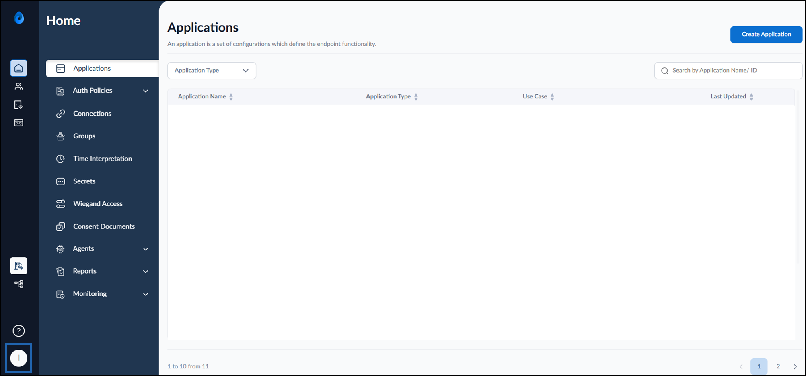
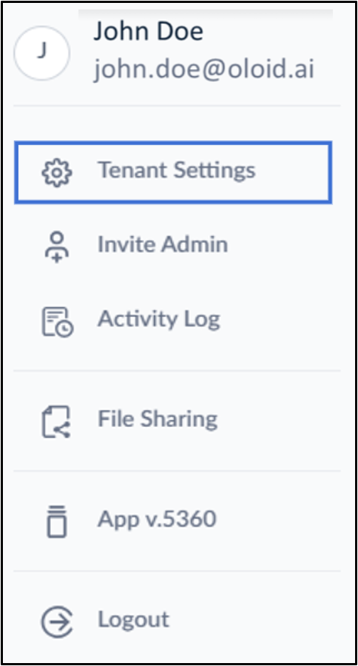
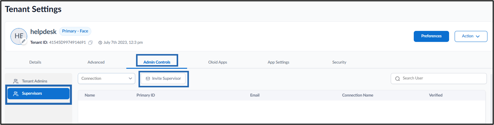
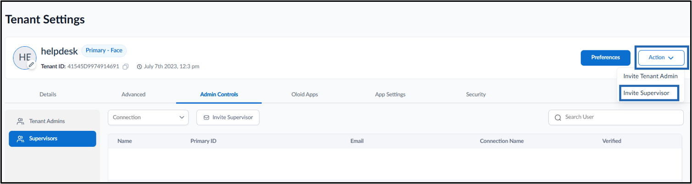
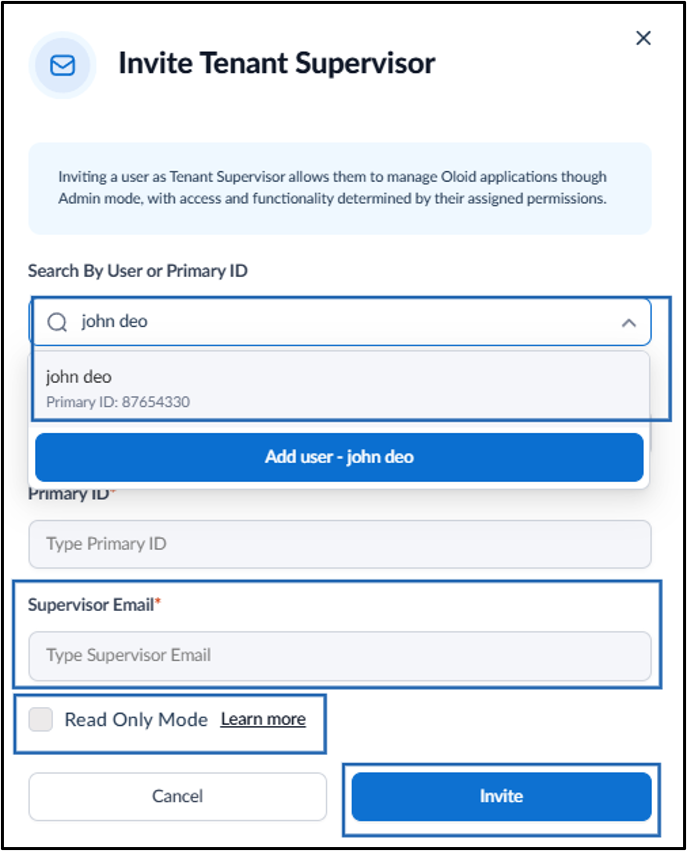
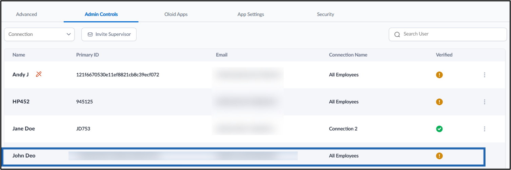

{/* Source: Intercom article 8231811 - https://oloid.help/en/articles/8231811-tenant-admin-portal-how-to-invite-a-supervisor */}
{/* Generated by intercom_to_mintlify.py - re-running overwrites this file. */}

## Introduction

This document provides instructions to invite a user as a Supervisor in the Tenant Admin Portal. A Supervisor has limited access to the Tenant Admin Portal and Oloid-connected devices.

## Prerequisites

- You must be a Tenant Admin to invite a user as Tenant Supervisor.
- The user you want to invite must already exist in the Tenant Admin Portal.

  <Note>
    **Note:** If the user does not exist in the Tenant Admin Portal, add the user before inviting them as a Supervisor. For more information, see [How to add and invite a Supervisor](/platform/tenant-admin-portal/how-to-add-and-invite-a-supervisor).
  </Note>

## Steps to Invite a Supervisor

1. Log in to the **Tenant Admin Portal**.
2. On the homepage of the portal, click **user profile icon** on the bottom left.

   

   The user profile menu is displayed.
3. Click **Tenant Settings**.

   

   The **Tenant Settings** page is displayed.
4. On the **Tenant Settings** page, do one of the following:
   1. Go to **Admin Controls** > **Supervisors** > **Invite Supervisor**.

      

      OR
   2. Click **Action** > **Invite Supervisor**.

      

      The **Invite Tenant Supervisor** pop-up box is displayed.
5. Do the following:
   1. Enter **User name** or **Primary ID** of existing user in the search field.

      <Note>
        **Note:** Enter the exact **User Name** or **Primary ID**.
      </Note>

   2. Enter **Supervisor Email**.
   3. Select **Read Only Mode** to restrict the Supervisor from performing any action. (Optional)
   4. Click **Invite**.

      

      The tenant supervisor is listed on the **Supervisors** tab. An invite email is sent to the user for verification.

      

##### Video Tutorial

[How to invite a supervisor in Tenant Admin Portal-Video Tutorial](/platform/tenant-admin-portal/videos/how-to-invite-a-supervisor-in-tenant-admin-portal-video-tutorial)
