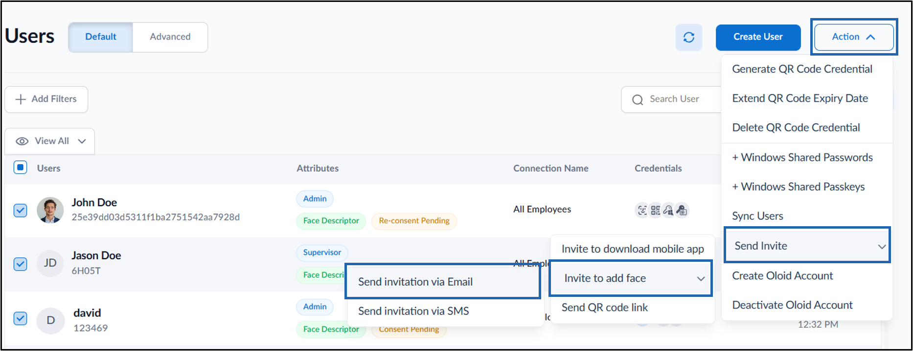
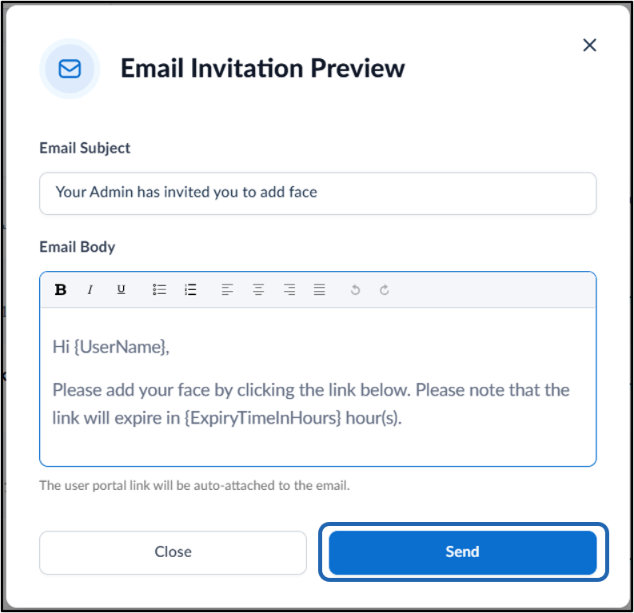
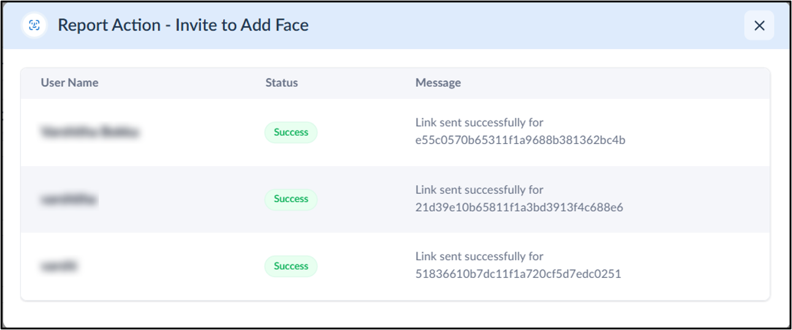
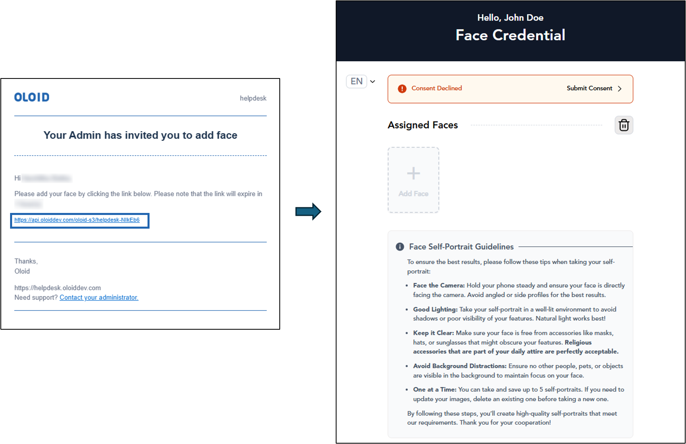

{/* Source: Intercom article 8379556 - https://oloid.help/en/articles/8379556-tenant-admin-portal-how-to-invite-to-add-face-in-bulk */}
{/* Generated by intercom_to_mintlify.py - re-running overwrites this file. */}

## Introduction

This document provides instructions to Invite to Add Face in Bulk in the Tenant Admin Portal.

## Prerequisites

- You must have admin access to Tenant Admin Portal.
- User must be created. For more, refer to [Tenant Admin Portal - How to Create User](/platform/tenant-admin-portal/tenant-admin-portal-how-to-create-user)

## Steps to Invite to Add Face in Bulk

1. Log in to the **Tenant Admin Portal**.
2. On the home page of the portal, click **Directory** on the left menu panel.

   

   The **Users** page is displayed.
3. Select the preferred users from the list.
4. On top right, click **Action** > **Send Invite** > **Invite to add face> Send invitation via E-mail**.

   

   An **Email Invitation Preview** pop-up box is displayed.
5. Click **Send**.

   

   An email invite link is sent to the user successfully.

   

   <Note>
     **Note:** Please enroll your face within the time mentioned in this email. After that, the link will expire.
   </Note>

   

   To upload face using the invite link, refer [How to add face using the invite link](/platform/user-portal/oloid-user-portal-how-to-add-a-face-using-invite-link)
