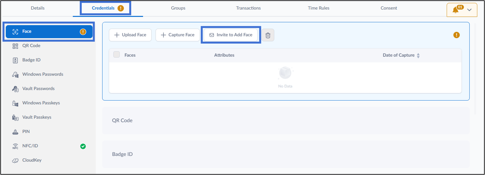
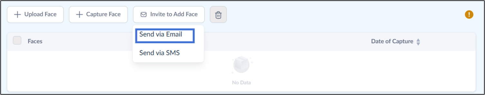
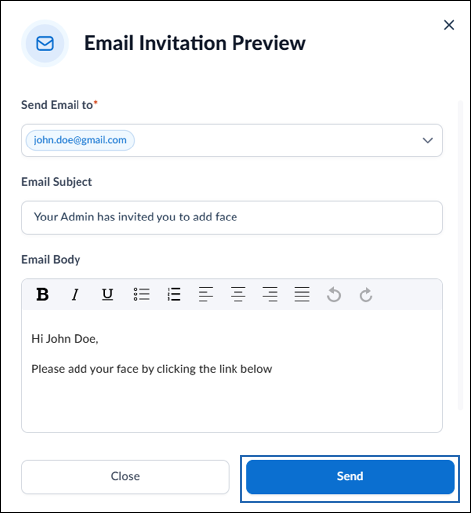
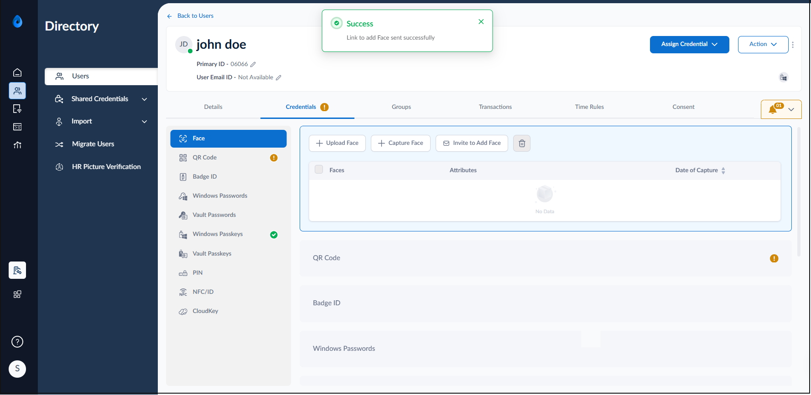
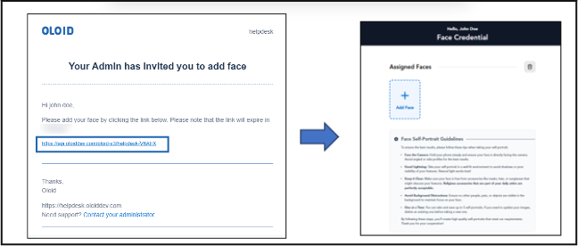
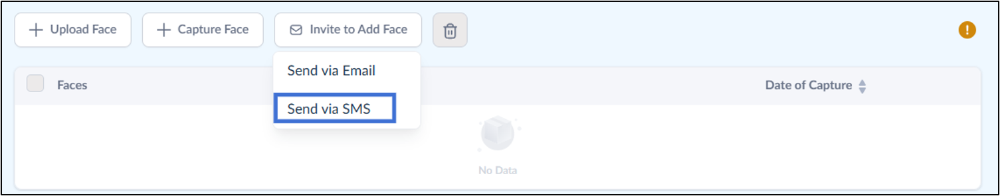
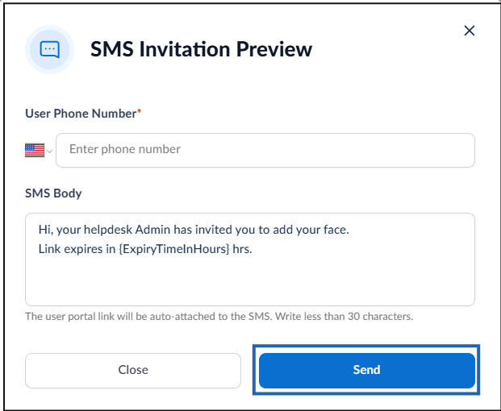
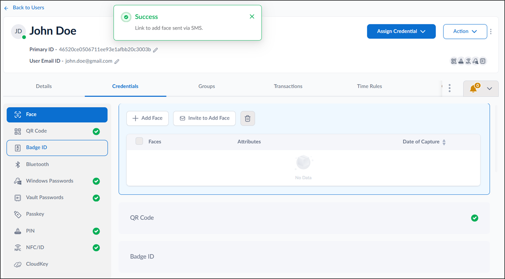
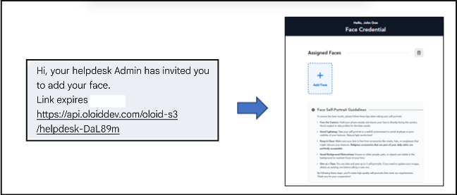

{/* Source: Intercom article 8398578 - https://oloid.help/en/articles/8398578-tenant-admin-portal-how-to-invite-to-add-face-via-email-sms-to-user */}
{/* Generated by intercom_to_mintlify.py - re-running overwrites this file. */}

## Introduction

This document provides step-by-step instructions to invite a user to add their face via email or SMS in the Tenant Admin Portal.

## Prerequisites

- You must have admin access to the Tenant Admin Portal.
- User must be created in the tenant admin portal. For more, refer to[Tenant Admin Portal - How to Create User](/platform/tenant-admin-portal/tenant-admin-portal-how-to-create-user)
- Face must be enabled in the Oloid User Portal setting For sending Invitation to Add Facevia **Email/SMS** button to be available. For more information, refer to [How to Configure Oloid User Portal in the Tenant Admin Portal](/platform/tenant-admin-portal/oloid-user-portal-how-to-configure-oloid-user-portal-in-tenant-admin).

## Steps to Send an Invite to Add a Face

1. Log in to the **Tenant Admin Portal**.
2. On the home page of the portal, click **Directory** on the left menu panel.

   

   The **Users** page is displayed.
3. Click **username** to edit.

   

   The user details page is displayed.

   

4. Go to **Credentials** > **Face** > **Invite to Add Face.**

   

5. Do one of the following:
   1. [Send an invitation via Email.](#send-an-invitation-via-email)
      OR
   2. [Send an invitation via SMS.](#send-an-invitation-via-sms)

### Send an Invitation via Email

This section explains how to invite users to upload their face by sending an invitation link via email.

1. Click **Invite to Add Face >** Select **Send via Email**.

   

   The **Email Invitation Preview** pop-up box is displayed.
2. Do the following:
   1. Enter the recipient's email ID(s) in the **Send Email to** field.
   2. Edit **Email Subject** field. (Optional)
   3. Edit **Email Body** field. (Optional)
   4. Click **Send**.

      

      An email with invite link is sent successfully to user to upload their face.

      

      <Note>
        **Note:** Please add your Face within the time mentioned in this email. After that, the link will expire.
      </Note>

      

### Send an Invitation via SMS

This section explains how to invite users to upload their face by sending an invitation link via SMS.

1. Click **Invite to Add Face >** Select **Send via SMS**.

   

   The **SMS Invitation Preview** pop-up box is displayed.
2. Do the following:
   1. Enter the **User's Phone Number** in the **Enter Phone Number** field.

      <Note>
        **Note:** Select the country icon to change the country code prefix.
      </Note>

   2. Edit **SMS Body** field. (Optional)
   3. Click **Send**.

      

      An SMS with invite link is sent successfully to the user to upload their face.

      

      <Note>
        **Note:** Please add your Face within the time mentioned in this SMS. After that, the link will expire.
      </Note>

      

      To upload face using the invite link, see [How to add face using the invite link](/platform/user-portal/oloid-user-portal-how-to-add-a-face-using-invite-link)

---

##### Video Tutorial

Watch the video[How to invite user to add face in the Tenant Admin Portal - Video Tutorial](/platform/tenant-admin-portal/videos/how-to-invite-user-to-add-face-in-the-tenant-admin-portal-video)
