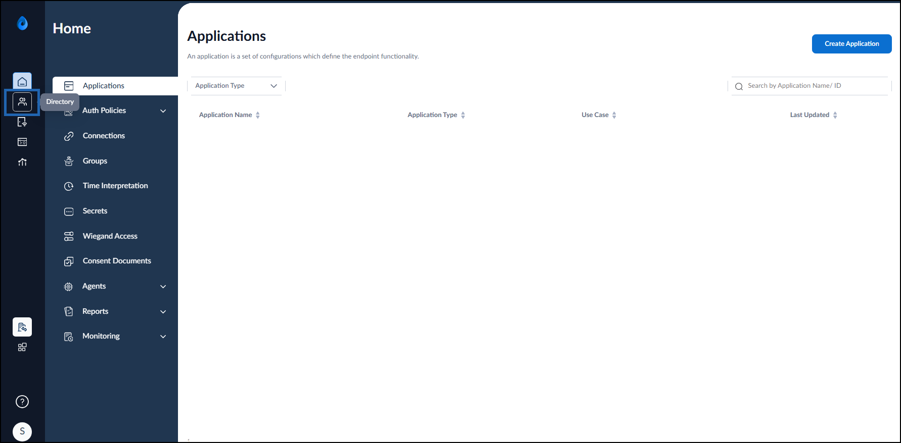
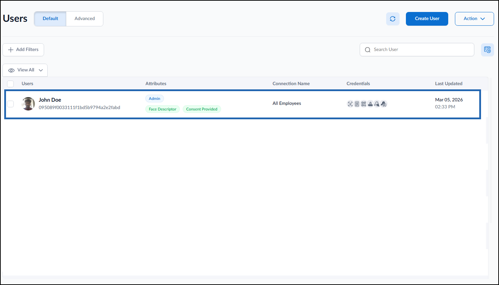
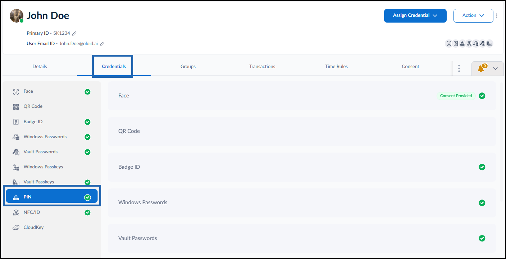
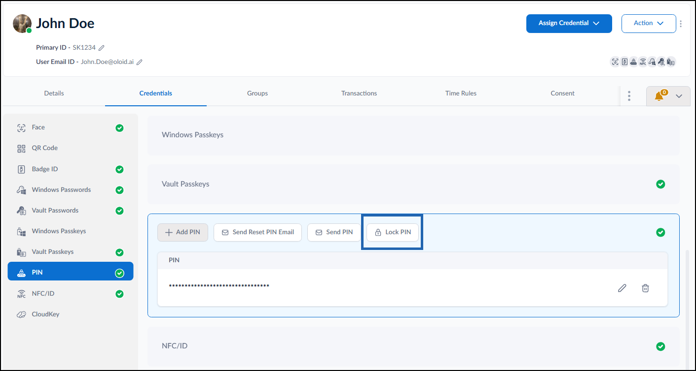
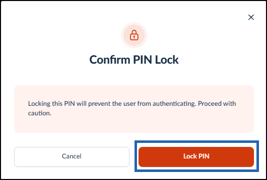
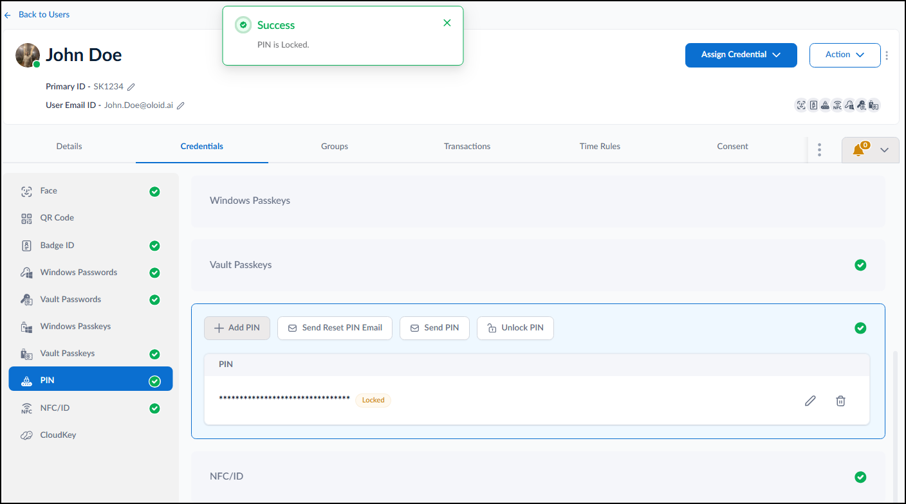

{/* Source: Intercom article 14014193 - https://oloid.help/en/articles/14014193-tenant-admin-portal-how-to-lock-pin-credential-for-a-user */}
{/* Generated by intercom_to_mintlify.py - re-running overwrites this file. */}

## Introduction

The **Lock PIN** feature allows the Tenant Admin to restrict the use of a user's PIN credential from the Tenant Admin Portal. Locking a PIN **prevents the user from authenticating with that credential** until it is unlocked or updated.

## Prerequisites

- You must have access to the **Tenant Admin Portal.**
- Ensure that the **PIN Lock** is enabled in the Tenant Settings. For further information, refer [PIN Lock Policy](/platform/tenant-admin-portal/tenant-admin-portal-how-to-configure-pin).

## Steps to Lock PIN of a User

1. Log in to the **Tenant Admin Portal**.
2. On the homepage, click **Directory** in the left navigation panel.

   

   The **Users** page is displayed.
3. Select the **user name** to edit.

   

   The **User Details** page is displayed.
4. Go to **Credentials** > **PIN**.

   

   The **PIN** section is displayed.
5. Click **Lock PIN**.

   <Note>
     **Note:** The PIN Lock Policy is used to configure the settings for locking a PIN after consecutive failed authentication attempts and defining the unlock behavior. For further information, refer [PIN Lock](/platform/tenant-admin-portal/tenant-admin-portal-how-to-configure-pin).
   </Note>

   

   The **Confirm PIN Lock** pop-up box is displayed.
6. Click **Lock PIN**.

   

   The PIN credential is locked successfully.

   

##### Related Document

[Tenant Admin Portal - How to Configure PIN](/platform/tenant-admin-portal/tenant-admin-portal-how-to-configure-pin)
