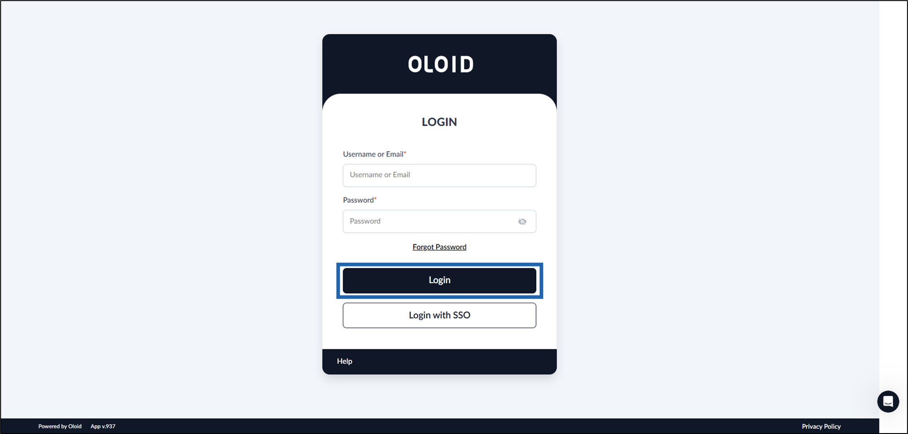
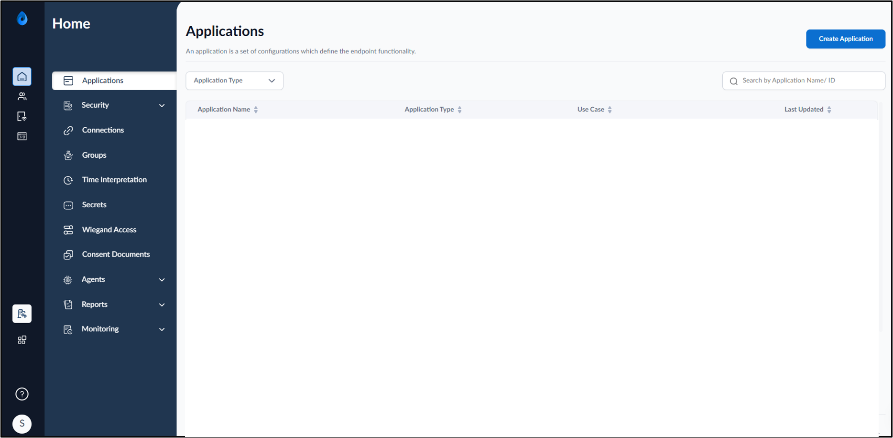

{/* Source: Intercom article 8462765 - https://oloid.help/en/articles/8462765-tenant-admin-portal-how-to-log-in-to-the-tenant-admin-portal */}
{/* Generated by intercom_to_mintlify.py - re-running overwrites this file. */}

## Introduction

This document provides instructions to log in to the **Tenant Admin Portal** using your Oloid account credentials.

## Prerequisite

You must be a user with Tenant Admin role.

## Steps to log in to the Tenant Admin Portal

1. Enter the URL provided for you in the browser’s address bar, and then press **Enter**.
   The Tenant Admin Portal **Login** page is displayed.
2. Do the following:
   1. Enter your **Username** or **Email**.
   2. Enter **Password**.
   3. Click **Login**.

      <Note>
        **Note:** You can also log in to the Tenant Admin Portal using a configured SSO or passwordless authentication method, such as, [Google](/more/sso-and-mfa/tenant-admin-portal-how-to-log-in-to-tenant-admin-portal-with-google), [Microsoft](/integrations/entra-id/tenant-admin-portal-how-to-log-in-to-tenant-admin-portal-with), [Okta](/more/sso-and-mfa/tenant-admin-portal-how-to-login-to-the-tenant-admin-portal-with-okta), [PingOne](/more/sso-and-mfa/tenant-admin-portal-how-to-login-to-the-tenant-admin-portal-with), [Auth0](/more/sso-and-mfa/how-to-log-in-to-tenant-admin-portal-using-auth0-sso), [Duo SSO](/more/sso-and-mfa/how-to-log-in-to-tenant-admin-portal-with-duo-sso), [Personal Passkey,](/more/passwordless-authenticator/tenant-admin-portal-how-to-log-into-tenant-admin-portal-using) [Webkey SSO](/platforms/web/webkey/webkey-how-to-login-to-tenant-admin-portal-with-oloid-webkey-sso) with your Email account.
      </Note>

      

      You are logged in to the Tenant Admin Portal successfully.

      
