{/* Source: Intercom article 8267045 - https://oloid.help/en/articles/8267045-tenant-admin-portal-how-to-map-user-to-a-group */}
{/* Generated by intercom_to_mintlify.py - re-running overwrites this file. */}

## Introduction

This document provides instructions to map user to a group in the Tenant Admin Portal. You can add user by adding a group to a user or by adding user to a group.

## Prerequisites

- You must have admin access to the Tenant Admin Portal.
- Ensure that the required user(s) and group(s) is(are) available in the Tenant Admin Portal.

## Steps to Map User to a Group

You can map user to a group using either of the following methods:

- Add Group to a User
- Add a User(s) to a Group

### Steps to Add a Group to a User

1. Log in to the **Tenant Admin Portal**.
2. On the home page, click **Directory** on the left menu panel.

   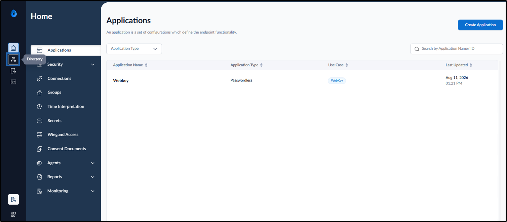

   The **Users** screen is displayed.
3. Click the preferred user name.

   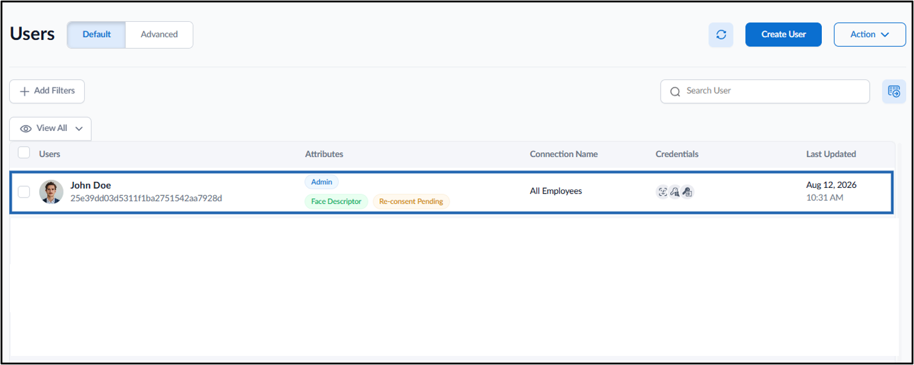

   The **User Details** page is displayed.

   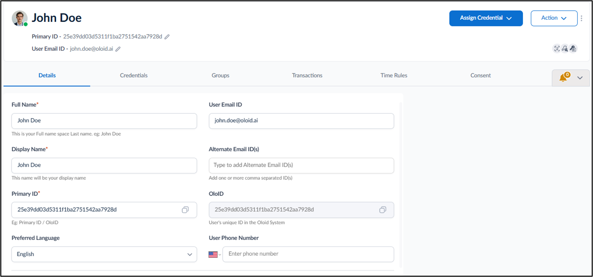

4. Click **Groups** > **+ Add Group**.

   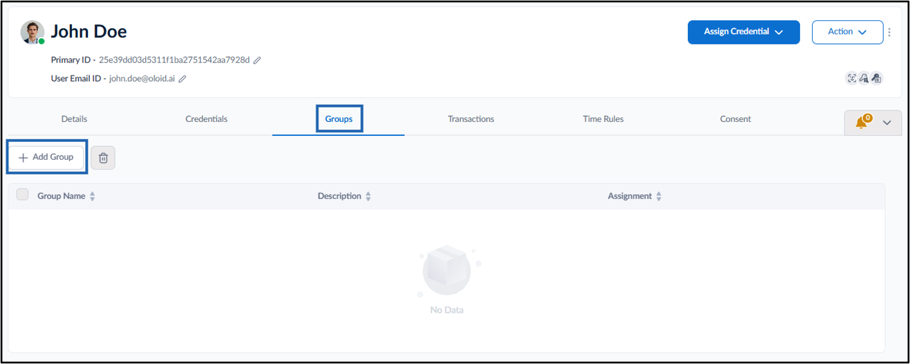

   The **Add Group** pop-up box is displayed.
5. Select the required group from the drop-down list and click **Add**.

   <Note>
     **Note:** If required, you can add a user to multiple groups.
   </Note>

   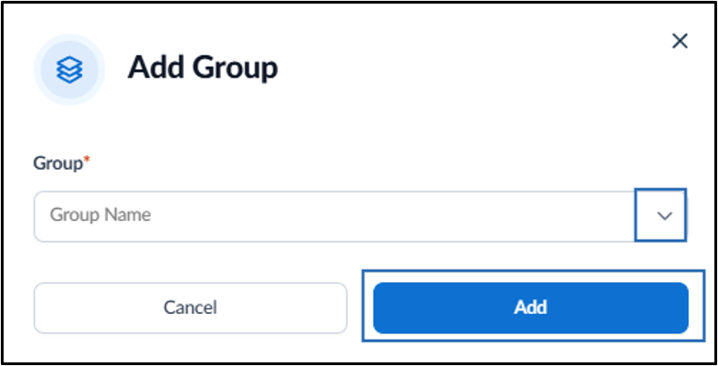

6. Click **Save**.
   The group is added and listed on the Groups tab.

   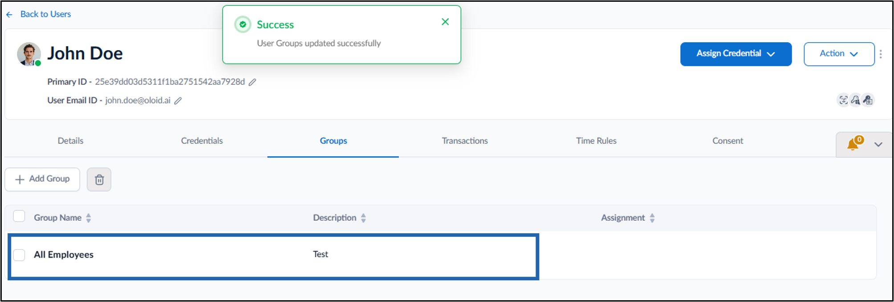

### Steps to Add User(s) to a Group

1. Log in to the **Tenant Admin Portal**.
2. On the home page, click **Groups** on the left panel menu.

   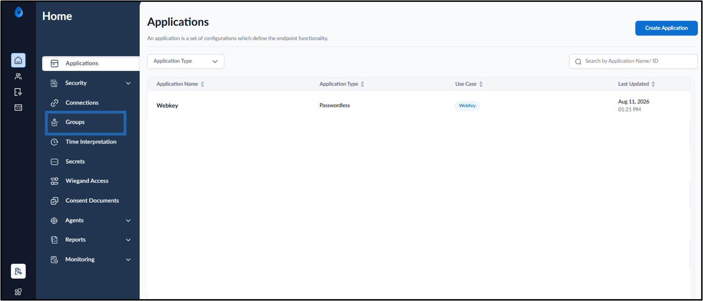

   The **Groups** page is displayed.
3. Click the preferred group.

   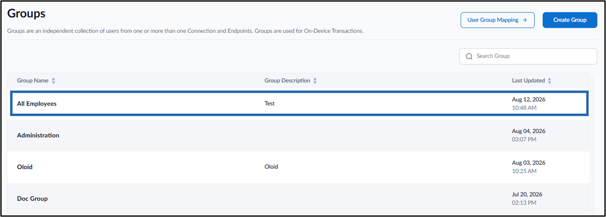

   The **Group Details** page is displayed.

   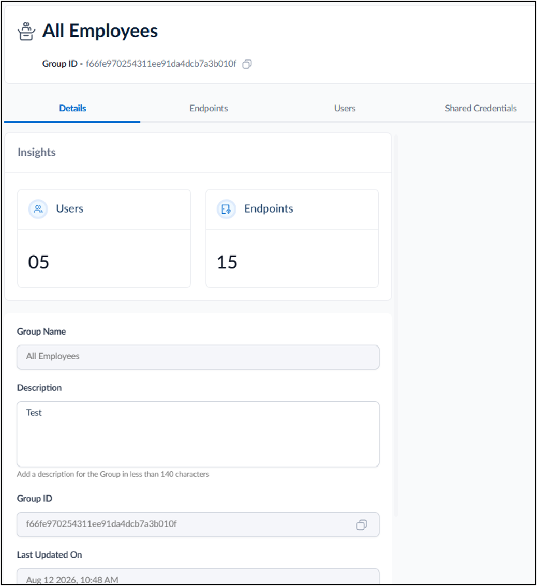

4. Click **Users** > **+ Add User**.

   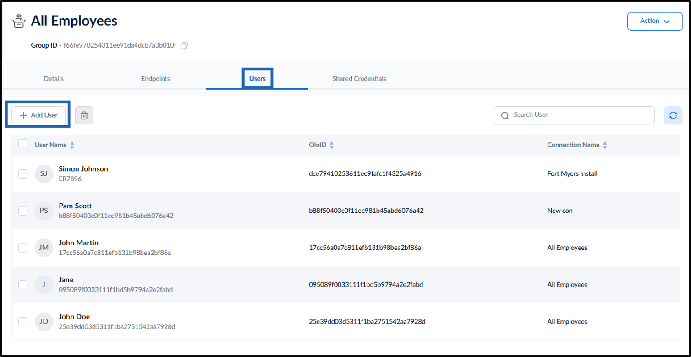

   The **Add User** pop-up box is displayed.
5. Enter the **user’s Full Name, Primary ID, OloID,** or **Employee ID**, and click **Add**.

   <Note>
     **Note:** If needed, you can add multiple users to a Group.
   </Note>

   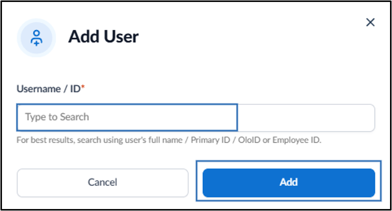

   The user is added successfully and listed on the **Group** tab.

   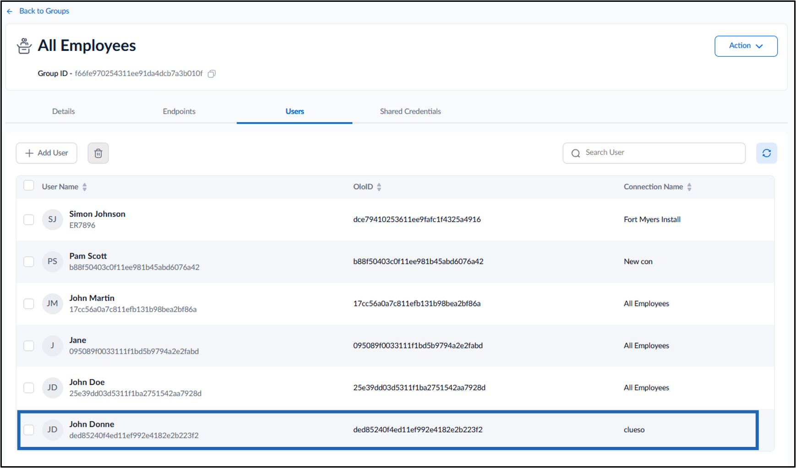

   <Note>
     **Note:** For instructions to map users to a group in bulk, see [How to map users to Group in bulk](/platform/tenant-admin-portal/how-to-map-users-to-group-in-bulk).
   </Note>
