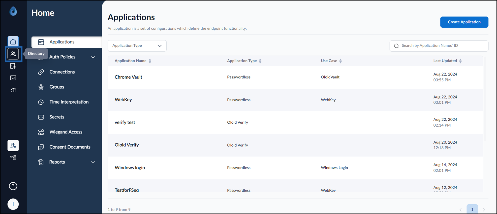
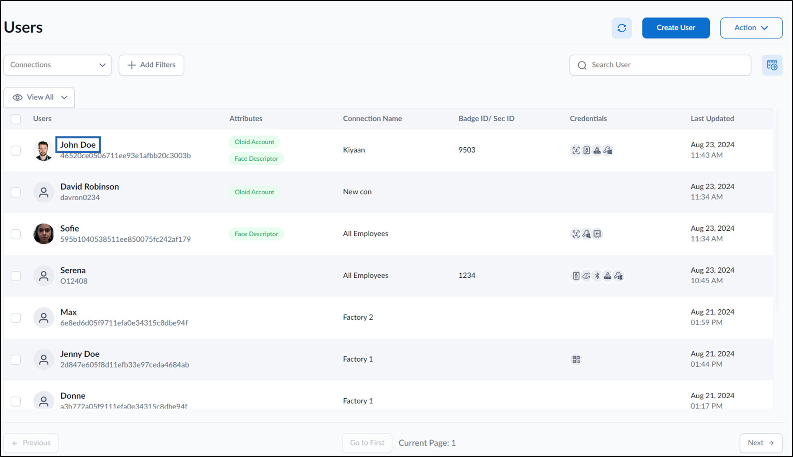
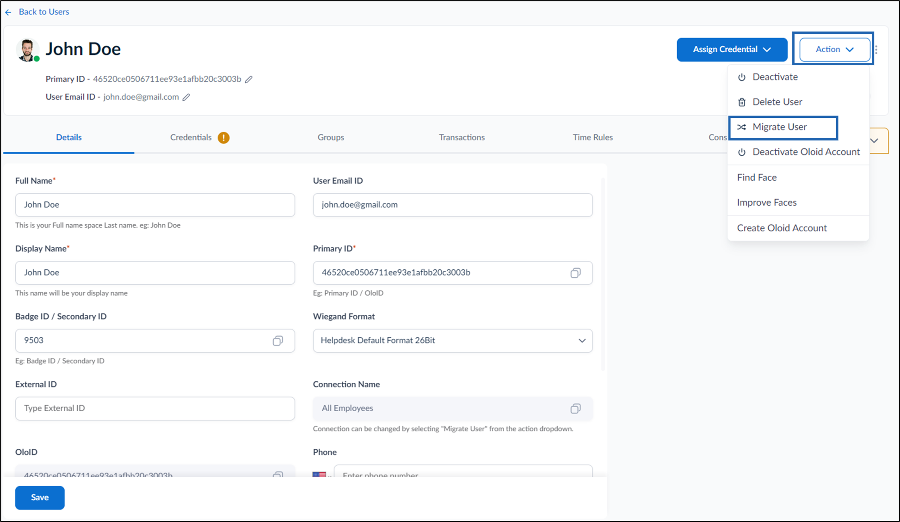
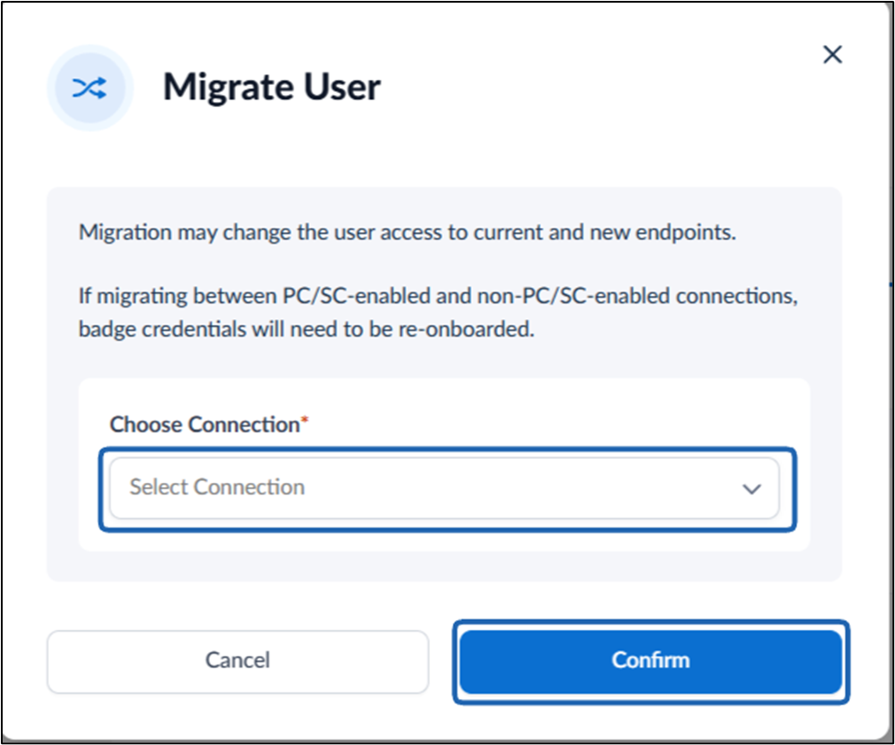
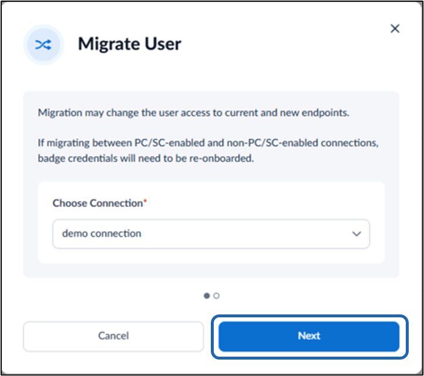
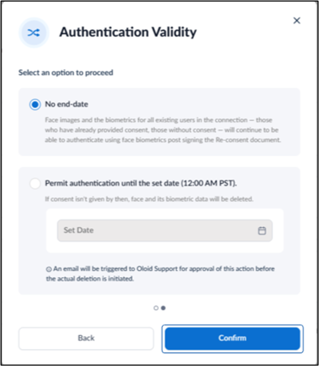
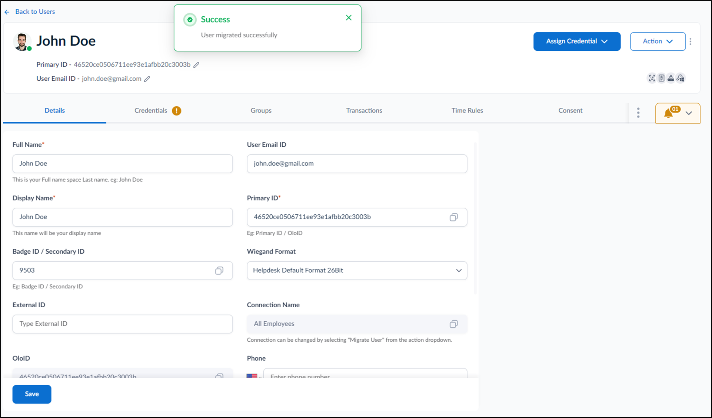
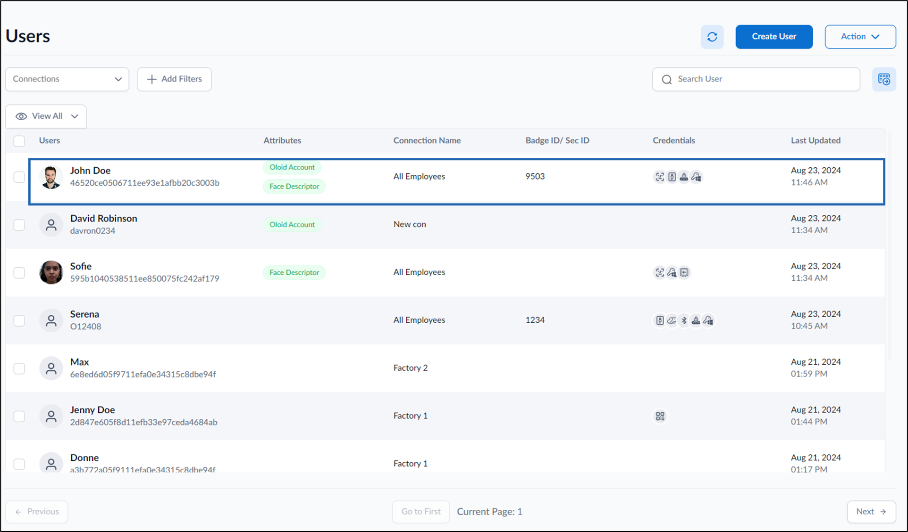

{/* Source: Intercom article 8379283 - https://oloid.help/en/articles/8379283-tenant-admin-portal-how-to-migrate-a-user-to-a-different-connection */}
{/* Generated by intercom_to_mintlify.py - re-running overwrites this file. */}

## Introduction

This document provides instructions to migrate a user to a different connection in the Tenant Admin Portal.

## Prerequisites

- You must have admin access to the Tenant Admin Portal.
- User must already be part of a connection.
- If the new connection has active consent enabled, the user must provide consent or re-consent after migration.

## Steps to Migrate User to a different Connection

1. Log in to the **Tenant admin Portal**.
2. On the home page of the portal, click **Directory** on the left menu panel.

   

   The **Users** page is displayed.
3. Click preferred **Username** to edit.

   

   The User details page is displayed.
4. Go to **Action** > Select **Migrate User**.

   

   The **Migrate User** pop-up box is displayed.
5. Do the following:
   1. If the new connection **does not** have consent configured:
      1. Select a new connection to map from **Connection** dropdown.
      2. Click **Confirm**.

         

   2. If the new connection **has** a consent configured:
      1. Select a new connection to map from **Connection** dropdown.
      2. Click **Next**.

         

      3. Select the preferred authentication validity period for the consent.

         <Note>
           **Note:**

           - **No-end date:** All existing users can keep using face authentication, with or without consent.
           - **Permit Authentication until the set date:** If the user does not provide consent by the selected date, the face and biometric data is deleted.
         </Note>

      4. Click **Confirm.**

         

         The user is migrated and mapped to the new connection.

         

         The updated connection for the user is displayed on the Users page.

         
