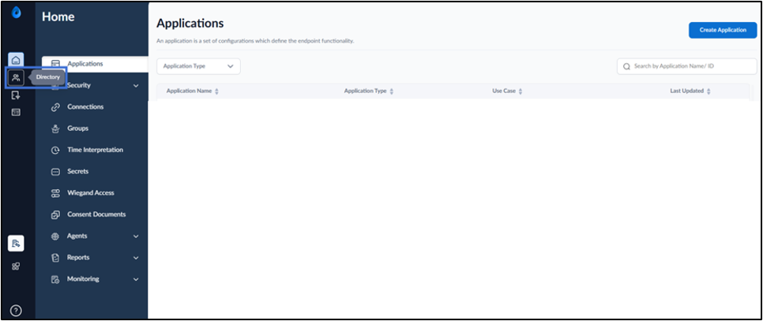
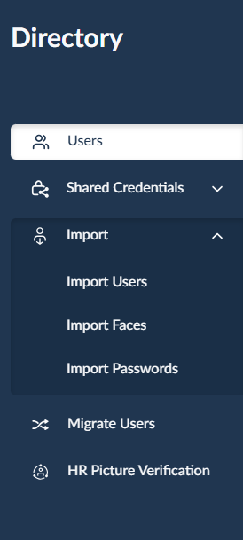
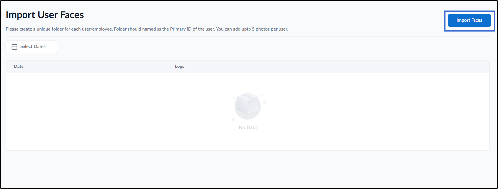
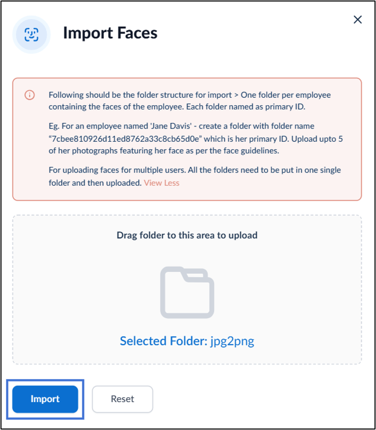
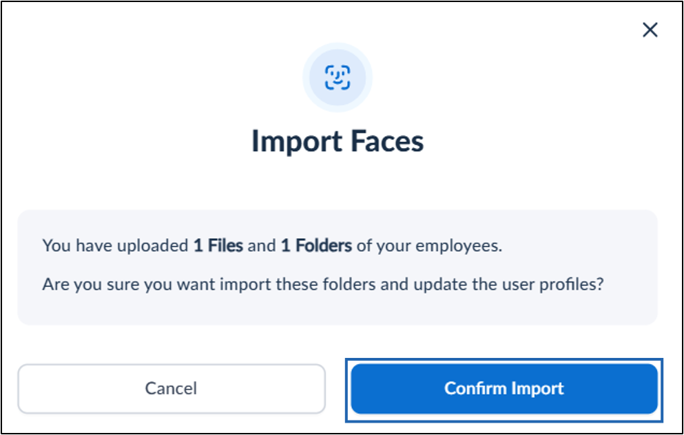
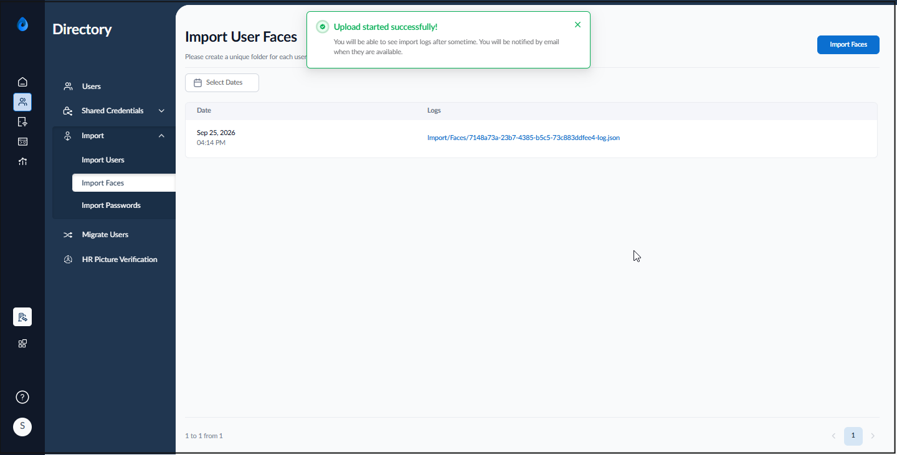

{/* Source: Intercom article 8185520 - https://oloid.help/en/articles/8185520-tenant-admin-portal-how-to-onboard-faces-in-bulk */}
{/* Generated by intercom_to_mintlify.py - re-running overwrites this file. */}

## Introduction

This document provides step-by-step instructions for onboarding faces in bulk in the **Tenant Admin Portal**. Bulk face onboarding enables administrators to upload facial images for multiple users in a single operation.

## Prerequisites

- Collect clear facial images of the employees. Employees can capture the images using their mobile phones and share them with the Admin for upload.
- Create a separate folder for each employee and name the folder using the employee's **Primary ID**. Each folder can contain a maximum of **five facial images**.
- To upload facial images for multiple employees, place all employee folders in a single folder and upload the folder.

## Steps to onboard faces in bulk

1. Log in to the **Tenant Admin Portal**.
2. On the home page of the portal, click **Directory** on the left panel menu.

   

   The **Users** page is displayed.
3. Select **Import** > **Import Faces**.

   

   The **Import User Faces** page is displayed.
4. Click **Import Faces**.

   

   The **Import Faces** pop-up box is displayed.
5. Drag and drop the file to upload.
6. Click **Import**.

   

   The Confirmation pop up box is displayed.
7. Click **Confirm Import.**

   

   The upload started successfully and images are listed on **Import Faces** page.

   
